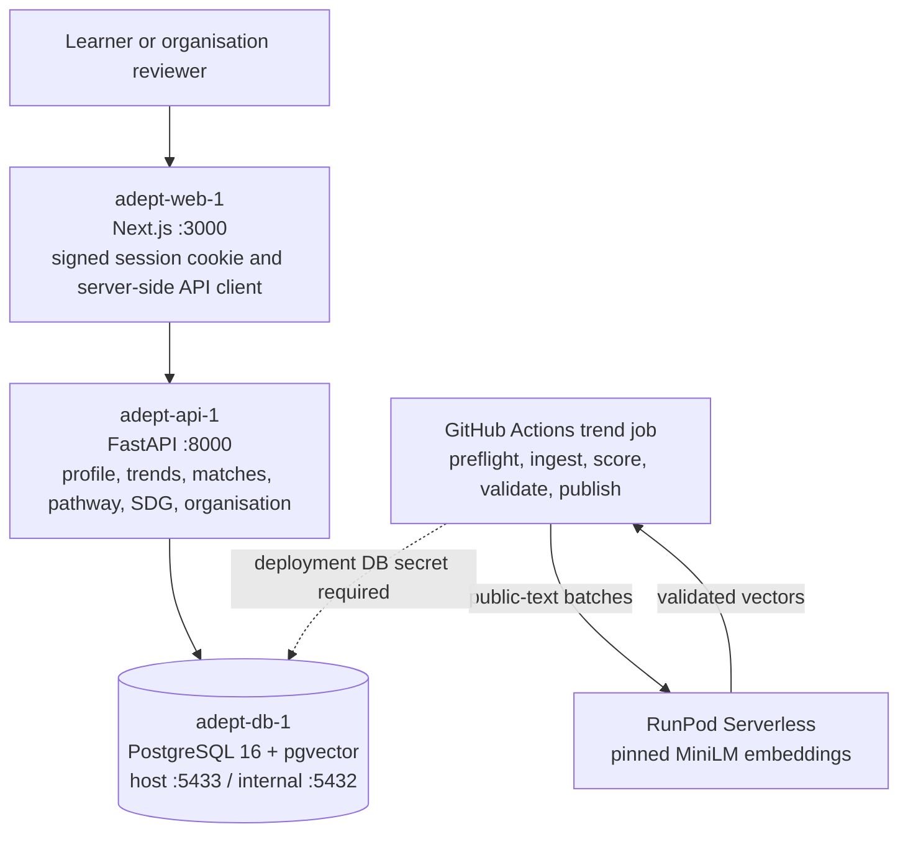

# Adept: preliminary project proposal

Draft prepared on 22 October 2026 against the supplied **SDC Hackathon Submission Template**.
Section numbering and answer limits follow that template. The supplied proposal deadline is
25 October 2026. This Markdown is working material for the final PDF, not a signed submission.

**Team-only completion items:** registration name, leader details, affiliation, workshop
attendance, prior-work ownership, employment IP declarations and signature. These cannot be
verified from the code. Add personal contact details privately in the submission PDF rather
than committing them to this public repository. Do not treat an unchecked box as a declaration.

Updated 24 October 2026 for the deployed MiniLM worker, Actions pipeline and database boundaries.

## 1. Team and project overview

| Template field | Response |
|---|---|
| Team name | Team to confirm the exact registered name. |
| Selected domain | Domain 1: The Aiversecity Future-Ready Workforce. |
| Selected SDG track | SDG 4: Quality Education; primary target 4.4, supported by 4.3, 8.2 and 8.5. |
| Project / solution name | Adept. |
| Name (leader) | Team to complete privately in the submission PDF. |
| Email and phone (leader) | Team to complete privately in the submission PDF; not retained in this repository. |
| University affiliation(s) | Team to confirm; the event host does not establish participants' affiliations. |
| Number of team members | Four development ownership roles (M1–M4) are documented; confirm the registered headcount. |

## 2. Executive summary and problem statement

### 2.1 The problem context

<!-- answer:start proposal-2.1 limit=250 -->
AI changes the tasks employers value, but workers and training providers often lack a clear
connection between those changes, a person's existing skills and an affordable next step.
Working adults facing automation, graduates entering the workforce and career switchers can
find many courses without knowing which skill gaps those courses address. HR and career
advisors face the same problem across teams and student cohorts.

Hays' 2025 Malaysia findings reported that 56% of professionals used AI tools at work, while
26% had received training to use them. The 30 percentage-point difference between these
reported shares illustrates a training challenge; it is not an estimate of how many individual
AI users lack training. These historical survey findings are context, not a measurement of
Adept's impact or of the Malaysian workforce in 2026.

The practical problem is deciding what to learn next, why it matters and whether the learning
fits available time and funding. Unexplained rankings and stale course lists make this harder,
especially for people with limited budgets. Adept addresses that decision with dated evidence,
an explicit skills gap and a costed reskilling pathway, supporting access to relevant technical
and vocational learning under SDG 4.
<!-- answer:end proposal-2.1 -->

Source: [Hays Malaysia, 2025 findings](https://www.hays.com.my/press-release/content/future-of-work-malaysia-technology-ai-impact).

### 2.2 The proposed AI solution

<!-- answer:start proposal-2.2 limit=300 -->
Adept connects a skills profile to changing skill signals, explainable role matches and a
personalised learning plan. A learner completes an intake or uploads a synthetic CV, confirms
catalogue skills and levels, and sets interests, weekly learning time and budget. The radar
shows rising, steady and declining skill signals. Ranked roles expose skill overlap, trend
outlook and interest fit, together with the skills the learner already has, partly meets or lacks.

The AI component is a pre-trained sentence encoder, all-MiniLM-L6-v2, deployed on RunPod
Serverless for batch processing. It relates arXiv research sentences to skill labels. A deterministic pipeline combines those signals with a
labour-market baseline and publishes validated, dated snapshots. Adi uses Runpod GLM-5.3
for grounded assistance, with Gemini only on primary failure. Moderate and fast scenarios expose uncertainty;
they are decision-support assumptions rather than calibrated forecasts of employment.

For a chosen role, Adept orders catalogue courses using skill prerequisites and shows time,
cost and funding notes. Learners save plans and record progress; organisation reviewers can
review completion evidence. HR and education advisors use the same engine for a team gap
heatmap, shared target-role plan and SDG contribution views.

The design applies database architecture and deployment concepts through PostgreSQL with
pgvector, typed FastAPI contracts, a Next.js interface and Docker containers. GenAI API
concepts support a guarded provider interface with catalogue-ID validation and a deterministic
guide on failure. A small Runpod request was verified locally; workshop attendance and
credit entitlements remain for the team to confirm. Every recommendation
includes sources, dates, scenario and an estimate label. People choose their roles and learning;
Adept makes no hiring, firing or admission decisions.
<!-- answer:end proposal-2.2 -->

## 3. Technical architecture and implementation plan

### 3.1 Conceptual tech stack

| Component | Implemented technology | Role |
|---|---|---|
| Interface | Next.js 16.2.12, React 19.2.9, TypeScript 5.9.3 | Individual `/app` and organisation `/org` modes; server-side API calls. |
| Presentation | Tailwind CSS 4.1.18, next-intl 4.4.0, Lucide | Responsive interface in English, Bahasa Melayu and Chinese. |
| API | Python 3.11, FastAPI, Pydantic v2, Uvicorn | Validated feature services and OpenAPI contracts. |
| Persistence | PostgreSQL 16, pgvector, psycopg 3 | Profiles, catalogue, snapshots, plans, evidence and organisations. |
| AI / methods | Pinned all-MiniLM-L6-v2 on RunPod Serverless; deterministic matching and pathway rules | 384-dimensional research/skill embeddings; transparent scoring and ordering. |
| Data | arXiv cs.AI RSS, committed BLS-derived baseline, official UN SDGs, Microsoft Learn, Coursera, cited provider pages, BNM exchange rates | Research signals, catalogue facts and source attribution. |
| Local deployment | Docker Compose | `adept-web-1`, `adept-api-1`, `adept-db-1`. |
| Quality / automation | pytest, Ruff, ESLint, TypeScript, contract and locale checks; GitHub Actions | Automated checks; conditional weekly trend refresh and source audit. |

**Architecture appendix A: current local system.** Service names and dependency order follow
[`docker-compose.yml`](../docker-compose.yml). The API boot process applies migrations and
seeds before serving. The web calls the API over the internal container network; the browser
does not receive database credentials.

See the [README diagram collection](../README.md#interactive-diagrams) and
[offline viewer](diagrams/index.html) for the full architecture, journeys, sequences,
score calculation, catalogue graph and schema excerpts. The job arrow above describes the
configured publication mechanism. A live MiniLM test passed on 24 October 2026, while the
first integrated refresh failed on private development database host `helium`; no production
snapshot publication is asserted. The workflow now checks database access before inference.

**Use of sponsor GenAI APIs:** the local Adi configuration uses Runpod
`glm-5.3`, verified with a small request on 23 October 2026. Gemini is configured as backup.
Adi uses a hosted public model endpoint. MiniLM uses the team's deployed queue-based
Serverless worker with baked-in weights. The team must confirm any sponsor
credits, workshop attendance or mentoring privately. No public web deployment or credit
entitlement is asserted in this draft.

### 3.2 Design-thinking and deployment strategy

<!-- answer:start proposal-3.2 limit=200 -->
We framed the experience around synthetic design personas: a working adult facing automation,
a graduate, a career switcher and an organisation advisor. These are design assumptions, not
interview findings. Their common need is an understandable next learning step within real
time and funding constraints.

We defined one journey: confirm skills, inspect changing signals, compare roles and save a
learning plan. One backend serves individual and team views. Visible score components,
source dates, uncertainty labels, three languages and responsive layouts support inspection
and accessibility. The repository contains API, pipeline, fairness and contract tests; team
review of user journeys remains part of acceptance.

The local prototype runs as three Docker services with database health checks, append-only
migrations and seed loading. For Phase 2, select a web/API host and managed PostgreSQL with
pgvector, configure HTTPS and persistent secrets, and provide a judge-accessible URL. The
plan names Replit or Vercel/Render with Supabase PostgreSQL as candidates; none is claimed
as live. Configure the trend-publication secret, verify backup and recovery, and run the
quality gate and synthetic end-to-end demo before release. Automated deployment and measured
user-outcome evaluation remain work to complete.
<!-- answer:end proposal-3.2 -->

## 4. Preliminary environmental and SDG impact framework

| Template metric category | Response |
|---|---|
| Target SDG sub-target(s) | **4.4:** relevant employment and entrepreneurship skills; **4.3:** equal access to affordable technical, vocational and tertiary learning. Supporting **8.2:** productivity through technological upgrading, and **8.5:** decent work and equal employment opportunity. These are paraphrases; official wording remains in the UN catalogue. |
| Current problem baseline | Hays' 2025 Malaysia findings report 56% AI use and 26% training, a 30 percentage-point difference between reported shares. This is a dated external context baseline. **Product baseline:** median time to a valid learning plan has not yet been measured; do not replace it with an invented number. |
| Core measurable KPI | Median minutes from intake start to a saved, sourced target-role plan, compared on the same synthetic cases with manual use of the same course catalogue. A valid plan must use existing skill/course IDs, respect prerequisites, disclose time/cost constraints and carry source/date metadata. Record valid-plan share alongside time. |
| Phase 2 impact target | **Proposed target, not achieved:** at least 20% less median planning time than the measured manual baseline, with no decrease in valid-plan share. Compute reduction as `100 × (baseline median − Adept median) / baseline median`; require a positive measured baseline. |

Measure both workflows using matched synthetic profiles, budgets and target roles; keep the
catalogue and snapshot fixed and counterbalance workflow order. Report task count, failures
and medians with the results. No participant identities or real CVs enter the demo dataset.
This protocol is a proposed evaluation, not evidence of an experiment already conducted.

The principal contribution is educational decision support. No reductions in carbon emissions,
national unemployment or income inequality are measured or claimed. SDG contribution scores
describe catalogue alignment and learning activity, not official UN indicator achievement.
Role/skill-to-target mappings are team-curated and remain drafts until human review.

Sources: [UN Goal 4](https://sdgs.un.org/goals/goal4),
[UN Goal 8](https://sdgs.un.org/goals/goal8),
[Hays Malaysia](https://www.hays.com.my/press-release/content/future-of-work-malaysia-technology-ai-impact).

## 5. Eligibility and readiness checklist

- [ ] All members completed mandatory GenAI, database and cloud workshops. **Team confirmation required.**
- [x] The concept connects an evidenced workforce learning problem to SDG 4.
- [x] The project targets a functional deployed application; the local three-service prototype exists.
- [ ] Every required field is complete within the limits. **Narrative limits are checked; team and signature fields remain outstanding.**

## 6. IP and originality declaration

### 6.1 Pre-existing / prior-owned work

**Yes / No: team to confirm.** Repository history does not establish when the hackathon's
originality period began or each member's ownership rights. The team must list any reused
code, designs, research and their owners before selecting an answer. KerjaCerdas and Orion
were consulted for README presentation; this does not establish reuse of their application code.
The guardrail feature documentation also mentions patterns from KerjaCerdas: review provenance
and rights rather than declaring that all work was newly created.

### 6.2 Third-party code, datasets or models

**Yes.** The main resources are declared below; the
[technical declaration](submission-technical-declaration.md#22-languages-frameworks-and-libraries)
provides versions, purposes and a fuller inventory.

| Type | Name | Licence / attribution basis |
|---|---|---|
| Code | Next.js, React, Tailwind CSS, next-intl, FastAPI, Pydantic, OpenAPI tools | MIT; retain upstream notices. |
| Code | TypeScript; class-variance-authority | Apache-2.0. |
| Code | PostgreSQL and pgvector | PostgreSQL License. |
| Code | Uvicorn; psycopg | BSD-3-Clause; LGPL-3.0 respectively. |
| Code | PyMuPDF | AGPL-3.0 or commercial licensing; compatibility review remains required. |
| Code | Sentence Transformers; PyTorch | Apache-2.0; BSD-3-Clause respectively. |
| Code / font | Lucide; Inter | ISC; SIL OFL 1.1 for the font. |
| Code | Mermaid 11.12.0 | MIT; documentation diagram rendering only. |
| Model | sentence-transformers/all-MiniLM-L6-v2 | Apache-2.0; pre-trained, not fine-tuned by the team. |
| Data | arXiv feed content; BLS-derived projections | arXiv API/content terms, with article licences varying; BLS public information and source attribution. |
| Data | UN SDG API; course/provider facts; BNM rates | Respective provider terms and cited URLs; public accessibility does not imply a common open-data licence. |
| Data | Team-curated taxonomy, mappings and synthetic evaluation fixtures | Team-authored curation with upstream evidence recorded; not a complete imported ESCO or O*NET taxonomy. |

### 6.3 Employment-related IP conflicts

**Yes / No: each member must confirm privately.** No employment, internship or consulting
agreement was reviewed. Add any applicable owner/permission details to the final submission;
do not infer the absence of a conflict from the repository.

## 7. Declaration

**Unsigned draft.** The team leader must review the completed proposal and make the accuracy
and originality declaration in the supplied template. No signature or attestation is generated.

| Field | Completion |
|---|---|
| Signature | Leader to sign privately after review. |
| Date | Actual signing date; not the date this draft was generated. |
| Final filename | `SDC2026_<RegisteredTeamName>_Preliminary.pdf` |

## Evidence and handoff

- [Feature specification and ownership](tasks.md), [decisions](decisions.md), [solution design](solution-design.md).
- [Scoring implementation](../src/api/app/features/matching/scoring.py), [trend publisher](../src/pipelines/trends/run.py), [pathway engine](../src/api/app/features/pathway/engine.py).
- [Source catalogue](../src/api/app/features/pathway/catalogue_sources.py), [seed records](../src/data/seed/), [append-only migrations](../src/db/migrations/).
- Before PDF export: complete team declarations, verify actual hosting and sponsor usage, inspect diagram exports and confirm the final form's word limits.
