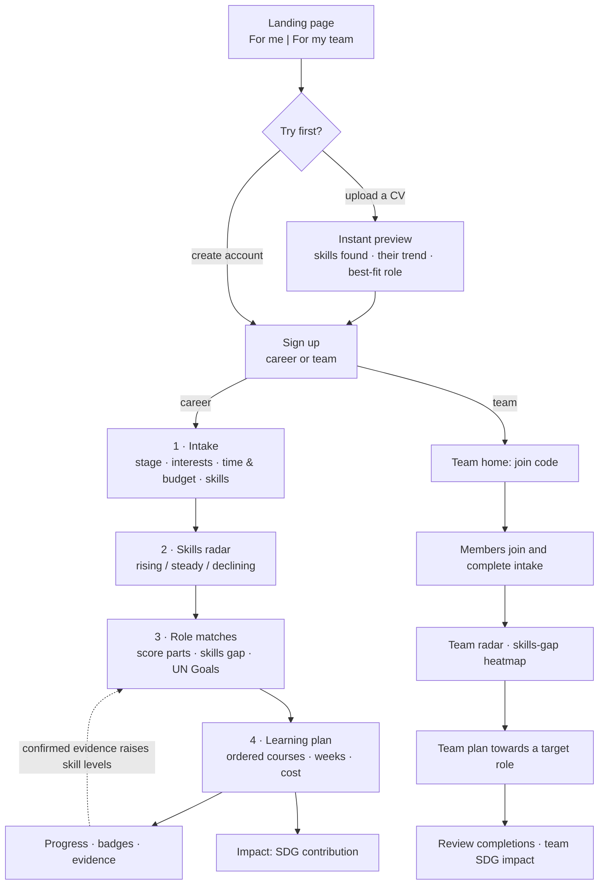
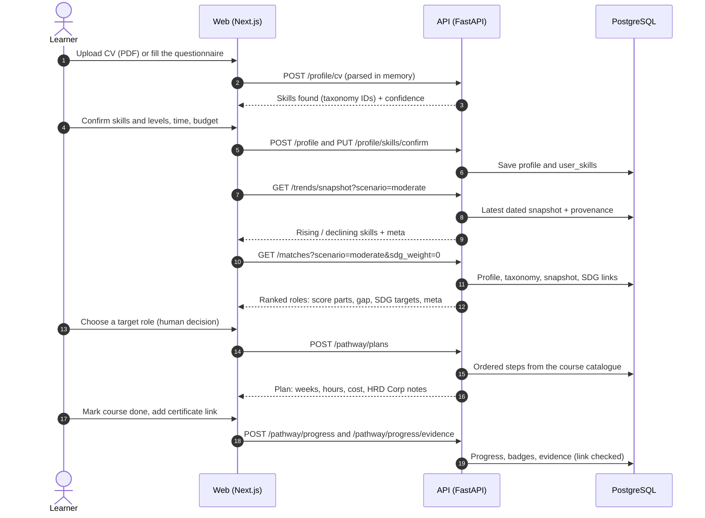
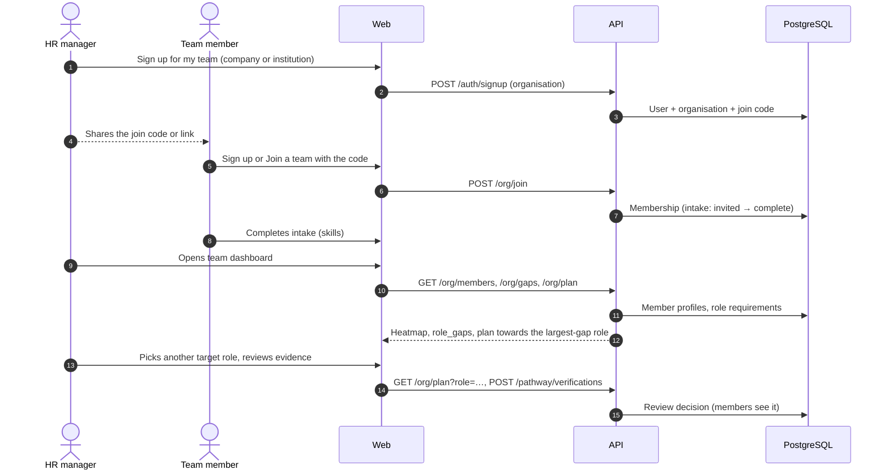
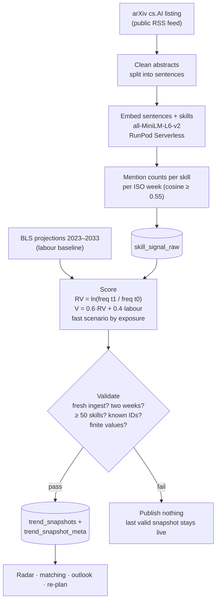
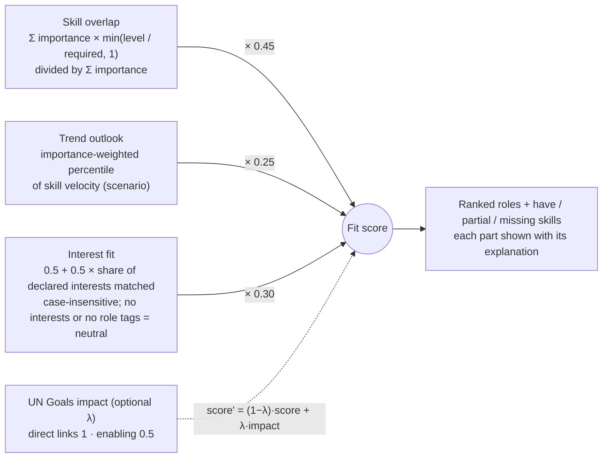
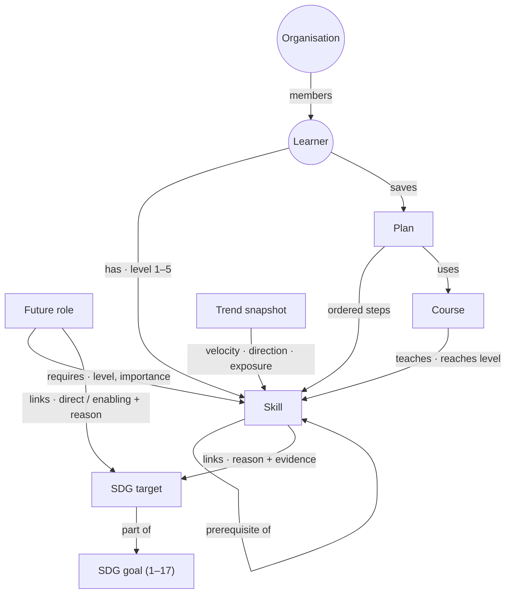
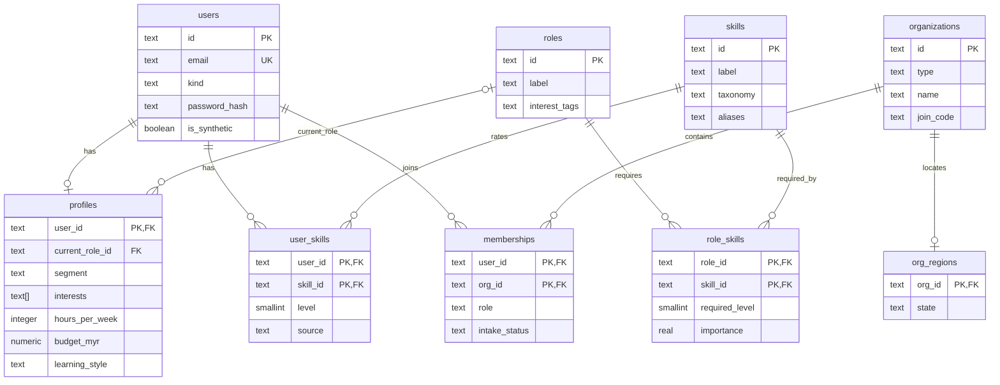
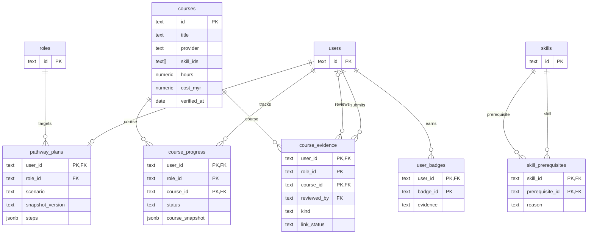
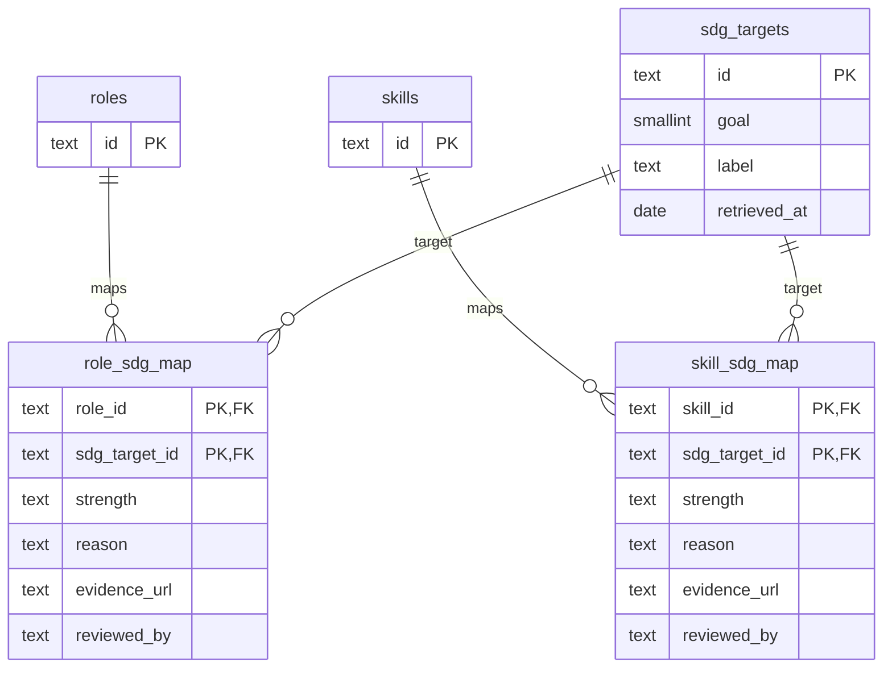
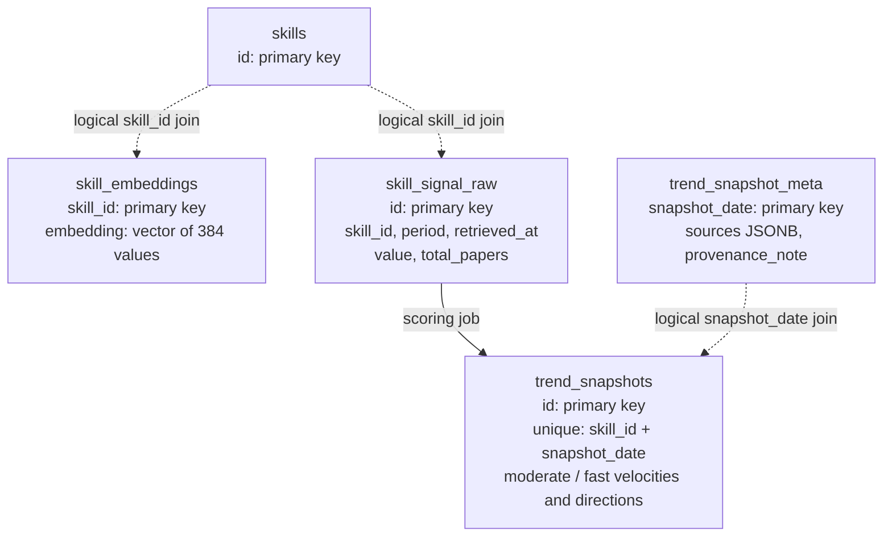

<div align="center">


<h1>Adept</h1>

<strong>Find your next role. Build the skills to get there.</strong>

<p>A sourced, human-led career and reskilling guide for the AI era.</p>

[](https://github.com/pecel-lelele/adept/actions/workflows/ci.yml)
[](src/web/package.json)
[](src/api/app/main.py)
[](LICENSE)

</div>

> **Submission hub:** [Proposal PDF](submission/SDC2026_Pecel-Lele_Preliminary.pdf) ·
> [Technical declaration PDF](submission/SDC2026_Pecel-Lele_TechDeclaration.pdf) ·
> [Replit proof of use](submission/SDC2026_Pecel%20Lele_Replit_POU.pdf) ·
> [RunPod proof of use](submission/SDC2026_Pecel%20Lele_Runpod_POU.pdf) ·
> [Deliverables and remaining checks](docs/submission/submission-deliverables.md).
> The checked-in PDFs are historical exports. Use the deliverables checklist to confirm
> final versions, signatures and judge access before submitting.

## Team and track

| Field | Details |
|---|---|
| Team | **Pecel Lele** · four members |
| University | Xiamen University Malaysia |
| Team leader | David Kurniawan |
| Event | SDC XMUM Hackathon 2026 |
| Domain | 1 · The Aiversecity Future-Ready Workforce |
| Main goal | **SDG 4 · Quality Education** (especially targets 4.3 and 4.4) |
| Supporting goals | SDGs 5, 8, 9 and 10 |

## Links

| Resource | Destination |
|---|---|
| Source code | [GitHub repository](https://github.com/pecel-lelele/adept) |
| Hosted demo | [Adept on Replit](https://adept-my.replit.app) · verify the deployed revision before presenting |
| Replit project | [Project page](https://replit.com/@kylomaxcellino/adept) |
| RunPod endpoints | [MiniLM](https://api.runpod.ai/v2/ta14jd0by2ijl2) · [Adi](https://api.runpod.ai/v2/b1dd8hy2hqo1nb/openai/v1) (requests need their own credentials) |
| Slides | [Team folder](https://drive.google.com/drive/folders/1oNEOcD5OXCK-iAAPoj3aXihO1cW77bTn?usp=sharing) · check judge access |
| Demo and pitch videos | [Team folder](https://drive.google.com/drive/folders/1tdSaHsHd1towg-bKghHUuSNn7jbI-LfN?usp=sharing) · select final files |
| Written sources | [Proposal](docs/submission/submission-proposal.md) · [technical declaration](docs/submission/submission-technical-declaration.md) |
| Operations | [Replit](replit.md) · [RunPod/MiniLM](src/pipelines/trends/runpod/DEPLOYMENT_HANDOFF.md) |

## Overview

### The problem

AI changes work faster than a one-time skills assessment or a static course list can
reflect. Learners need a credible next step; managers need a cohort view without taking
career choices away from people. See the [competition context](docs/project-context.md).

### What Adept does

One backend supports a personal workspace (`/app`), a member's work view (`/work`) and
an organisation workspace (`/org`). The journey connects **confirmed skills → dated
AI and labour signals → explained role matches → a chosen learning plan → progress
and links to the 17 UN SDGs**. Forecasts and match scores are *estimates*,
not hiring, promotion, admission or firing decisions.

| For an individual | For a team or career centre |
|---|---|
| Upload a synthetic PDF/DOCX/text CV or answer four short intake steps; confirm catalogue skills. | Create an organisation and invite people with a join code. |
| Compare dated skill/role trends under moderate and fast AI scenarios. | See member progress and privacy-gated aggregate gaps from consenting profiles. |
| Inspect score components and missing skills, then choose a target role and sourced courses. | Select a training programme and review evidence; members decide whether to accept it. |
| Track progress, explore openings and see why a role/path maps to UN goals. | Manage training budgets and view sourced, aggregate SDG links. |

The demonstration uses **public reference data and synthetic people/CVs only**. It does not
store raw CVs. Every displayed recommendation resolves to a catalogue record and carries
source names, URLs, retrieval dates, the selected snapshot date, scenario and estimate
status. Members explicitly choose whether to share skills or progress with an employer.

<a name="getting-started"></a>
<a name="quick-start"></a>

## How to run

**Requirements:** Python 3.11, [uv](https://docs.astral.sh/uv/), Node.js 24 and pnpm
10.29.3. PostgreSQL 16 with pgvector is needed for persistent local accounts; the
established Compose configuration supplies it. No model key is needed for offline tests.

From the repository root:

```bash
uv sync --frozen
npx --yes pnpm@10.29.3 install --frozen-lockfile
```

Copy [`.env.example`](.env.example) to an ignored `.env` and set **your own local**
database password and URL. Never use a production or shared database for setup,
migration, seeding or tests. Start only the established Compose services if needed;
`make setup` also migrates and seeds its selected database, so inspect the target first.

```bash
# For an explicitly selected local development database; supply its password privately.
docker compose -f docker-compose.db.yml up -d --wait db
uv run --frozen python src/scripts/dev.py db-migrate
uv run --frozen python src/scripts/dev.py seed
uv run --frozen python src/scripts/dev.py dev
```

Open [the web app](http://localhost:3000) or [API documentation](http://localhost:8000/docs).
The separate full stack is defined in [`docker-compose.yml`](docker-compose.yml); it
also binds published ports to loopback. Neither build nor startup migrates by itself.

### Try a synthetic journey

Create a synthetic account, use one of the [five demo CVs and their editable intake
profiles](docs/demo-cvs/README.md), then follow **Radar → Roles → Plan → Progress → Jobs**.
For a team, create an organisation, invite a synthetic member, and choose sharing
separately from membership. CV extraction and course suggestions need human review.

### Run checks

```bash
uv run --no-project python src/scripts/dev.py check
```

This runs lint, Python and web component tests, TypeScript, translation parity and
contract drift. PostgreSQL integration tests deliberately **skip** without an explicit
disposable target; a skip is not a pass. To run them against an existing local server,
set `ADEPT_TEST_PG_ADMIN_URL` to its loopback **postgres admin database** in your
private environment, then run `.venv/Scripts/python.exe src/scripts/test_postgres.py`
(Windows) or `.venv/bin/python src/scripts/test_postgres.py` (Unix). The runner creates,
migrates, seeds and removes only its verified disposable databases. Read
[testing and isolation](docs/testing.md) before using it. [CI](https://github.com/pecel-lelele/adept/actions/workflows/ci.yml)
also runs the production build, browser journeys, contracts and isolated PostgreSQL
migration/seed checks; local checks do not prove a live deployment.

## AI and data

| Component | Provider and model | Purpose and boundary |
|---|---|---|
| Adi guide | Built-in deterministic guide by default (`LLM_PROVIDER=none`) | Answers without a paid model when none is configured. |
| Adi, optional | Z.ai `glm-5.3` via RunPod; Google `gemini-3.5-flash-lite`, `gemini-3.6-flash`, `gemini-3.1-flash-lite` | Selects validated, server-authored answer blocks; separately authenticated failover. No unchecked model prose or people decisions. |
| Trend matcher | Sentence Transformers **all-MiniLM-L6-v2**, pinned on RunPod; optional Google **gemini-embedding-001** (384 dimensions) | Matches public arXiv research to catalogue skills in a background job. Gemini becomes primary only after a passing, reviewed equivalence report; **no live switch is claimed**. |
| Skill suggestions | Google **gemini-embedding-001** (768 dimensions), optional | Proposes catalogue IDs for short, redacted unmatched skill phrases; the person confirms every addition. Full CVs are not sent to this model. |

Matching, scenarios, pathways and SDG links use documented deterministic methods and
catalogue IDs. Adi's optional LLM gateway validates choices and falls back to the
built-in guide when a provider fails. The [/about page](src/web/src/app/about/page.tsx) is the in-app model
and data register; [decisions](docs/decisions.md) record method changes.

Research signals use public arXiv cs.AI papers with a dated BLS labour baseline.
Additional sources include official Malaysian labour data, the UN SDG API, verified
learning providers and credited public job feeds. Job ads are not a census; research
attention is not a measured vacancy forecast. The UI shows the selected data window,
citations and fallback/estimate labels rather than inventing freshness. Read the
[source assessment and refresh method](docs/data-refresh.md).

## Replit deployment

The root [`.replit`](.replit) runs `python3 src/scripts/replit.py build` and then
`python3 src/scripts/replit.py start`. The supervisor starts private FastAPI and one
public Next.js server, checks API/database readiness, and does **not** migrate, seed or
start inference automatically. Production requires its own stable session and proxy
secrets, an exact origin, a verified proxy-hop count and an explicitly initialized
PostgreSQL database. A code push is not a successful publish; verify the deployed
revision and signed-in synthetic journey. See the [publishing handoff](replit.md),
[proxy verification](docs/replit-proxy-verification.md) and
[Replit proof of use](submission/SDC2026_Pecel%20Lele_Replit_POU.pdf).

## RunPod and refresh

RunPod hosts the separately authenticated Adi provider and the pinned MiniLM worker;
their keys are not interchangeable. The worker's
[deployment handoff](src/pipelines/trends/runpod/DEPLOYMENT_HANDOFF.md) records its
image, endpoint, setup and verified historical inference result, not proof of a current
snapshot. The [RunPod proof of use](submission/SDC2026_Pecel%20Lele_Runpod_POU.pdf)
is a checked-in export; verify it against the final setup.

GitHub's daily scheduler calls the app, which fetches and publishes against **its own**
private database. Page reads only load saved data; user-facing pages show the data date
instead of starting paid work. Manual refresh is admin-only. The legacy GitHub trend
backup needs a separately approved, runner-reachable database and must not be pointed
at Replit's private host. Provider calls and production migrations are **not** part of
local verification. See [refresh operations](docs/data-refresh.md).

<a name="interactive-diagrams"></a>

## Diagrams

Open a diagram only when you need its detail. These selected schematics include an
optional legacy manual trend publisher; daily production refresh runs inside the app.
The [interactive diagram explorer](docs/diagrams/index.html) supports zoom, pan and
SVG download (download the HTML to view it locally). For operational behavior, use
[architecture](docs/architecture.md), [data refresh](docs/data-refresh.md) and the code.

<a name="3-system-architecture"></a>

<details>
<summary><strong>System architecture</strong></summary>

### System architecture


</details>

<details>
<summary><strong>User journeys, sequences and trend pipeline · 4 diagrams</strong></summary>

### User journey (both modes)



### Individual: from CV to a saved plan



### Organisation: from join code to a team plan



### Legacy manual trend snapshot pipeline (validated)

The diagram describes the backup publisher, not the daily method-specific paper-store catch-up.



</details>

<details>
<summary><strong>Match scoring and knowledge graph · 2 diagrams</strong></summary>

### Explainable match score



- Protected attributes (age, gender, background) are never read by matching. Counterfactual tests swap personas and require identical results.
- Declaring matching interests adds a bonus above the neutral interest contribution; unmatched interests stay neutral. Scenario outlooks report each scenario's computed skill aggregate, so mixed skill signals can make fast less extreme than moderate. Comparison metadata says `scenario: "both"`; selectable scenarios remain moderate and fast.
- Completed learning can raise a skill's effective matching level when an organisation reviewer confirms it, or when a certificate link passes the provider-page check. That link check confirms reachability and provider domain, not certificate ownership.

### Knowledge graph

The catalogue is a graph. Pathways walk it from the learner's skills to a target role.



Versioned [taxonomy, course and SDG records](src/data/seed/README.md) are the authority for every surfaced ID. Counts change as reviewed source records are added; the application never invents a catalogue entity.

</details>

<details>
<summary><strong>Database schema and provenance · 4 diagrams</strong></summary>

### Identity, intake and role requirements

Selected columns from the append-only [SQL migrations](src/db/migrations/), not replacement DDL.
Solid ER relationships below reflect declared foreign keys. Array and JSON references are
explained separately rather than presented as enforced foreign keys.



### Learning plans and evidence



`courses.skill_ids` is an array and `pathway_plans.steps` is JSONB; application logic resolves
those IDs. `role_id` in progress and evidence is part of the composite key, not a declared
foreign key. Evidence has separate submitter and nullable reviewer references to `users`.
`course_progress.course_snapshot` preserves course facts independently of the saved target.
Accepted completions across all targets feed the same effective skill levels to matching,
individual learning plans and team gaps; rejection and undo still revoke that credit.

### SDG mappings



`sdg_targets.goal` resolves to `sdg_goals.id` in application data; the migrations do not
add a foreign-key constraint for it. SDG mapping `reviewed_by` is attribution text,
not an account foreign key. Unreviewed links remain draft mappings.

### Trend storage and provenance



Dotted connections are logical joins, not declared foreign keys. Embeddings, raw signals,
and trend snapshot `skill_id` columns are not constrained to `skills` by the current DDL;
publish-time validation checks taxonomy membership. `trend_snapshot_meta` is joined by date.

The diagram omits some supporting tables:

| Table                        | Purpose                                                    |
| ---------------------------- | ---------------------------------------------------------- |
| `arxiv_fetch_log`            | Audit of each arXiv pull                                   |
| `data_syncs`                 | Catalogue and SDG sync runs                                |
| `fx_rates`                   | Bank Negara Malaysia rates for converting course prices    |
| `llm_calls`                  | Log of LLM gateway calls (empty while `LLM_PROVIDER=none`) |
| `snapshots`, `trend_signals` | Early skeleton tables kept for compatibility               |

Migrations are in [`src/db/migrations`](src/db/migrations). New changes always go in a new file.

</details>

## Project structure

| Path | Contents |
|---|---|
| `src/web/` | Next.js routes, feature components, translations and the shared shell |
| `src/api/` | FastAPI contracts, authentication and feature services |
| `src/pipelines/` | Public-source preparation, evaluation and publication tools |
| `src/db/migrations/` | Append-only SQL; apply explicitly to the intended database |
| `src/data/seed/` | Versioned public references and synthetic demonstration fixtures |
| `tests/` | API, component, browser, pipeline and isolated database regressions |
| `docs/` | Architecture, methods, sources, decisions and submission writing |
| `.github/workflows/` | CI, source checks, guarded manual jobs and daily trigger |

## What works, and what comes next

- **One connected journey:** confirmed skills feed the radar, explained role matches,
  a chosen plan, progress and SDG reasons. The organisation workspace uses the same
  engine with explicit sharing and small-cohort privacy gates.
- **Traceable data:** the app shows observation windows and sources; its daily refresh
  writes through the private Replit database. CI checks the build, synthetic browser
  journeys and disposable PostgreSQL migrations without starting paid inference.
- **Next evidence step:** verify the exact hosted revision, production migrations and
  dated snapshot with synthetic accounts before the final demo. A model inference result
  by itself does not establish that a snapshot was published.
- **Next evaluation step:** run and review Gemini trend equivalence before switching
  matchers. Human impact/KPI trials remain unrun (0 testers, 0 trials in the last
  recorded review on 30 October 2026); the proposed 20% time-saving goal is a target,
  not a measured result. See the [evidence checklist](docs/submission/rubric-check.md#evidence-still-outstanding).

## Submission checklist

- [x] Source, synthetic demo CVs, proposal and technical-declaration exports linked.
- [x] Replit and RunPod proof-of-use exports linked; their historical state is disclosed.
- [ ] Confirm final PDFs/signatures and selected slide/video files against the latest app.
- [ ] Check anonymous access to shared folders and the live demo revision.
- [ ] Record the observed snapshot, source dates and actual demo/recording date.
- [ ] Measure human KPI results before making any time-savings claim.

The [deliverables guide](docs/submission/submission-deliverables.md) tracks further
submission checks; a checked box above describes a repository link, not a final upload.

## License

[Apache License 2.0](LICENSE). Source records and third-party assets keep their own
provider terms and attribution.
