<div align="center">


<h1>Adept</h1>

<strong>Find your next role. Build the skills to get there.</strong>

<p>Career matching and personalised reskilling for the AI era.</p>

[](https://nextjs.org/)
[](https://react.dev/)
[](https://www.typescriptlang.org/)
[](https://tailwindcss.com/)
[](https://www.python.org/)
[](https://fastapi.tiangolo.com/)
[](https://github.com/pgvector/pgvector)
[](https://docs.docker.com/compose/)
[](LICENSE)

<p><a href="#features">Features</a> · <a href="#getting-started">Getting started</a> · <a href="#diagrams">Diagrams</a> · <a href="#ai-and-data">AI and data</a> · <a href="#project-structure">Project structure</a></p>

</div>

Adept connects your current skills to future roles, explains the gaps, and builds a learning plan around your time and budget. Individuals and organisations use the same engine, with dedicated workspaces for learners, employees and HR teams.

<p align="center"><strong>Your skills → AI signals → Role matches → Learning plan → Job openings</strong></p>

## Team

| Field       | Details                                                       |
| :---------- | :------------------------------------------------------------ |
| Team        | **Pecel Lele**                                                |
| University  | Xiamen University Malaysia                                    |
| Team leader | David Kurniawan                                               |
| Members     | 4                                                             |
| Competition | SDC XMUM Hackathon 2026                                       |
| Domain      | **Domain 1 — The Aiversecity Future-Ready Workforce**         |
| SDG track   | **SDG 4 — Quality Education**; supporting SDGs 5, 8, 9 and 10 |

## Links

| Resource                            | Link / status                                                                        |
| :---------------------------------- | :----------------------------------------------------------------------------------- |
| GitHub repository                   | https://github.com/pecel-lelele/adept                                                |
| Replit project                      | https://replit.com/@kylomaxcellino/adept                                             |
| Live demo                           | https://adept-my.replit.app                                                          |
| RunPod · Adi / GLM-5.3              | https://api.runpod.ai/v2/b1dd8hy2hqo1nb/openai/v1                                    |
| RunPod · MiniLM-L6-v2               | https://api.runpod.ai/v2/ta14jd0by2ijl2                                              |
| Submission proposal                 | [PDF source](submission/SDC2026_Pecel-Lele_Preliminary.pdf)                          |
| Technical tools / stack declaration | [PDF source](submission/SDC2026_Pecel-Lele_TechDeclaration.pdf)                      |
| Slide deck                          | https://drive.google.com/drive/folders/1oNEOcD5OXCK-iAAPoj3aXihO1cW77bTn?usp=sharing |
| Demo video                          | https://drive.google.com/drive/folders/1tdSaHsHd1towg-bKghHUuSNn7jbI-LfN?usp=sharing |
| Pitching video                      | https://drive.google.com/drive/folders/1tdSaHsHd1towg-bKghHUuSNn7jbI-LfN?usp=sharing |

The queue-based endpoint ID is `ta14jd0by2ijl2` with base URL
`https://api.runpod.ai/v2/ta14jd0by2ijl2`. Authenticate with the MiniLM-specific
`TRENDS_RUNPOD_API_KEY` bearer token; do not substitute Adi's GLM `RUNPOD_API_KEY`.

- `POST /runsync` submits a batch and waits for its embeddings.
- `POST /run` queues a batch; poll `GET /status/{job_id}`.
- `GET /health` reports endpoint and worker health.

```bash
curl --fail-with-body --silent --show-error \
  --request POST 'https://api.runpod.ai/v2/ta14jd0by2ijl2/runsync' \
  --header "Authorization: Bearer ${TRENDS_RUNPOD_API_KEY}" \
  --header 'Content-Type: application/json' \
  --data '{"input":{"texts":["Human-AI collaboration design"]}}'
```

A completed response contains the pinned model/revision and one finite 384-dimensional
vector per input. The inference smoke test passed on 24 October 2026; publishing a snapshot
still requires a separate successful **Trends refresh** run. Store the key in a secret manager.

## Features

| Step                       | What you can do                                                                            |
| :------------------------- | :----------------------------------------------------------------------------------------- |
| **Understand your skills** | Upload a synthetic CV or complete the questionnaire, then confirm the extracted skills.    |
| **Explore AI signals**     | See dated skill trends, compare moderate and fast scenarios, and replay earlier snapshots. |
| **Find a direction**       | Compare roles with a score breakdown, skills gap and SDG links.                            |
| **Build a plan**           | Choose courses around your hours and budget; track progress and supporting evidence.       |
| **Connect to work**        | Explore job openings and relevant certification exams alongside your target role.          |
| **Plan for a team**        | Review team gaps, create training programmes, manage funding and review evidence.          |

English, Bahasa Melayu and Chinese are supported. Adi explains the information in your signed-in workspace.

<a name="12-getting-started"></a>

<a name="quick-start"></a>

## Getting started

**Requirements:** Python 3.11, [uv](https://docs.astral.sh/uv/), Node.js 24, pnpm 10.29.3,
and Docker Desktop if you want the local PostgreSQL container.

From the repository root:

```bash
uv sync --frozen
npx --yes pnpm@10.29.3 install --frozen-lockfile
```

Copy [`.env.example`](.env.example) to a local, ignored `.env`. For the Python task runner,
put local settings in `.env`; use that directory's template and
set your own database password/connection. Platform production secrets are separate.

For the optional **database-only** local Compose service:

```bash
# Export POSTGRES_PASSWORD in your shell first; never commit it.
docker compose -f docker-compose.db.yml up -d --wait db
uv run --frozen python src/scripts/dev.py db-migrate
uv run --frozen python src/scripts/dev.py seed
uv run --frozen python src/scripts/dev.py dev
```

Open [Adept](http://localhost:3000) or [API documentation](http://localhost:8000/docs).
Next.js defaults to port 3000 and honors `PORT`; FastAPI honors `API_PORT` (default 8000).
For a custom API port, also point `API_URL` at it. Use the same commands in PowerShell;
setting an environment variable there uses `$env:NAME='value'`.

Database-only commands (`make setup`, `make dev`, `make db-up`, and `make db-down`) use
`docker-compose.db.yml` and do not require `SESSION_SECRET`. The full local stack in
`docker-compose.yml` reuses that database definition and requires a private, generated
`SESSION_SECRET` for its API container. Both files use the same project database volume.

Replit Preview uses the root development command in [replit.md](replit.md).
Migrations/seeding are explicit setup operations, not production startup actions.

Run `make check` (or `.venv/Scripts/python.exe src/scripts/dev.py check` on Windows)
for the quality gate. Tests isolate the database by default, so PostgreSQL checks skip.
To include them, set `ADEPT_TEST_DATABASE_URL` to an explicitly selected disposable
PostgreSQL database after applying migrations and seeds to that same database. Tests
write data and terminate their own pooled sessions; use neither a shared nor a production
database. The CI database job runs these integration checks and trend export comparisons.
Passed subtests are successful cases inside workflow-security tests, not skipped checks.

**Try the app:** choose one of the [five complete synthetic demo CVs and intake profiles](docs/demo-cvs/),
create an invented `example.test` account, and follow **Radar → Roles → Plan → Progress → Jobs**.
Create a team account to try programmes, funding decisions and completion reviews, and join
with a synthetic learner using its join code. Personal and organisation learning stay separate.

| Synthetic demo profile                     | CV                                                                            |
| :----------------------------------------- | :---------------------------------------------------------------------------- |
| Imran Hakim · Compliance Analytics Officer | [Download PDF](docs/demo-cvs/cv_imran_hakim_compliance_analytics_officer.pdf) |
| Sofia Tan · Process Automation Analyst     | [Download PDF](docs/demo-cvs/cv_sofia_tan_process_automation_analyst.pdf)     |
| Meera Anand · Logistics Supervisor         | [Download PDF](docs/demo-cvs/cv_meera_anand_logistics_supervisor.pdf)         |
| Adrian Lim · Data Analyst                  | [Download PDF](docs/demo-cvs/cv_adrian_lim_data_analyst.pdf)                  |
| Nur Hana · Bank Operations Executive       | [Download PDF](docs/demo-cvs/cv_nur_hana_bank_operations_executive.pdf)       |

The demo guide supplies editable synthetic intake settings; time, budget and proficiency
choices are not verified CV facts. Parser regression fixtures remain under `tests/`.

**Publish on Replit:** use the root `.replit` build/start commands and
[publishing handoff](replit.md#publishing-handoff). The web starts with the monorepo standalone
launcher, not `next start`. One public Next.js server relays `/api/v1/*` to private FastAPI; the root supervisor waits for API/database readiness before opening the web port.
Provide stable `SESSION_SECRET`, matching `PROXY_SHARED_SECRET`, Replit's managed
PostgreSQL `DATABASE_URL` and exact production origin. The Replit deployment runs with
`TRUSTED_PROXY_HOPS=1`: the client is the right-most `X-Forwarded-For` entry appended by
Replit's edge, and caller-supplied entries to its left are ignored. Production refuses to start
in trusted mode with 0 hops. With 0 hops (local development) no client IP is forwarded and
anonymous visitors share one rate-limit bucket. If the ingress chain changes, recheck it with
[docs/replit-proxy-verification.md](docs/replit-proxy-verification.md). Authenticated rate limits
use verified session IDs; anonymous requests without a forwarded address share their direct
peer's allowance. Both modes require the shared secret.
Importing GitHub files copies neither database contents nor secrets. Pull the merged source
into the correct Replit project before making a fresh publish attempt. A working public
instance does not prove that a newer attempted release succeeded.

## AI and data

| Component            | Provider / model                                                                 | Purpose                                                                                                              |
| :------------------- | :------------------------------------------------------------------------------- | :------------------------------------------------------------------------------------------------------------------- |
| Adi                  | Z.ai **GLM-5.3** (`glm-5.3`) through RunPod                                      | Selects validated answer blocks using the user's Adept data.                                                         |
| Adi fallback         | Google **Gemini 3.5 Flash Lite**, with Gemini 3.6 Flash / 3.1 Flash Lite backups | Handles provider failure; a built-in guide remains available.                                                        |
| Trend encoder        | Sentence Transformers **all-MiniLM-L6-v2** through RunPod                        | Relates public research sentences to catalogue skills, until the Gemini matcher passes its equivalence test. One method per series: a window never mixes MiniLM and Gemini days. |
| Trend matcher        | Google **gemini-embedding-001** at 384 dimensions                                | Becomes the primary matcher for the backfill and daily runs once a passing equivalence report is committed (M1-024; not yet run): embeds public arXiv papers and skill labels and counts mentions at or above one stored threshold per model, chosen to match MiniLM's mentions per paper. Background jobs only, never on a page read. |
| CV / skill-search suggestions | Google **gemini-embedding-001**                                          | Suggests one catalogue match for unfamiliar skill phrases or an explicitly submitted search; the user confirms additions. Manual search uses approved aliases locally. |

Model features are configurable; the default assistant uses the built-in guide. Role scores, learning plans and trend calculations use deterministic rules. Model-selected IDs pass through `validate_ids` before display.

Data comes from arXiv, BLS projections, the UN SDG API, Microsoft Learn, verified course and certification providers, public job-board APIs, and Bank Negara Malaysia exchange rates. Recommendations show sources, dates, scenarios and estimate labels. The prototype uses public data and synthetic profiles/CVs; people choose their own next steps.

## Development

| Command (repository root)                                       | Purpose                                                                 |
| :-------------------------------------------------------------- | :---------------------------------------------------------------------- |
| `uv run --frozen python src/scripts/dev.py check`               | Ruff, ESLint, TypeScript, translation parity, pytest and contract drift |
| `uv run --frozen python src/scripts/dev.py test`                | Python regression suite                                                 |
| `uv run --frozen python src/scripts/dev.py contracts`           | OpenAPI and typed web client generation                                 |
| `uv run --frozen python src/scripts/dev.py db-migrate` / `seed` | Explicit local database preparation                                     |
| `npx --yes pnpm@10.29.3 test:proxy`                             | Public proxy, CORS and startup regressions                              |
| `npx --yes pnpm@10.29.3 typecheck`                              | Product TypeScript checks                                               |
| `npx --yes pnpm@10.29.3 build`                                  | Build the Next.js standalone product; no mockup/artifact build          |

CI also checks PostgreSQL upgrades/recovery, navigation/read retries and the worker publisher.
The merged hardening revision passed 940 Python tests (32 environment-dependent skips),
44 database integration tests, 11 proxy/startup tests, 12 navigation/retry tests and all CI jobs.
These are tested source results, not a claim that every deployed release matches this commit.

### RunPod Serverless and GitHub Actions

MiniLM is deployed as a **queue-based RunPod Serverless worker** using the public image
`ghcr.io/pecel-lelele/adept-minilm:latest`. Its pinned model revision is
`1110a243fdf4706b3f48f1d95db1a4f5529b4d41`. A completed live test returned two
384-dimensional embeddings. The container includes model weights and PyTorch; GitHub's
trend runner installs pipeline client dependencies and calls RunPod over HTTPS.

| Workflow                                               | Trigger and responsibility                                                                                                                                     |
| :----------------------------------------------------- | :------------------------------------------------------------------------------------------------------------------------------------------------------------- |
| [CI](.github/workflows/ci.yml)                         | Pushes to `main`, pull requests and manual runs: lint, tests, real PostgreSQL checks, translations, generated contracts and production web build.              |
| [Data sources](.github/workflows/data-sources.yml)     | Mondays 02:17 UTC (10:17 MYT) and manual runs: checks upstream SDG/course data and evidence links; does not publish trend snapshots.                          |
| [Trends refresh](.github/workflows/trends-refresh.yml) | Manual backup only (not scheduled, M1-017): ingest public research → RunPod embeddings → score → validate → publish a dated snapshot. The daily in-app refresh adds arXiv days to a method-specific paper store; it uses MiniLM until a passing, reviewed Gemini equivalence report is committed. There is no cross-method top-up on matcher failure. |
| [Publish MiniLM](.github/workflows/publish-minilm.yml) | Manual dispatch on the source repository's `main` only: builds `linux/amd64` and publishes GHCR tags with job-scoped `GITHUB_TOKEN`. PRs/forks do not publish. |

Configure **repository Settings → Secrets and variables → Actions**:

| Kind     | Exact name                  | Value                                                                                                                                                    |
| :------- | :-------------------------- | :------------------------------------------------------------------------------------------------------------------------------------------------------- |
| Secret   | `TREND_DATABASE_URL`        | Only an explicitly approved PostgreSQL target reachable from GitHub Actions for the manual backup. Replit's private app database is not reachable from the runner. |
| Secret   | `TRENDS_RUNPOD_API_KEY`     | A dedicated MiniLM key permitted to invoke the endpoint.                                                                                                 |
| Variable | `TRENDS_RUNPOD_ENDPOINT_ID` | `ta14jd0by2ijl2`                                                                                                                                         |

The workflow maps `TREND_DATABASE_URL` to the process variable `DATABASE_URL`. A repository
secret named only `DATABASE_URL` does not satisfy that workflow. MiniLM credentials are
separate from Adi's `RUNPOD_API_KEY` and Gemini settings.

The in-app scheduler is the production refresh path. Only for an approved reachable backup
target, run **Actions → Trends refresh → Run workflow → main**, then open the `refresh` job.
The database preflight must pass, then `Ingest, score, validate and publish` must report
`Published snapshot YYYY-MM-DD.` A green run that skipped missing configuration is not a
publication. Inference success alone does not establish sufficient research history or a
successful database write; failures preserve the previous published snapshot.

The first integrated backup fetched 366 papers and counted mentions, then failed saving to
Replit's private development host `helium`. Replit's private database must be reached by the
app's in-process refresh, not by putting its connection string in a GitHub runner secret.
Development and production are separate databases. The backup preflight rejects an
unreachable target before fetching papers or invoking paid inference.

The documented batch configuration uses **Active workers = 0** and **Max workers = 1**; verify current RunPod settings and costs in the owner's account. A request starts
the worker when needed; no manually running test is required to keep the integration alive.
Replit serves saved database snapshots, so app page loads do not call MiniLM directly.
Keeping the same database does not require a Replit redeployment for each trend refresh.
See the [operations and recovery guide](src/pipelines/trends/runpod/DEPLOYMENT_HANDOFF.md)
for image access, worker recovery, first-run validation and deployment evidence.

**Submission and technical guides:** [Proposal](docs/submission/submission-proposal.md) · [Technical declaration](docs/submission/submission-technical-declaration.md) · [Diagrams](docs/diagrams/index.html) · [Decisions](docs/decisions.md) · [MiniLM operations](src/pipelines/trends/runpod/DEPLOYMENT_HANDOFF.md) · [Replit publishing](replit.md). Background: [architecture](docs/architecture.md) · [solution design](docs/solution-design.md).

<a name="interactive-diagrams"></a>

## Diagrams

The architecture is shown below. Expand the other sections for the user journeys, pipeline, matching logic and database views. The [interactive diagram viewer](docs/diagrams/index.html) supports zoom, pan and SVG download; download the HTML file and open it locally.

<a name="3-system-architecture"></a>

### System architecture

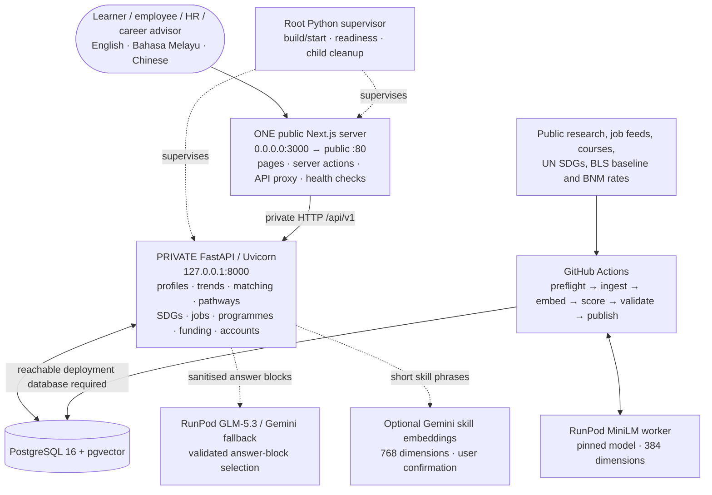

<details>
<summary><strong>User journeys, sequences and trend pipeline · 4 diagrams</strong></summary>

### User journey (both modes)

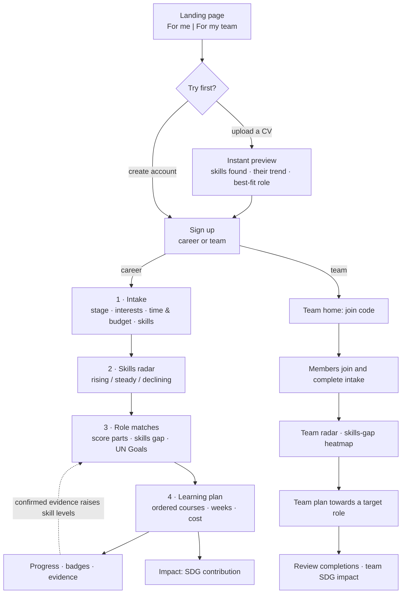

### Individual: from CV to a saved plan

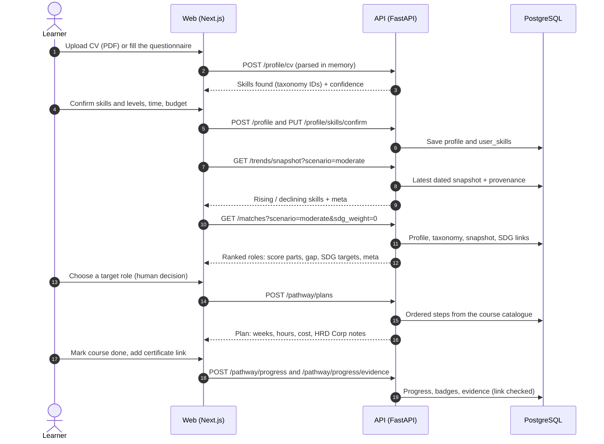

### Organisation: from join code to a team plan

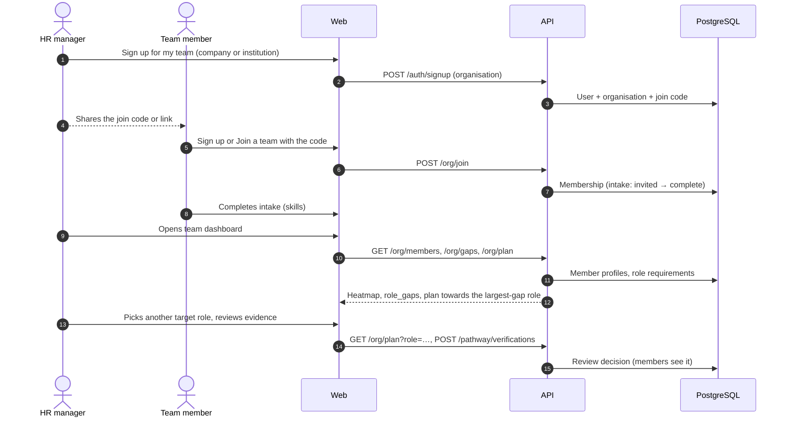

### Legacy manual trend snapshot pipeline (validated)

The diagram describes the backup publisher, not the daily method-specific paper-store catch-up.

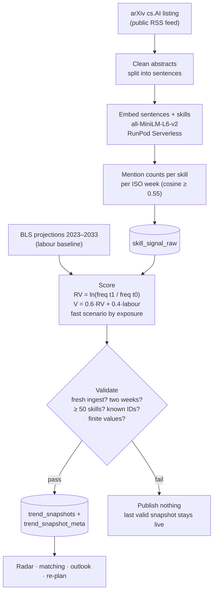

</details>

<details>
<summary><strong>Match scoring and knowledge graph · 2 diagrams</strong></summary>

### Explainable match score

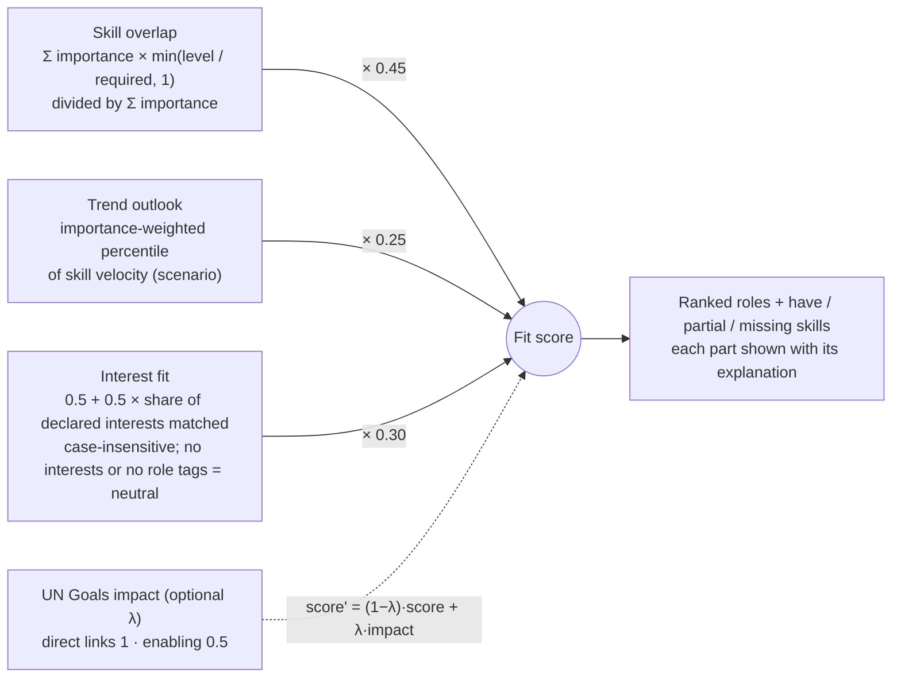

- Protected attributes (age, gender, background) are never read by matching. Counterfactual tests swap personas and require identical results.
- Declaring matching interests adds a bonus above the neutral interest contribution; unmatched interests stay neutral. Scenario outlooks report each scenario's computed skill aggregate, so mixed skill signals can make fast less extreme than moderate. Comparison metadata says `scenario: "both"`; selectable scenarios remain moderate and fast.
- Completed learning can raise a skill's effective matching level when an organisation reviewer confirms it, or when a certificate link passes the provider-page check. That link check confirms reachability and provider domain, not certificate ownership.

### Knowledge graph

The catalogue is a graph. Pathways walk it from the learner's skills to a target role.

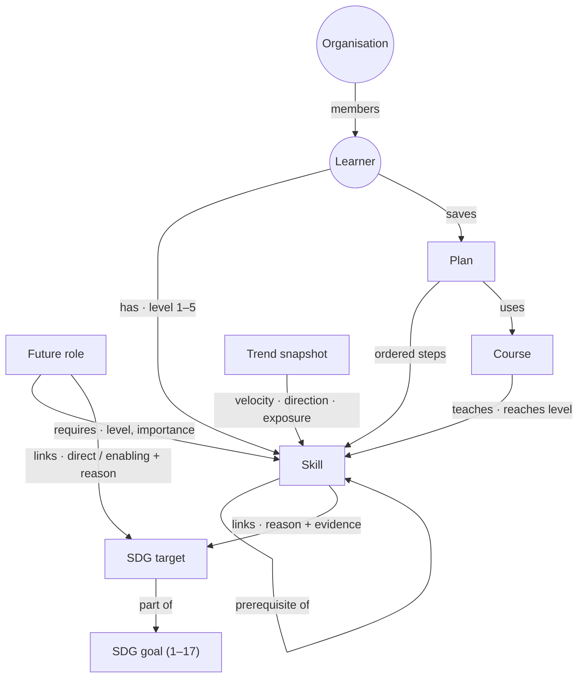

The catalogue holds 31 roles (28 targets), 140 skills and 98 sourced courses, plus all 17 goals and 169 targets with 61 role-target and 165 skill-target links.

</details>

<details>
<summary><strong>Database schema and provenance · 4 diagrams</strong></summary>

### Identity, intake and role requirements

Selected columns from the append-only [SQL migrations](src/db/migrations/), not replacement DDL.
Solid ER relationships below reflect declared foreign keys. Array and JSON references are
explained separately rather than presented as enforced foreign keys.

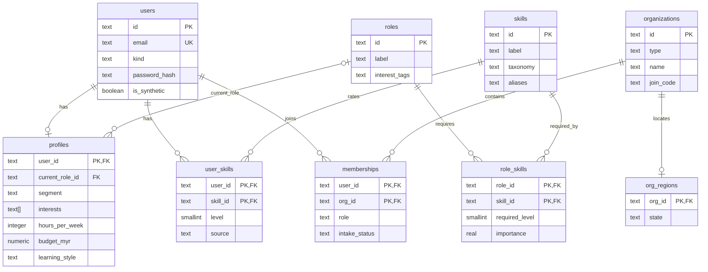

### Learning plans and evidence

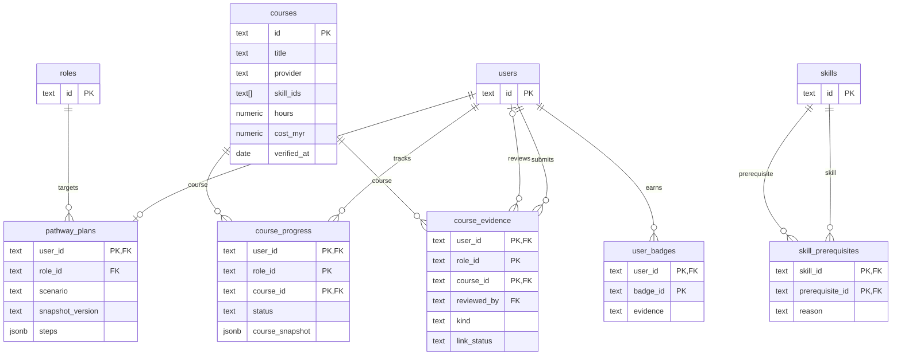

`courses.skill_ids` is an array and `pathway_plans.steps` is JSONB; application logic resolves
those IDs. `role_id` in progress and evidence is part of the composite key, not a declared
foreign key. Evidence has separate submitter and nullable reviewer references to `users`.
`course_progress.course_snapshot` preserves course facts independently of the saved target.
Accepted completions across all targets feed the same effective skill levels to matching,
individual learning plans and team gaps; rejection and undo still revoke that credit.

### SDG mappings

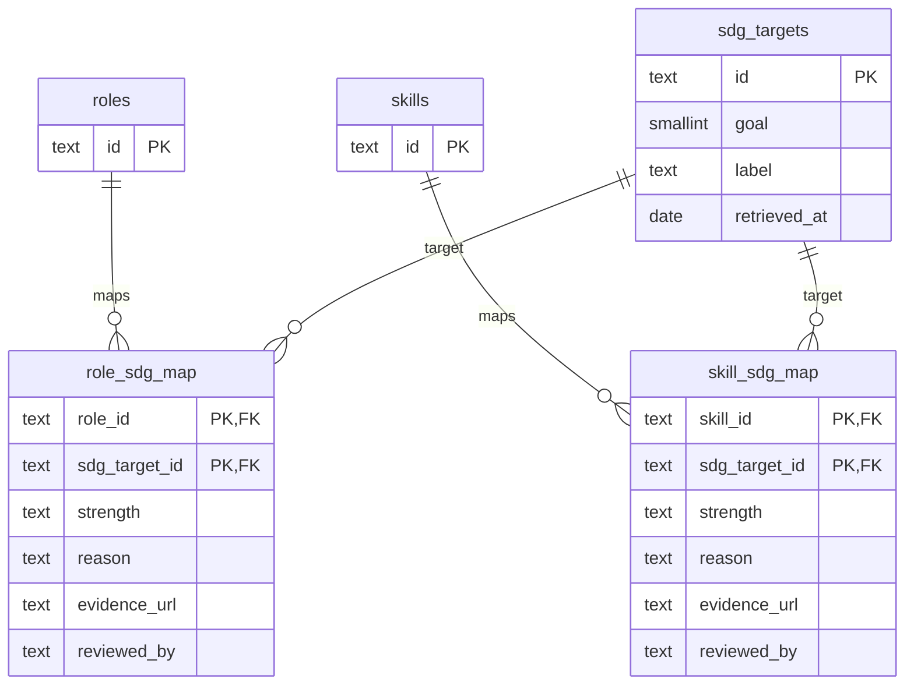

`sdg_targets.goal` resolves to `sdg_goals.id` in application data; the migrations do not
add a foreign-key constraint for it. SDG mapping `reviewed_by` is attribution text,
not an account foreign key. Unreviewed links remain draft mappings.

### Trend storage and provenance

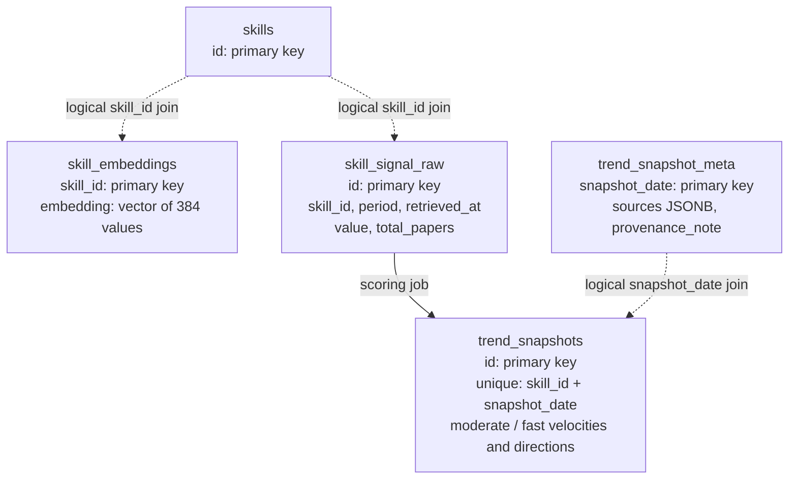

Dotted connections are logical joins, not declared foreign keys. Embeddings, raw signals,
and trend snapshot `skill_id` columns are not constrained to `skills` by the current DDL;
publish-time validation checks taxonomy membership. `trend_snapshot_meta` is joined by date.

The diagram omits some supporting tables:

| Table                        | Purpose                                                    |
| ---------------------------- | ---------------------------------------------------------- |
| `arxiv_fetch_log`            | Audit of each arXiv pull                                   |
| `data_syncs`                 | Catalogue and SDG sync runs                                |
| `fx_rates`                   | Bank Negara Malaysia rates for converting course prices    |
| `llm_calls`                  | Log of LLM gateway calls (empty while `LLM_PROVIDER=none`) |
| `snapshots`, `trend_signals` | Early skeleton tables kept for compatibility               |

Migrations are in [`src/db/migrations`](src/db/migrations). New changes always go in a new file.

</details>

## Project structure

| Path                                          | Current contents                                                        |
| :-------------------------------------------- | :---------------------------------------------------------------------- |
| `src/web/`                                    | Next.js product, shared UI, translations and standalone scripts         |
| `src/api/`                                    | FastAPI contracts and feature services                                  |
| `src/pipelines/`                              | Research, job, course, SDG and validation jobs                          |
| `src/data/seed/`                              | Dated public reference data and synthetic fixtures                      |
| `src/db/`                                     | Append-only SQL migrations and explicit seed loader                     |
| `tests/`                                      | API, pipeline, public proxy and deployment regression suites            |
| `.github/workflows/`                          | CI, source audit, trend refresh and guarded MiniLM image publisher      |
| `docs/`                                       | Current submission sources, decisions and diagram explorer              |
| `src/scripts/`                                | Cross-platform setup/check runner and supervised production build/start |
| `pyproject.toml`, `uv.lock`, `pnpm-lock.yaml` | Python and JavaScript dependency manifests/locks                        |
| `.replit`                                     | Root build/start commands and one public port (3000 → 80)               |

## Root production deployment

The root configuration uses exactly these commands:

```bash
python3 src/scripts/replit.py build
python3 src/scripts/replit.py start
```

Build installs frozen uv/pnpm dependencies (Python requirements fallback when uv is absent),
builds Next.js with webpack and copies standalone
assets. Start launches FastAPI privately on loopback, waits for API/database readiness,
then runs the generated Next.js server on the single public port. Neither operation runs
migrations, seeding or model inference. `artifacts/`, the Express proxy, Drizzle scaffold,
mockup sandbox and generated scaffold clients are not part of this product.

`GET /api/healthz` and `GET /api/v1` are readiness aliases; an unavailable database returns 503. `/api/v1/health` preserves the FastAPI health response. Unknown API paths still return 404. CI starts this exact production pair against disposable PostgreSQL and checks pages,
static CSS, health, CORS preflight and a read-only failed login through the public proxy.

## Production boundaries

The Next.js/API pair must receive the same nonempty `PROXY_SHARED_SECRET`. Set
`TRUSTED_PROXY_HOPS` from the real forwarding chain; do not guess it. Replit production uses 1
(one appending edge in front of the single public server).
Trusted client-IP mode rejects zero hops; the best-effort default permits zero but then
anonymous visitors share one rate-limit bucket. Replit's verified configuration uses one
hop. Local direct-socket development may use zero. The public API handler strips caller-supplied internal identity headers.

`AUTH_MODE=demo` is the legacy name for PostgreSQL-backed local accounts with signed sessions,
not an automatic demo login. Keep `APP_ENV=production`, `AUTH_RAW_USER_IDS=false` and an empty
`AUTH_DEFAULT_USER`. Authentication uses Adept's signed local accounts stored in Replit PostgreSQL.

The hardened MiniLM dependency pins are source changes. Applying them to the live worker
requires a guarded image build and RunPod redeployment. The historical verified worker image
is not evidence that those newer dependencies are already deployed. Keep all keys and
connection strings in secret stores, never in this README or submission PDFs.

Final-round review: [refresh and demo runbook](docs/review-runbook.md). The dashboard shows the measured data date; manual refresh is admin-only and the daily in-app scheduler is separate from the optional legacy GitHub backup. Production configuration and paid-run acceptance remain explicit rollout steps.

### Final-round disclosure and measurement notes (30 October 2026)

The About registry and technical declaration identify RunPod MiniLM, RunPod GLM-5.3
with separately authenticated Gemini failover, and Replit hosting. Google Fonts'
Inter assets are available through `@fontsource-variable/inter`; current app styles
use Arial/system fallbacks, without a live Google Fonts request. ElevenLabs was
confirmed used for presentation audio, not application recommendations.

The MyCOL 2024/2025 badge uses only the reviewed stored `data-analyst` ID and cites
TalentCorp's restricted title list; it does not change ranking or claim current vacancies.
See [mapping evidence](docs/reference/critical-occupations.md).
Human KPI trials remain unrun (0 testers, 0 trials); automated local API timings
are separate evidence: [journey measurements](docs/evidence/kpi-automated-journeys.md).
