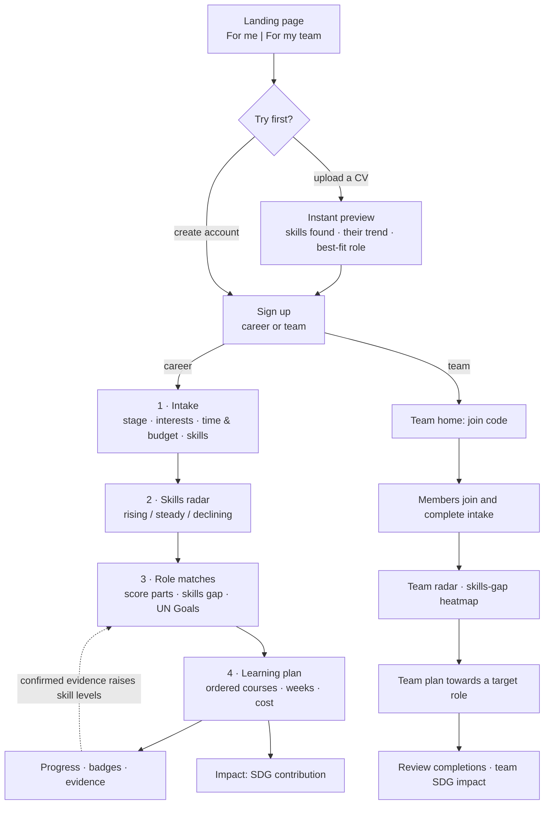
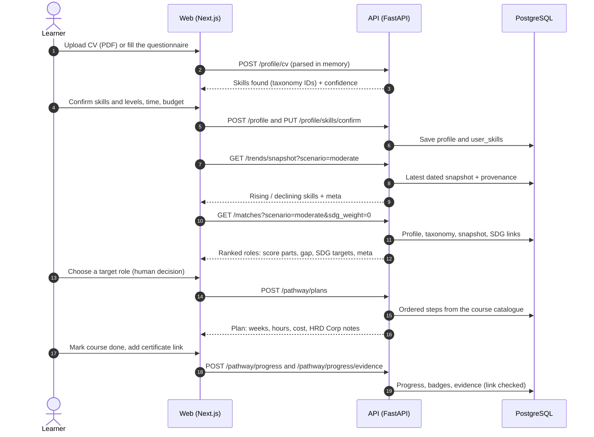
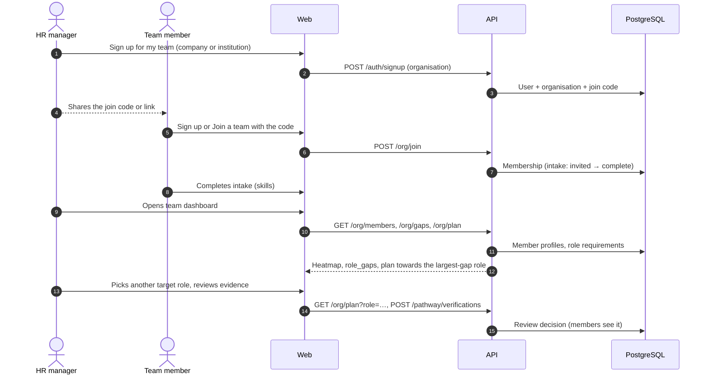
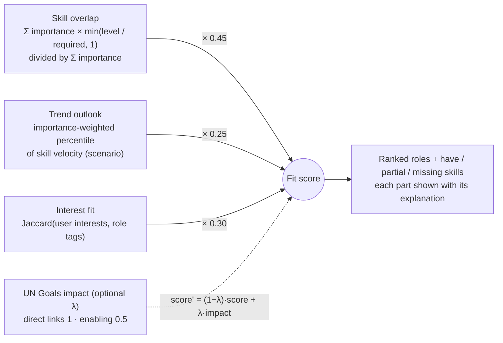
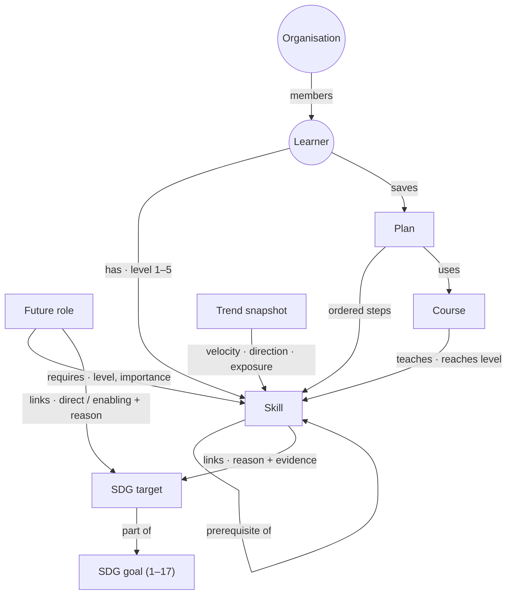
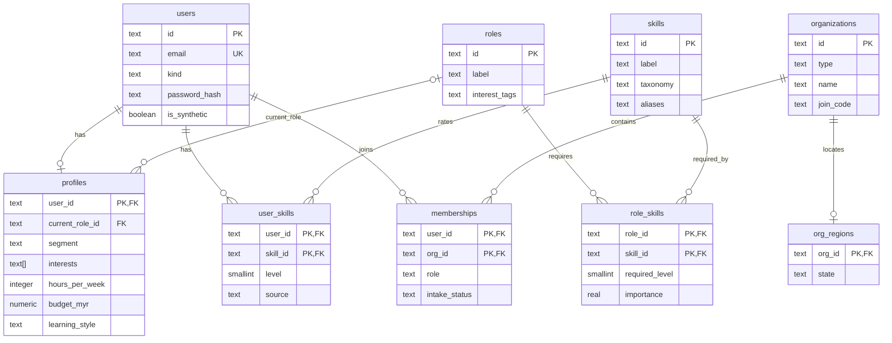
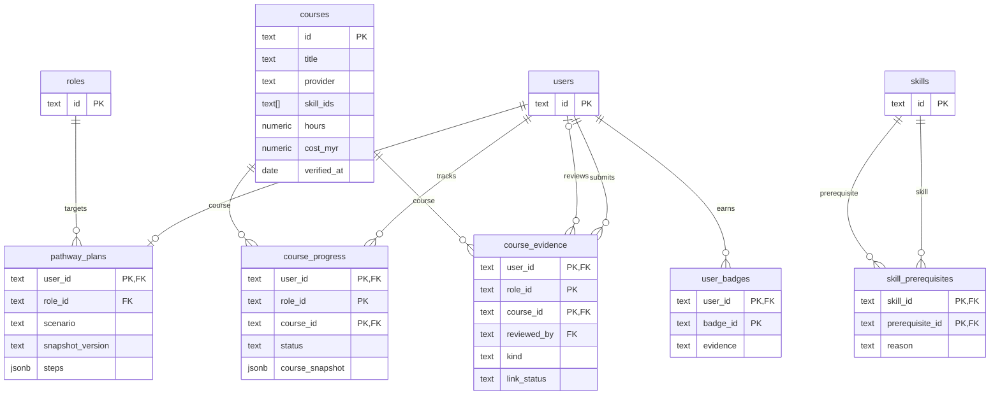
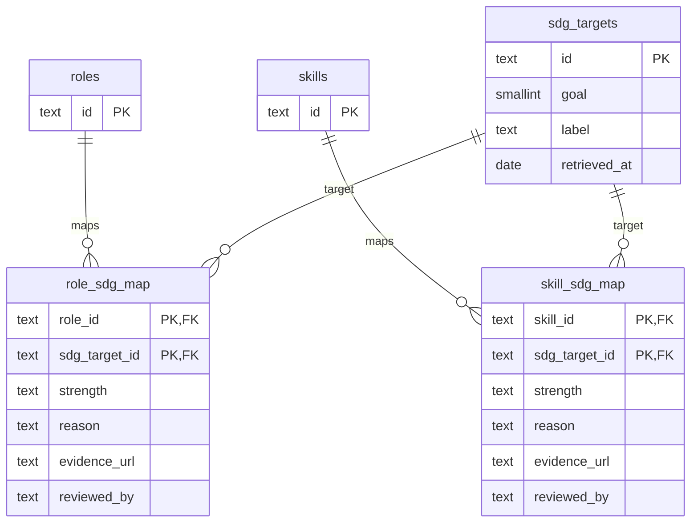
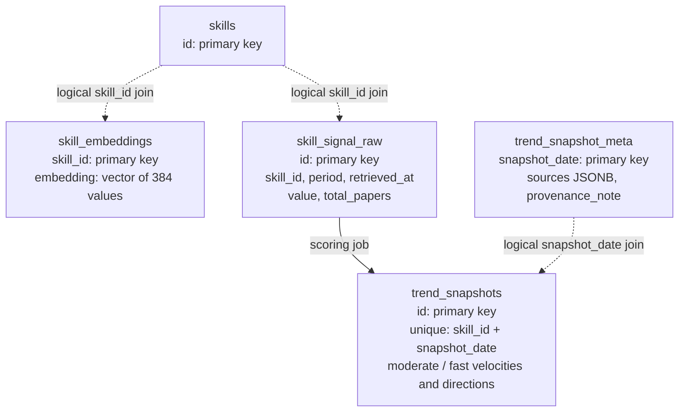

<div align="center">


<h1>Adept</h1>

<strong>Find your next role. Build the skills to get there.</strong>

<p>Career matching and personalised reskilling for the AI era.</p>

[](https://nextjs.org/)
[](https://react.dev/)
[](https://www.typescriptlang.org/)
[](https://tailwindcss.com/)
[](https://www.python.org/)
[](https://fastapi.tiangolo.com/)
[](https://github.com/pgvector/pgvector)
[](https://docs.docker.com/compose/)
[](LICENSE)

<p><a href="#features">Features</a> · <a href="#getting-started">Getting started</a> · <a href="#diagrams">Diagrams</a> · <a href="#ai-and-data">AI and data</a> · <a href="#project-structure">Project structure</a></p>

</div>

Adept connects your current skills to future roles, explains the gaps, and builds a learning plan around your time and budget. Individuals and organisations use the same engine, with dedicated workspaces for learners, employees and HR teams.

<p align="center"><strong>Your skills → AI signals → Role matches → Learning plan → Job openings</strong></p>

## Team

| Field | Details |
|:---|:---|
| Team | **Pecel Lele** |
| University | Xiamen University Malaysia |
| Team leader | David Kurniawan |
| Members | 4 |
| Competition | SDC XMUM Hackathon 2026 |
| Domain | **Domain 1 — The Aiversecity Future-Ready Workforce** |
| SDG track | **SDG 4 — Quality Education**; supporting SDGs 5, 8, 9 and 10 |

## Links

| Resource | Link / status |
|:---|:---|
| GitHub repository | https://github.com/pecel-lelele/adept |
| Replit project | https://replit.com/@darrensuwandi06/adept |
| Live demo | Pending |
| RunPod · Adi / GLM-5.3 | https://api.runpod.ai/v2/b1dd8hy2hqo1nb/openai/v1 |
| RunPod · MiniLM-L6-v2 | https://api.runpod.ai/v2/ta14jd0by2ijl2 |
| Slide deck | Pending |
| Demo video | Pending |
| Pitching video | Pending |

The MiniLM endpoint accepts authenticated embedding requests at `POST /runsync` with an
`input.texts` array. Its inference smoke test passed on 24 October 2026; snapshot publication
requires a separate successful **Trends refresh** run.

## Features

| Step | What you can do |
|:---|:---|
| **Understand your skills** | Upload a synthetic CV or complete the questionnaire, then confirm the extracted skills. |
| **Explore AI signals** | See dated skill trends, compare moderate and fast scenarios, and replay earlier snapshots. |
| **Find a direction** | Compare roles with a score breakdown, skills gap and SDG links. |
| **Build a plan** | Choose courses around your hours and budget; track progress and supporting evidence. |
| **Connect to work** | Explore job openings and relevant certification exams alongside your target role. |
| **Plan for a team** | Review team gaps, create training programmes, manage funding and review evidence. |

English, Bahasa Melayu and Chinese are supported. Adi explains the information in your signed-in workspace.

<a name="12-getting-started"></a>

<a name="quick-start"></a>

## Getting started

**Requirements:** Python 3.11, [uv](https://docs.astral.sh/uv/), Node.js 20+, and Docker Desktop running.

From the repository root:

```bash
make setup
make dev
```

Setup installs dependencies, creates `.env`, starts PostgreSQL, applies migrations and loads the committed seed data. Open [Adept](http://localhost:3000) or the [API documentation](http://localhost:8000/docs).

<details>
<summary><strong>Windows without Make</strong></summary>

```powershell
uv run --no-project python src/scripts/dev.py setup
uv run --no-project python src/scripts/dev.py dev
```

</details>

<details>
<summary><strong>Run the complete app with Docker instead</strong></summary>

```bash
docker compose -p adept up -d --build --wait
```

This builds web and API containers, starts PostgreSQL, applies migrations and seeds the database. Open the same local URLs above. Stop with `docker compose -p adept down`.

</details>

**Try the app:** upload a [sample synthetic CV](tests/api/profile/fixtures/cvs/), create a career account with an `example.test` email, and follow **Radar → Roles → Plan → Progress**. Create a separate team account to try organisation features and invite the learner with its join code.

**Configuration:** [`.env.example`](.env.example) lists the application, database and model settings. Keep secrets in `.env` locally or in the hosting platform's Secrets. When using Replit Database, keep its supplied `DATABASE_URL`; importing GitHub files does not copy the local database.

**Publish on Replit:** [`.replit`](.replit) supplies Autoscale build/start commands for
the production Next.js and FastAPI servers. Follow the [Replit deployment guide](docs/replit-deployment.md)
to preserve local workspace changes, configure the published origin and secrets,
initialize the production database and inspect build/run logs. The Preview runner
is for development. Pull merged GitHub changes into Replit before publishing.

## AI and data

| Component | Provider / model | Purpose |
|:---|:---|:---|
| Adi | Z.ai **GLM-5.3** (`glm-5.3`) through RunPod | Selects validated answer blocks using the user's Adept data. |
| Adi fallback | Google **Gemini 3.5 Flash Lite**, with Gemini 3.6 Flash / 3.1 Flash Lite backups | Handles provider failure; a built-in guide remains available. |
| Trend encoder | Sentence Transformers **all-MiniLM-L6-v2** through RunPod | Relates public research sentences to catalogue skills. Deployed worker verified with two 384-dimensional embeddings. |
| CV skill suggestions | Google **gemini-embedding-001** | Suggests catalogue matches for unfamiliar skill phrases; the user confirms additions. |

Model features are configurable; the default assistant uses the built-in guide. Role scores, learning plans and trend calculations use deterministic rules. Model-selected IDs pass through `validate_ids` before display.

Data comes from arXiv, BLS projections, the UN SDG API, Microsoft Learn, verified course and certification providers, public job-board APIs, and Bank Negara Malaysia exchange rates. Recommendations show sources, dates, scenarios and estimate labels. The prototype uses public data and synthetic profiles/CVs; people choose their own next steps.

## Development

| Command | Purpose |
|:---|:---|
| `make check` | Ruff, ESLint, TypeScript, translation parity, pytest and contract drift checks |
| `make test` | Run the Python test suite |
| `make contracts` | Regenerate OpenAPI and the TypeScript API types |
| `make db-migrate` | Apply pending database migrations |
| `make seed` | Load committed reference and synthetic datasets |

On Windows, use `uv run --no-project python src/scripts/dev.py <command>` for the same tasks. GitHub Actions runs PR checks and scheduled trend/source refreshes.

### RunPod Serverless and GitHub Actions

MiniLM is deployed as a **queue-based RunPod Serverless worker** using the public image
`ghcr.io/pecel-lelele/adept-minilm:latest`. Its pinned model revision is
`1110a243fdf4706b3f48f1d95db1a4f5529b4d41`. A completed live test returned two
384-dimensional embeddings. The container includes model weights and PyTorch; GitHub's
trend runner installs pipeline client dependencies and calls RunPod over HTTPS.

| Workflow | Trigger and responsibility |
|:---|:---|
| [CI](.github/workflows/ci.yml) | Pushes to `main`, pull requests and manual runs: lint, tests, real PostgreSQL checks, translations, generated contracts and production web build. |
| [Data sources](.github/workflows/data-sources.yml) | Mondays 02:17 UTC (10:17 WITA) and manual runs: checks upstream SDG/course data and evidence links; does not publish trend snapshots. |
| [Trends refresh](.github/workflows/trends-refresh.yml) | Mondays 03:41 UTC (11:41 WITA) and manual runs: ingest public research → RunPod embeddings → score → validate → publish a dated database snapshot. |
| [Publish MiniLM](.github/workflows/publish-minilm.yml) | Trusted `main` or `feat/minilm-runpod-deploy` pushes affecting the worker, encoder or workflow, plus manual runs on those refs: builds `linux/amd64` and publishes GHCR tags using `GITHUB_TOKEN`. PR events do not publish. |

Configure **repository Settings → Secrets and variables → Actions**:

| Kind | Exact name | Value |
|:---|:---|:---|
| Secret | `TREND_DATABASE_URL` | The published app's production PostgreSQL connection string, reachable from GitHub Actions. Replit's development `helium` URL cannot be used externally. |
| Secret | `TRENDS_RUNPOD_API_KEY` | A dedicated MiniLM key permitted to invoke the endpoint. |
| Variable | `TRENDS_RUNPOD_ENDPOINT_ID` | `ta14jd0by2ijl2` |

The workflow maps `TREND_DATABASE_URL` to the process variable `DATABASE_URL`. A repository
secret named only `DATABASE_URL` does not satisfy that workflow. MiniLM credentials are
separate from Adi's `RUNPOD_API_KEY` and Gemini settings.

Run **Actions → Trends refresh → Run workflow → main**, then open the `refresh` job.
The database preflight must pass, then `Ingest, score, validate and publish` must report
`Published snapshot YYYY-MM-DD.` A green run that skipped missing configuration is not a
publication. Inference success alone does not establish sufficient research history or a
successful database write; failures preserve the previous published snapshot.

The first integrated refresh fetched 366 papers and counted mentions, then failed saving to
Replit's private development host `helium`. To use Replit's production database, publish the
app, then open **Database → Production → Settings / Connection details** and update the
GitHub secret. Development and production are separate databases. Preflight now rejects
this configuration before fetching papers or invoking paid inference.

Keep **Active workers = 0** and **Max workers = 1** for this batch workload. A request starts
the worker when needed; no manually running test is required to keep the integration alive.
Replit serves saved database snapshots, so app page loads do not call MiniLM directly.
Keeping the same database does not require a Replit redeployment for each trend refresh.
See the [operations and recovery guide](src/pipelines/trends/runpod/DEPLOYMENT_HANDOFF.md)
for image access, worker recovery, first-run validation and deployment evidence.

**Technical guides:** [Architecture](docs/architecture.md) · [Solution design](docs/solution-design.md) · [Diagrams](docs/diagrams/index.html) · [Decisions](docs/decisions.md) · [MiniLM RunPod setup](src/pipelines/trends/runpod/DEPLOYMENT_HANDOFF.md)

<a name="interactive-diagrams"></a>

## Diagrams

The architecture is shown below. Expand the other sections for the user journeys, pipeline, matching logic and database views. The [interactive diagram viewer](docs/diagrams/index.html) supports zoom, pan and SVG download; download the HTML file and open it locally.

<a name="3-system-architecture"></a>

### System architecture


<details>
<summary><strong>User journeys, sequences and trend pipeline · 4 diagrams</strong></summary>

### User journey (both modes)



### Individual: from CV to a saved plan



### Organisation: from join code to a team plan



### Trend data pipeline (weekly, validated)


</details>

<details>
<summary><strong>Match scoring and knowledge graph · 2 diagrams</strong></summary>

### Explainable match score



- Protected attributes (age, gender, background) are never read by matching. Counterfactual tests swap personas and require identical results.
- Completed learning can raise a skill's effective matching level when an organisation reviewer confirms it, or when a certificate link passes the provider-page check. That link check confirms reachability and provider domain, not certificate ownership.

### Knowledge graph

The catalogue is a graph. Pathways walk it from the learner's skills to a target role.



The catalogue holds 31 roles (28 targets), 140 skills and 98 sourced courses, plus all 17 goals and 169 targets with 61 role-target and 165 skill-target links.

</details>

<details>
<summary><strong>Database schema and provenance · 4 diagrams</strong></summary>

### Identity, intake and role requirements

Selected columns from the append-only [SQL migrations](src/db/migrations/), not replacement DDL.
Solid ER relationships below reflect declared foreign keys. Array and JSON references are
explained separately rather than presented as enforced foreign keys.



### Learning plans and evidence



`courses.skill_ids` is an array and `pathway_plans.steps` is JSONB; application logic resolves
those IDs. `role_id` in progress and evidence is part of the composite key, not a declared
foreign key. Evidence has separate submitter and nullable reviewer references to `users`.
`course_progress.course_snapshot` preserves course facts independently of the saved target.
Accepted completions across all targets feed the same effective skill levels to matching,
individual learning plans and team gaps; rejection and undo still revoke that credit.

### SDG mappings



`sdg_targets.goal` resolves to `sdg_goals.id` in application data; the migrations do not
add a foreign-key constraint for it. SDG mapping `reviewed_by` is attribution text,
not an account foreign key. Unreviewed links remain draft mappings.

### Trend storage and provenance



Dotted connections are logical joins, not declared foreign keys. Embeddings, raw signals,
and trend snapshot `skill_id` columns are not constrained to `skills` by the current DDL;
publish-time validation checks taxonomy membership. `trend_snapshot_meta` is joined by date.


The diagram omits some supporting tables:

| Table | Purpose |
|---|---|
| `arxiv_fetch_log` | Audit of each arXiv pull |
| `data_syncs` | Catalogue and SDG sync runs |
| `fx_rates` | Bank Negara Malaysia rates for converting course prices |
| `llm_calls` | Log of LLM gateway calls (empty while `LLM_PROVIDER=none`) |
| `snapshots`, `trend_signals` | Early skeleton tables kept for compatibility |

Migrations are in [`src/db/migrations`](src/db/migrations). New changes always go in a new file.

</details>

## Project structure

| Path | Contents |
|:---|:---|
| `.github/workflows/` | CI, trend refresh and data-source checks |
| `src/api/` | FastAPI services, shared contracts, security and model gateways |
| `src/web/` | Next.js routes, feature components, translations and assets |
| `src/pipelines/` | Trend, matching, pathway, SDG and jobs pipelines |
| `src/data/seed/` | Public reference datasets and synthetic demo data |
| `src/db/` | SQL migrations, migration runner and seeding |
| `src/docker/` | Container builds and startup |
| `src/scripts/` | Development runner and local utilities |
| `tests/` | API, pipeline and synthetic CV test fixtures |
| `docs/` | Architecture, methods and team documentation |

<details>
<summary><strong>Expand the complete source, configuration and test tree</strong></summary>

Tracked application files and supporting documentation are listed below. Temporary submission drafts and ignored local files are omitted.

```text
adept/
├── .github/
│   └── workflows/
│       ├── ci.yml
│       ├── data-sources.yml
│       ├── publish-minilm.yml
│       └── trends-refresh.yml
├── docs/
│   ├── diagrams/
│   │   ├── index.html
│   │   ├── render.mjs
│   │   └── viewer.template.html
│   ├── architecture.md
│   ├── decisions.md
│   ├── project-context.md
│   ├── README.md
│   ├── skill-exposure-methodology.md
│   ├── solution-design.md
│   ├── tasks.md
│   └── team-rules.md
├── src/
│   ├── api/
│   │   ├── app/
│   │   │   ├── contracts/
│   │   │   │   ├── __init__.py
│   │   │   │   ├── accounts.py
│   │   │   │   ├── assistant.py
│   │   │   │   ├── common.py
│   │   │   │   ├── funding.py
│   │   │   │   ├── guardrails.py
│   │   │   │   ├── jobs.py
│   │   │   │   ├── matching.py
│   │   │   │   ├── org.py
│   │   │   │   ├── packages.py
│   │   │   │   ├── pathway.py
│   │   │   │   ├── profile.py
│   │   │   │   ├── programmes.py
│   │   │   │   ├── scenarios.py
│   │   │   │   ├── sdg.py
│   │   │   │   └── trends.py
│   │   │   ├── core/
│   │   │   │   ├── llm/
│   │   │   │   │   ├── __init__.py
│   │   │   │   │   ├── CLAUDE.md
│   │   │   │   │   ├── FEATURE.md
│   │   │   │   │   ├── gateway.py
│   │   │   │   │   ├── GEMINI.md
│   │   │   │   │   ├── provider.py
│   │   │   │   │   └── validator.py
│   │   │   │   ├── security/
│   │   │   │   │   ├── __init__.py
│   │   │   │   │   ├── body_limit.py
│   │   │   │   │   ├── headers.py
│   │   │   │   │   ├── pii.py
│   │   │   │   │   ├── rate_limit.py
│   │   │   │   │   ├── sanitize.py
│   │   │   │   │   ├── session.py
│   │   │   │   │   └── tokens.py
│   │   │   │   ├── __init__.py
│   │   │   │   ├── accounts.py
│   │   │   │   ├── auth.py
│   │   │   │   ├── config.py
│   │   │   │   ├── db.py
│   │   │   │   ├── embeddings.py
│   │   │   │   ├── errors.py
│   │   │   │   ├── fairness.py
│   │   │   │   ├── logging.py
│   │   │   │   ├── overview.py
│   │   │   │   ├── refdata.py
│   │   │   │   ├── routes.py
│   │   │   │   ├── seed.py
│   │   │   │   └── taxonomy.py
│   │   │   ├── features/
│   │   │   │   ├── accounts/
│   │   │   │   │   ├── __init__.py
│   │   │   │   │   ├── router.py
│   │   │   │   │   └── service.py
│   │   │   │   ├── assistant/
│   │   │   │   │   ├── __init__.py
│   │   │   │   │   ├── CLAUDE.md
│   │   │   │   │   ├── context.py
│   │   │   │   │   ├── FEATURE.md
│   │   │   │   │   ├── guide.py
│   │   │   │   │   ├── router.py
│   │   │   │   │   └── service.py
│   │   │   │   ├── guardrails/
│   │   │   │   │   ├── __init__.py
│   │   │   │   │   ├── datasync.py
│   │   │   │   │   ├── router.py
│   │   │   │   │   └── service.py
│   │   │   │   ├── jobs/
│   │   │   │   │   ├── __init__.py
│   │   │   │   │   ├── CLAUDE.md
│   │   │   │   │   ├── FEATURE.md
│   │   │   │   │   ├── fit.py
│   │   │   │   │   ├── GEMINI.md
│   │   │   │   │   ├── repository.py
│   │   │   │   │   ├── router.py
│   │   │   │   │   └── service.py
│   │   │   │   ├── matching/
│   │   │   │   │   ├── __init__.py
│   │   │   │   │   ├── CLAUDE.md
│   │   │   │   │   ├── evaluation.py
│   │   │   │   │   ├── FEATURE.md
│   │   │   │   │   ├── gap_port.py
│   │   │   │   │   ├── GEMINI.md
│   │   │   │   │   ├── personas.py
│   │   │   │   │   ├── replay.py
│   │   │   │   │   ├── replay_diff.py
│   │   │   │   │   ├── repository.py
│   │   │   │   │   ├── router.py
│   │   │   │   │   ├── schemas.py
│   │   │   │   │   ├── scoring.py
│   │   │   │   │   ├── sdg_port.py
│   │   │   │   │   ├── sdg_weight.py
│   │   │   │   │   ├── service.py
│   │   │   │   │   └── trend_port.py
│   │   │   │   ├── org/
│   │   │   │   │   ├── __init__.py
│   │   │   │   │   ├── CLAUDE.md
│   │   │   │   │   ├── FEATURE.md
│   │   │   │   │   ├── funding.py
│   │   │   │   │   ├── funding_store.py
│   │   │   │   │   ├── GEMINI.md
│   │   │   │   │   ├── packages.py
│   │   │   │   │   ├── programmes.py
│   │   │   │   │   ├── repository.py
│   │   │   │   │   ├── router.py
│   │   │   │   │   ├── schemas.py
│   │   │   │   │   └── service.py
│   │   │   │   ├── pathway/
│   │   │   │   │   ├── __init__.py
│   │   │   │   │   ├── catalogue_sources.py
│   │   │   │   │   ├── CLAUDE.md
│   │   │   │   │   ├── data.py
│   │   │   │   │   ├── engine.py
│   │   │   │   │   ├── FEATURE.md
│   │   │   │   │   ├── GEMINI.md
│   │   │   │   │   ├── progress.py
│   │   │   │   │   ├── replan.py
│   │   │   │   │   ├── repository.py
│   │   │   │   │   ├── router.py
│   │   │   │   │   ├── schemas.py
│   │   │   │   │   ├── service.py
│   │   │   │   │   ├── sync.py
│   │   │   │   │   ├── trend_port.py
│   │   │   │   │   └── verification.py
│   │   │   │   ├── preview/
│   │   │   │   │   ├── __init__.py
│   │   │   │   │   └── router.py
│   │   │   │   ├── profile/
│   │   │   │   │   ├── __init__.py
│   │   │   │   │   ├── CLAUDE.md
│   │   │   │   │   ├── cv_parser.py
│   │   │   │   │   ├── FEATURE.md
│   │   │   │   │   ├── GEMINI.md
│   │   │   │   │   ├── repository.py
│   │   │   │   │   ├── router.py
│   │   │   │   │   ├── schemas.py
│   │   │   │   │   ├── service.py
│   │   │   │   │   └── skill_match.py
│   │   │   │   ├── scenarios/
│   │   │   │   │   ├── __init__.py
│   │   │   │   │   ├── CLAUDE.md
│   │   │   │   │   ├── FEATURE.md
│   │   │   │   │   ├── GEMINI.md
│   │   │   │   │   ├── repository.py
│   │   │   │   │   ├── router.py
│   │   │   │   │   ├── schemas.py
│   │   │   │   │   └── service.py
│   │   │   │   ├── sdg/
│   │   │   │   │   ├── __init__.py
│   │   │   │   │   ├── CLAUDE.md
│   │   │   │   │   ├── FEATURE.md
│   │   │   │   │   ├── GEMINI.md
│   │   │   │   │   ├── repository.py
│   │   │   │   │   ├── router.py
│   │   │   │   │   ├── schemas.py
│   │   │   │   │   ├── service.py
│   │   │   │   │   ├── sources.py
│   │   │   │   │   └── sync.py
│   │   │   │   ├── trends/
│   │   │   │   │   ├── __init__.py
│   │   │   │   │   ├── CLAUDE.md
│   │   │   │   │   ├── FEATURE.md
│   │   │   │   │   ├── GEMINI.md
│   │   │   │   │   ├── mocks.py
│   │   │   │   │   ├── provenance.py
│   │   │   │   │   ├── repository.py
│   │   │   │   │   ├── router.py
│   │   │   │   │   ├── schemas.py
│   │   │   │   │   └── service.py
│   │   │   │   └── __init__.py
│   │   │   ├── __init__.py
│   │   │   ├── export_openapi.py
│   │   │   └── main.py
│   │   └── openapi.json
│   ├── data/
│   │   └── seed/
│   │       ├── arxiv_raw/
│   │       │   ├── 2024-10-06_2024-10-12.json
│   │       │   ├── 2024-10-13_2024-10-19.json
│   │       │   └── 2026-10-20.json
│   │       ├── courses/
│   │       │   ├── courses.csv
│   │       │   └── README.md
│   │       ├── jobs/
│   │       │   ├── certifications.csv
│   │       │   ├── fetch_log.json
│   │       │   └── job_postings.csv
│   │       ├── org/
│   │       │   ├── memberships.csv
│   │       │   ├── organizations.csv
│   │       │   ├── README.md
│   │       │   └── users.csv
│   │       ├── pathway/
│   │       │   ├── README.md
│   │       │   └── skill_prerequisites.csv
│   │       ├── personas/
│   │       │   ├── expected_roles.csv
│   │       │   ├── profiles.csv
│   │       │   ├── README.md
│   │       │   ├── user_skills.csv
│   │       │   └── users.csv
│   │       ├── sdg/
│   │       │   ├── org_regions.csv
│   │       │   ├── README.md
│   │       │   ├── role_sdg_map.csv
│   │       │   ├── sdg_goals.csv
│   │       │   ├── sdg_targets.csv
│   │       │   └── skill_sdg_map.csv
│   │       ├── taxonomy/
│   │       │   ├── provenance.json
│   │       │   ├── README.md
│   │       │   ├── role_skills.csv
│   │       │   ├── roles.csv
│   │       │   └── skills.csv
│   │       ├── trends/
│   │       │   ├── README.md
│   │       │   ├── snapshots.csv
│   │       │   └── trend_signals.csv
│   │       ├── bls_projections_2023_2033.csv
│   │       ├── canonical_skills.csv
│   │       ├── labor_decay.csv
│   │       ├── mock_trends.json
│   │       ├── mock_trends_2026-10-13.json
│   │       ├── mock_trends_2026-10-20.json
│   │       └── README.md
│   ├── db/
│   │   ├── migrations/
│   │   │   ├── 20261019120000_core_init.sql
│   │   │   ├── 20261020120000_m3_pathway_sdg_guardrails.sql
│   │   │   ├── 20261020160000_m1_trends_signal_tables.sql
│   │   │   ├── 20261021090000_m3_live_data_and_shared_state.sql
│   │   │   ├── 20261021120000_m3_catalogue_formats_and_fx.sql
│   │   │   ├── 20261021130000_m3_completion_evidence.sql
│   │   │   ├── 20261021140000_m1_signal_aggregation_by_fetch_date.sql
│   │   │   ├── 20261021150000_core_skill_aliases.sql
│   │   │   ├── 20261021150000_m2_skill_aliases.sql
│   │   │   ├── 20261021160000_m2_role_interest_tags.sql
│   │   │   ├── 20261022090000_core_local_accounts.sql
│   │   │   ├── 20261022120000_core_trend_snapshot_meta.sql
│   │   │   ├── 20261022150000_m2_profile_learning_style.sql
│   │   │   ├── 20261022220000_core_completion_course_snapshots.sql
│   │   │   ├── 20261022223000_core_pathway_plan_history.sql
│   │   │   ├── 20261023035000_role_target_scope.sql
│   │   │   ├── 20261023040000_learning_funding.sql
│   │   │   ├── 20261023120000_core_workspaces.sql
│   │   │   ├── 20261023160000_jobs_openings_certifications.sql
│   │   │   ├── 20261023170000_catalogue_embeddings.sql
│   │   │   └── 20261024010000_jobs_partial_fetch_status.sql
│   │   ├── migrate.py
│   │   └── seed.py
│   ├── docker/
│   │   ├── api.Dockerfile
│   │   ├── boot.py
│   │   └── web.Dockerfile
│   ├── pipelines/
│   │   ├── guardrails/
│   │   │   ├── __init__.py
│   │   │   └── check_links.py
│   │   ├── jobs/
│   │   │   ├── __init__.py
│   │   │   ├── boards.py
│   │   │   ├── certifications.py
│   │   │   ├── classify.py
│   │   │   ├── run.py
│   │   │   └── sources.py
│   │   ├── matching/
│   │   │   ├── __init__.py
│   │   │   ├── README.md
│   │   │   └── run.py
│   │   ├── pathway/
│   │   │   ├── __init__.py
│   │   │   ├── README.md
│   │   │   └── run.py
│   │   ├── sdg/
│   │   │   ├── __init__.py
│   │   │   ├── README.md
│   │   │   └── run.py
│   │   ├── trends/
│   │   │   ├── runpod/
│   │   │   │   ├── .env.example
│   │   │   │   ├── __init__.py
│   │   │   │   ├── DEPLOYMENT_HANDOFF.md
│   │   │   │   ├── Dockerfile
│   │   │   │   ├── Dockerfile.dockerignore
│   │   │   │   ├── handler.py
│   │   │   │   ├── README.md
│   │   │   │   ├── requirements.txt
│   │   │   │   └── test_input.json
│   │   │   ├── __init__.py
│   │   │   ├── arxiv_ingest.py
│   │   │   ├── embed_taxonomy.py
│   │   │   ├── encoder.py
│   │   │   ├── export_fixtures_from_db.py
│   │   │   ├── generate_mock_fixtures.py
│   │   │   ├── labor_baseline.py
│   │   │   ├── populate_dual_snapshot.py
│   │   │   ├── preflight.py
│   │   │   ├── README.md
│   │   │   ├── run.py
│   │   │   └── score.py
│   │   ├── __init__.py
│   │   └── README.md
│   ├── scripts/
│   │   ├── dev.py
│   │   ├── generate_mock_cvs.py
│   │   └── smoke_workspace.py
│   └── web/
│       ├── messages/
│       │   ├── en/
│       │   │   ├── common.json
│       │   │   ├── guardrails.json
│       │   │   ├── jobs.json
│       │   │   ├── matching.json
│       │   │   ├── org.json
│       │   │   ├── pathway.json
│       │   │   ├── profile.json
│       │   │   ├── scenarios.json
│       │   │   ├── sdg.json
│       │   │   ├── trends.json
│       │   │   └── ui.json
│       │   ├── ms/
│       │   │   ├── common.json
│       │   │   ├── guardrails.json
│       │   │   ├── jobs.json
│       │   │   ├── matching.json
│       │   │   ├── org.json
│       │   │   ├── pathway.json
│       │   │   ├── profile.json
│       │   │   ├── scenarios.json
│       │   │   ├── sdg.json
│       │   │   ├── trends.json
│       │   │   └── ui.json
│       │   └── zh/
│       │       ├── common.json
│       │       ├── guardrails.json
│       │       ├── jobs.json
│       │       ├── matching.json
│       │       ├── org.json
│       │       ├── pathway.json
│       │       ├── profile.json
│       │       ├── scenarios.json
│       │       ├── sdg.json
│       │       ├── trends.json
│       │       └── ui.json
│       ├── src/
│       │   ├── app/
│       │   │   ├── about/
│       │   │   │   └── page.tsx
│       │   │   ├── admin/
│       │   │   │   ├── snapshots/
│       │   │   │   │   └── page.tsx
│       │   │   │   ├── sources/
│       │   │   │   │   └── page.tsx
│       │   │   │   ├── layout.tsx
│       │   │   │   └── page.tsx
│       │   │   ├── api/
│       │   │   │   ├── account/
│       │   │   │   │   └── export/
│       │   │   │   │       └── route.ts
│       │   │   │   ├── assistant/
│       │   │   │   │   └── route.ts
│       │   │   │   ├── preview/
│       │   │   │   │   └── route.ts
│       │   │   │   └── workspace/
│       │   │   │       └── route.ts
│       │   │   ├── app/
│       │   │   │   ├── courses/
│       │   │   │   │   └── page.tsx
│       │   │   │   ├── funding/
│       │   │   │   │   └── page.tsx
│       │   │   │   ├── jobs/
│       │   │   │   │   └── page.tsx
│       │   │   │   ├── join/
│       │   │   │   │   └── page.tsx
│       │   │   │   ├── matches/
│       │   │   │   │   ├── [roleId]/
│       │   │   │   │   │   └── page.tsx
│       │   │   │   │   └── page.tsx
│       │   │   │   ├── onboarding/
│       │   │   │   │   └── page.tsx
│       │   │   │   ├── pathway/
│       │   │   │   │   ├── compare/
│       │   │   │   │   │   └── page.tsx
│       │   │   │   │   └── page.tsx
│       │   │   │   ├── profile/
│       │   │   │   │   └── page.tsx
│       │   │   │   ├── progress/
│       │   │   │   │   └── page.tsx
│       │   │   │   ├── radar/
│       │   │   │   │   └── page.tsx
│       │   │   │   ├── sdg/
│       │   │   │   │   └── page.tsx
│       │   │   │   ├── layout.tsx
│       │   │   │   ├── loading.tsx
│       │   │   │   └── page.tsx
│       │   │   ├── auth/
│       │   │   │   ├── (entry)/
│       │   │   │   │   ├── login/
│       │   │   │   │   │   └── page.tsx
│       │   │   │   │   ├── signup/
│       │   │   │   │   │   └── page.tsx
│       │   │   │   │   └── layout.tsx
│       │   │   │   ├── consent/
│       │   │   │   │   └── page.tsx
│       │   │   │   ├── join/
│       │   │   │   │   └── page.tsx
│       │   │   │   ├── logout/
│       │   │   │   │   └── route.ts
│       │   │   │   └── layout.tsx
│       │   │   ├── org/
│       │   │   │   ├── courses/
│       │   │   │   │   └── page.tsx
│       │   │   │   ├── funding/
│       │   │   │   │   └── page.tsx
│       │   │   │   ├── gaps/
│       │   │   │   │   └── page.tsx
│       │   │   │   ├── members/
│       │   │   │   │   └── page.tsx
│       │   │   │   ├── plan/
│       │   │   │   │   └── page.tsx
│       │   │   │   ├── programmes/
│       │   │   │   │   ├── new/
│       │   │   │   │   │   └── page.tsx
│       │   │   │   │   └── page.tsx
│       │   │   │   ├── radar/
│       │   │   │   │   └── page.tsx
│       │   │   │   ├── sdg/
│       │   │   │   │   └── page.tsx
│       │   │   │   ├── setup/
│       │   │   │   │   └── page.tsx
│       │   │   │   ├── verify/
│       │   │   │   │   └── page.tsx
│       │   │   │   ├── layout.tsx
│       │   │   │   ├── loading.tsx
│       │   │   │   └── page.tsx
│       │   │   ├── try/
│       │   │   │   └── page.tsx
│       │   │   ├── work/
│       │   │   │   ├── funding/
│       │   │   │   │   └── page.tsx
│       │   │   │   ├── plan/
│       │   │   │   │   └── page.tsx
│       │   │   │   ├── progress/
│       │   │   │   │   └── page.tsx
│       │   │   │   ├── skills/
│       │   │   │   │   └── page.tsx
│       │   │   │   ├── layout.tsx
│       │   │   │   ├── loading.tsx
│       │   │   │   └── page.tsx
│       │   │   ├── adept.css
│       │   │   ├── adi.css
│       │   │   ├── globals.css
│       │   │   ├── icon.svg
│       │   │   ├── insight.css
│       │   │   ├── layout.tsx
│       │   │   ├── page.tsx
│       │   │   └── workspace.css
│       │   ├── components/
│       │   │   ├── adi/
│       │   │   │   ├── Adi3D.tsx
│       │   │   │   ├── AdiAssistant.tsx
│       │   │   │   └── AdiMascot.tsx
│       │   │   ├── shell/
│       │   │   │   ├── Brand.tsx
│       │   │   │   ├── Motion.tsx
│       │   │   │   ├── Nav.tsx
│       │   │   │   ├── PageSkeleton.tsx
│       │   │   │   ├── Shell.tsx
│       │   │   │   ├── Site.tsx
│       │   │   │   ├── SiteMenu.tsx
│       │   │   │   └── WorkspaceSwitcher.tsx
│       │   │   ├── ui/
│       │   │   │   ├── badge.tsx
│       │   │   │   ├── button.tsx
│       │   │   │   └── card.tsx
│       │   │   ├── viz/
│       │   │   │   ├── FeatureArt.tsx
│       │   │   │   ├── Heatmap.tsx
│       │   │   │   ├── index.ts
│       │   │   │   ├── OrgScene.tsx
│       │   │   │   ├── PathScene.tsx
│       │   │   │   ├── Ring.tsx
│       │   │   │   ├── RiseArt.tsx
│       │   │   │   ├── Scene3D.tsx
│       │   │   │   ├── ScoreBar.tsx
│       │   │   │   ├── SdgTiles.tsx
│       │   │   │   ├── StackBar.tsx
│       │   │   │   ├── StepTrack.tsx
│       │   │   │   └── TrendBars.tsx
│       │   │   ├── ApiError.tsx
│       │   │   ├── DataFreshnessBadge.tsx
│       │   │   ├── EmptyState.tsx
│       │   │   ├── ErrorState.tsx
│       │   │   ├── EstimateLabel.tsx
│       │   │   ├── Fold.tsx
│       │   │   ├── index.ts
│       │   │   ├── Kpis.tsx
│       │   │   ├── LocaleSwitcher.tsx
│       │   │   ├── MetaBar.tsx
│       │   │   ├── PageHeader.tsx
│       │   │   ├── RetryButton.tsx
│       │   │   ├── ScenarioToggle.tsx
│       │   │   ├── ScoreBreakdown.tsx
│       │   │   ├── SdgBadge.tsx
│       │   │   ├── SourceBadge.tsx
│       │   │   ├── StubBanner.tsx
│       │   │   ├── TrendPill.tsx
│       │   │   └── useBusy.ts
│       │   ├── config/
│       │   │   └── navigation.ts
│       │   ├── features/
│       │   │   ├── core/
│       │   │   │   ├── components/
│       │   │   │   │   ├── AccountDataCard.tsx
│       │   │   │   │   ├── AudienceSwitch.tsx
│       │   │   │   │   ├── AuthView.tsx
│       │   │   │   │   ├── CvPreview.tsx
│       │   │   │   │   ├── DashboardView.tsx
│       │   │   │   │   ├── JoinView.tsx
│       │   │   │   │   ├── LandingMotion.tsx
│       │   │   │   │   ├── LandingParts.tsx
│       │   │   │   │   ├── LandingView.tsx
│       │   │   │   │   └── SkillBankPanel.tsx
│       │   │   │   ├── auth-actions.ts
│       │   │   │   └── index.ts
│       │   │   ├── guardrails/
│       │   │   │   ├── components/
│       │   │   │   │   └── AboutView.tsx
│       │   │   │   └── index.ts
│       │   │   ├── jobs/
│       │   │   │   ├── components/
│       │   │   │   │   ├── CareerRoadmap.tsx
│       │   │   │   │   ├── CertificationsCard.tsx
│       │   │   │   │   ├── JobBoardView.tsx
│       │   │   │   │   ├── OpeningItem.tsx
│       │   │   │   │   └── RoleOpeningsCard.tsx
│       │   │   │   ├── api.ts
│       │   │   │   └── index.ts
│       │   │   ├── matching/
│       │   │   │   ├── components/
│       │   │   │   │   ├── labels.ts
│       │   │   │   │   ├── MatchDetailView.tsx
│       │   │   │   │   ├── MatchesView.tsx
│       │   │   │   │   ├── ReplayChanges.tsx
│       │   │   │   │   ├── SdgWeightSlider.tsx
│       │   │   │   │   └── SnapshotPicker.tsx
│       │   │   │   ├── hooks/
│       │   │   │   │   └── .gitkeep
│       │   │   │   ├── api.ts
│       │   │   │   └── index.ts
│       │   │   ├── org/
│       │   │   │   ├── components/
│       │   │   │   │   ├── AssignedPackageView.tsx
│       │   │   │   │   ├── FundingView.tsx
│       │   │   │   │   ├── GapsView.tsx
│       │   │   │   │   ├── JoinCodeCard.tsx
│       │   │   │   │   ├── MembersView.tsx
│       │   │   │   │   ├── OrgDashboardView.tsx
│       │   │   │   │   ├── OrgSettingsForm.tsx
│       │   │   │   │   ├── OrgSetupView.tsx
│       │   │   │   │   ├── PackagesView.tsx
│       │   │   │   │   ├── PlanView.tsx
│       │   │   │   │   └── RemoveMemberButton.tsx
│       │   │   │   ├── hooks/
│       │   │   │   │   └── .gitkeep
│       │   │   │   ├── programmes/
│       │   │   │   │   ├── components/
│       │   │   │   │   │   ├── ProgrammesView.tsx
│       │   │   │   │   │   └── ProgrammeWizard.tsx
│       │   │   │   │   ├── actions.ts
│       │   │   │   │   └── api.ts
│       │   │   │   ├── work/
│       │   │   │   │   ├── components/
│       │   │   │   │   │   ├── SharingView.tsx
│       │   │   │   │   │   ├── WorkHomeView.tsx
│       │   │   │   │   │   └── WorkPlanView.tsx
│       │   │   │   │   ├── actions.ts
│       │   │   │   │   ├── api.ts
│       │   │   │   │   └── org.ts
│       │   │   │   ├── actions.ts
│       │   │   │   ├── api.ts
│       │   │   │   ├── funding-actions.ts
│       │   │   │   ├── funding-year.ts
│       │   │   │   └── index.ts
│       │   │   ├── pathway/
│       │   │   │   ├── components/
│       │   │   │   │   ├── ActionForm.tsx
│       │   │   │   │   ├── CatalogueView.tsx
│       │   │   │   │   ├── CompareRolesView.tsx
│       │   │   │   │   ├── EvidenceBadge.tsx
│       │   │   │   │   ├── EvidenceForm.tsx
│       │   │   │   │   ├── PathwaySteps.tsx
│       │   │   │   │   ├── PathwayView.tsx
│       │   │   │   │   ├── ProgressView.tsx
│       │   │   │   │   ├── ReviewForm.tsx
│       │   │   │   │   ├── SegmentGuide.tsx
│       │   │   │   │   └── VerificationQueueView.tsx
│       │   │   │   ├── hooks/
│       │   │   │   │   └── .gitkeep
│       │   │   │   ├── action-state.ts
│       │   │   │   ├── actions.ts
│       │   │   │   ├── api.ts
│       │   │   │   ├── catalogue-query.ts
│       │   │   │   └── index.ts
│       │   │   ├── profile/
│       │   │   │   ├── components/
│       │   │   │   │   ├── CvReview.tsx
│       │   │   │   │   ├── IntakeWizard.tsx
│       │   │   │   │   ├── OnboardingView.tsx
│       │   │   │   │   └── ProfileView.tsx
│       │   │   │   ├── hooks/
│       │   │   │   │   └── .gitkeep
│       │   │   │   ├── actions.ts
│       │   │   │   ├── api.ts
│       │   │   │   └── index.ts
│       │   │   ├── scenarios/
│       │   │   │   ├── components/
│       │   │   │   │   └── RoleOutlookPanel.tsx
│       │   │   │   ├── hooks/
│       │   │   │   │   └── useScenario.ts
│       │   │   │   ├── api.ts
│       │   │   │   └── index.ts
│       │   │   ├── sdg/
│       │   │   │   ├── components/
│       │   │   │   │   └── SdgContributionView.tsx
│       │   │   │   ├── hooks/
│       │   │   │   │   └── .gitkeep
│       │   │   │   ├── api.ts
│       │   │   │   └── index.ts
│       │   │   └── trends/
│       │   │       ├── components/
│       │   │       │   ├── AdminDataView.tsx
│       │   │       │   ├── RadarView.tsx
│       │   │       │   └── SignalExplorer.tsx
│       │   │       ├── hooks/
│       │   │       │   └── .gitkeep
│       │   │       ├── api.ts
│       │   │       └── index.ts
│       │   ├── lib/
│       │   │   ├── api/
│       │   │   │   ├── client.ts
│       │   │   │   ├── index.ts
│       │   │   │   ├── server.ts
│       │   │   │   └── types.ts
│       │   │   ├── auth/
│       │   │   │   ├── account.ts
│       │   │   │   ├── session.ts
│       │   │   │   ├── workspace.ts
│       │   │   │   └── workspaces.ts
│       │   │   ├── i18n/
│       │   │   │   ├── config.ts
│       │   │   │   ├── global.d.ts
│       │   │   │   └── request.ts
│       │   │   ├── navigation.ts
│       │   │   ├── scenario.ts
│       │   │   ├── skill-bank.ts
│       │   │   └── utils.ts
│       │   └── proxy.ts
│       ├── components.json
│       ├── eslint.config.mjs
│       ├── next.config.ts
│       ├── package.json
│       ├── pnpm-lock.yaml
│       ├── postcss.config.mjs
│       └── tsconfig.json
├── tests/
│   ├── api/
│   │   ├── assistant/
│   │   │   ├── test_assistant.py
│   │   │   └── test_workspaces.py
│   │   ├── core/
│   │   │   ├── test_accounts.py
│   │   │   ├── test_core.py
│   │   │   ├── test_dev_script.py
│   │   │   ├── test_overview.py
│   │   │   ├── test_seed_reader.py
│   │   │   └── test_session_secret.py
│   │   ├── guardrails/
│   │   │   ├── test_auth_tokens.py
│   │   │   ├── test_fairness.py
│   │   │   ├── test_middleware.py
│   │   │   ├── test_rate_limit.py
│   │   │   ├── test_rate_limit_postgres.py
│   │   │   ├── test_router.py
│   │   │   ├── test_sanitize_pii.py
│   │   │   ├── test_security_config.py
│   │   │   ├── test_sources_everywhere.py
│   │   │   └── test_sync_guard.py
│   │   ├── jobs/
│   │   │   └── test_jobs.py
│   │   ├── llm/
│   │   │   ├── test_failover.py
│   │   │   └── test_gateway.py
│   │   ├── matching/
│   │   │   ├── conftest.py
│   │   │   ├── test_evaluation.py
│   │   │   ├── test_gap_and_sdg.py
│   │   │   ├── test_interest_jaccard.py
│   │   │   ├── test_matching_scoring.py
│   │   │   ├── test_pipeline_e2e.py
│   │   │   ├── test_review_validation.py
│   │   │   ├── test_router.py
│   │   │   ├── test_saved_profile.py
│   │   │   ├── test_sdg_weight_and_replay.py
│   │   │   ├── test_snapshot_meta.py
│   │   │   ├── test_snapshot_replay_api.py
│   │   │   ├── test_trend_coverage.py
│   │   │   └── test_trend_port.py
│   │   ├── org/
│   │   │   ├── test_funding.py
│   │   │   ├── test_member_privacy.py
│   │   │   ├── test_packages.py
│   │   │   ├── test_programmes.py
│   │   │   ├── test_router.py
│   │   │   └── test_workspaces.py
│   │   ├── pathway/
│   │   │   ├── conftest.py
│   │   │   ├── test_catalogue_connectivity.py
│   │   │   ├── test_certificate_redirect.py
│   │   │   ├── test_earned_levels.py
│   │   │   ├── test_engine.py
│   │   │   ├── test_fairness.py
│   │   │   ├── test_integration_ports.py
│   │   │   ├── test_plans_progress.py
│   │   │   ├── test_postgres_refdata.py
│   │   │   ├── test_postgres_store.py
│   │   │   ├── test_postgres_sync.py
│   │   │   ├── test_router.py
│   │   │   └── test_verification.py
│   │   ├── preview/
│   │   │   └── test_preview.py
│   │   ├── profile/
│   │   │   ├── fixtures/
│   │   │   │   └── cvs/
│   │   │   │       ├── cv_aisyah.pdf
│   │   │   │       ├── cv_data_entry.pdf
│   │   │   │       ├── cv_java_javascript.pdf
│   │   │   │       ├── cv_long.txt
│   │   │   │       ├── cv_python_programming.pdf
│   │   │   │       ├── cv_ravi.pdf
│   │   │   │       ├── cv_scanned.pdf
│   │   │   │       ├── cv_weijie.pdf
│   │   │   │       └── README.md
│   │   │   ├── conftest.py
│   │   │   ├── test_cv_edge_cases.py
│   │   │   ├── test_cv_fixtures.py
│   │   │   ├── test_cv_parser_prompt5.py
│   │   │   ├── test_cv_sections_and_suggestions.py
│   │   │   ├── test_f1_intake.py
│   │   │   ├── test_interest_sanitising.py
│   │   │   ├── test_learning_style.py
│   │   │   ├── test_review_validation.py
│   │   │   ├── test_router.py
│   │   │   └── test_unmatched_review.py
│   │   ├── scenarios/
│   │   │   ├── test_outlook_method.py
│   │   │   └── test_router.py
│   │   ├── sdg/
│   │   │   ├── conftest.py
│   │   │   ├── test_mapping.py
│   │   │   └── test_router.py
│   │   └── trends/
│   │       ├── test_provenance.py
│   │       ├── test_router.py
│   │       ├── test_source_resolution.py
│   │       └── test_strict_mode_and_timeouts.py
│   ├── harness/
│   │   ├── __init__.py
│   │   ├── fixtures.py
│   │   └── workspaces.py
│   ├── pipelines/
│   │   ├── guardrails/
│   │   │   └── test_check_links.py
│   │   ├── jobs/
│   │   │   ├── test_classify.py
│   │   │   ├── test_postgres_refresh.py
│   │   │   └── test_refresh_preservation.py
│   │   ├── matching/
│   │   │   └── test_run.py
│   │   ├── pathway/
│   │   │   ├── fixtures/
│   │   │   │   └── catalog_sample.json
│   │   │   └── test_run.py
│   │   ├── sdg/
│   │   │   ├── fixtures/
│   │   │   │   └── goal_list_sample.json
│   │   │   └── test_run.py
│   │   └── trends/
│   │       ├── test_labor_baseline.py
│   │       ├── test_mock_fixture_consistency.py
│   │       ├── test_preflight.py
│   │       ├── test_run.py
│   │       ├── test_runpod_encoder.py
│   │       └── test_score.py
│   ├── conftest.py
│   └── web-navigation.test.ts
├── .dockerignore
├── .env.example
├── .gitattributes
├── .gitignore
├── AGENTS.md
├── CLAUDE.md
├── docker-compose.yml
├── GEMINI.md
├── LICENSE
├── Makefile
├── pyproject.toml
├── pyrightconfig.json
├── README.md
├── requirements.txt
└── uv.lock
```

</details>
