<div align="center">


<h1>Adept</h1>

<strong>Find your next role. Build the skills to get there.</strong>

<p>Explainable career matching and personalised reskilling for the AI era.</p>

[](https://nextjs.org/)
[](https://react.dev/)
[](https://www.typescriptlang.org/)
[](https://tailwindcss.com/)
[](https://www.python.org/)
[](https://fastapi.tiangolo.com/)
[](https://github.com/pgvector/pgvector)
[](https://docs.docker.com/compose/)
[](LICENSE)

<p><a href="docs/SUBMISSION_PROPOSAL.md">Project proposal</a> · <a href="docs/SUBMISSION_TECH_DECLARATION.md">Technical declaration</a> · <a href="#interactive-diagrams">Interactive diagrams</a> · <a href="#12-getting-started">Quick start</a></p>

</div>

**Adept** takes a person from *"who I am today"* to *"where I can be in the AI era"*. It is our entry for the
**SDC XMUM Hackathon 2026, Domain 1: The Aiversecity Future-Ready Workforce** (main SDG 4, with 8, 5, 9 and 10).

You give Adept your skills, from a CV or a short questionnaire. It shows:

- which of your skills are rising or declining, from updatable AI-research and labour-market signals;
- which future roles fit you, with an explainable score and a clear skills gap;
- an ordered, costed learning plan, with every role and skill linked to the UN Sustainable Development Goals.

Teams get the same engine at team level. HR/L&D managers and career centres see a skills-gap heatmap, a shared team plan and the goals the plan supports.

Every recommendation shows its source and date and its AI-pace scenario (moderate or fast), and is labelled as an estimate. The product supports human decisions; it never makes hiring decisions.

> The proposal and the technical-tools declaration are drafted in
> [docs/SUBMISSION_PROPOSAL.md](docs/SUBMISSION_PROPOSAL.md) and
> [docs/SUBMISSION_TECH_DECLARATION.md](docs/SUBMISSION_TECH_DECLARATION.md). The diagrams below are
> editable Mermaid source, recovered from the repository rather than the blurry screenshots.
> Use the vector exports for presentation slides and PDF submissions.

### Interactive diagrams

Open [the diagram viewer](docs/diagrams/index.html) locally in your browser. It includes every
README diagram, with **wheel/pinch zoom, drag-to-pan, a zoom slider, Fit, 100%, fullscreen,
SVG download and Mermaid source download**. Resize the canvas from its lower-right corner.
On a keyboard, use `+` / `-` to zoom, arrow keys to pan and `0` to fit.

GitHub displays `.html` files as source and cannot run JavaScript inside a README. Download
[`docs/diagrams/index.html`](docs/diagrams/index.html) and open it, or serve the checked-out docs:

```bash
python -m http.server 8765 --bind 127.0.0.1 --directory docs
```

Then open [the interactive viewer](http://localhost:8765/diagrams/). It works offline when
opened directly; all rendered vector diagrams and their Mermaid sources are embedded.
The source blocks below also render natively on GitHub. Larger schemas are split by domain.

To rebuild the offline viewer after editing a source block, run
`node docs/diagrams/render.mjs <mermaid/dist> <playwright/index.mjs>` with Mermaid 11.12.0 and
Playwright installed in a separate tooling directory. Set `DIAGRAM_BROWSER_CHANNEL=msedge`
or `chrome` to use an installed browser, otherwise Playwright uses its bundled Chromium.
`viewer.template.html` holds the controls; `index.html` is the generated, standalone result.

## Contents

1. [The problem and who it is for](#1-the-problem-and-who-it-is-for)
2. [What Adept does](#2-what-adept-does)
3. [System architecture](#3-system-architecture) *(proposal §3.1, declaration §2.1)*
4. [Tech stack](#4-tech-stack) *(proposal §3.1, declaration §2.2–3.2)*
5. [How it works: flows and sequences](#5-how-it-works-flows-and-sequences)
6. [Recommendation logic and graph topology](#6-recommendation-logic-and-graph-topology)
7. [Data model (database schema)](#7-data-model-database-schema)
8. [Data sources, AI and guardrails](#8-data-sources-ai-and-guardrails) *(declaration §3–4, §6)*
9. [Design thinking and deployment strategy](#9-design-thinking-and-deployment-strategy) *(proposal §3.2)*
10. [SDG impact framework](#10-sdg-impact-framework) *(proposal §4)*
11. [Third-party code, datasets and models](#11-third-party-code-datasets-and-models) *(proposal §6.2, declaration §2.2, §4)*
12. [Getting started](#12-getting-started)
13. [Development, testing and CI](#13-development-testing-and-ci)
14. [Repository layout and team](#14-repository-layout-and-team)

---

## 1. The problem and who it is for

AI is changing which jobs exist faster than training programmes can follow. In Malaysia:

- In Hays' 2025 Malaysia findings, 56% of professionals used AI tools at work and 26% had received training to use them: a 30 percentage-point difference between the two reported shares. This is historical context, not a 2026 measurement or an individual-level estimate. [Hays Malaysia](https://www.hays.com.my/press-release/content/future-of-work-malaysia-technology-ai-impact).

Workers don't know which skills to learn, employers can't tell which roles to train for, and static course lists go out of date quickly.

**Who Adept serves:**

| Mode | Users | What they walk away with |
|---|---|---|
| Individual (`/app`) | Working adults at risk of displacement, fresh graduates, career switchers | Ranked future roles, the skills gap for each, a saved learning plan that fits their hours and budget, progress and badges |
| Organisation (`/org`) | HR / L&D managers, TVET and university career centres | A team skills-gap heatmap, a shared plan towards a target role, evidence review, the team's SDG contribution |

## 2. What Adept does

| Handbook must-have | How Adept delivers it | Where |
|---|---|---|
| 1. Skills profile intake | CV upload (PDF/text, parsed in memory) or a four-step questionnaire: stage, interests, time and budget, learning style, skills with levels 1–5. The user confirms every skill. | `/`, `/app/onboarding`, `/app/profile` |
| 2. AI-trend signal layer | Dated, versioned snapshots from arXiv cs.AI research signals and BLS 2023–2033 projections; a weekly refresh job that validates before publishing; source, date and measured period shown on every view. | `/app/radar`, `src/pipelines/trends` |
| 3. Future-role matching | Explainable score = weighted skill overlap + trend outlook + interest fit, shown part by part with have / partial / missing skills. Optional UN Goals weight. Replay against an older snapshot explains what changed. | `/app/matches` |
| 4. Personalised pathway | Ordered steps from a prerequisite graph and a sourced course catalogue (free, paid, HRD Corp-claimable), with weeks from the learner's hours per week and cost against budget. | `/app/pathway`, `/app/courses` |
| 5. SDG mapping | Every role and skill is linked to SDG targets with a reason and evidence source. Person, company and region contribution views. | `/app/sdg`, `/org/sdg` |
| 6. Handling uncertainty | A moderate and a fast AI-pace scenario change scores and outlooks; outlooks show low–high ranges; every prediction is labelled an estimate. | AI-pace switch on every relevant page |

**Good-to-haves also built:**

- an employer heatmap and team plan;
- automatic re-planning when trend data or the profile changes;
- English, Bahasa Melayu and Chinese, with a mobile layout;
- progress, badges and evidence review;
- fairness checks;
- trend replay;
- the SDG-weighted ranking slider.

## 3. System architecture

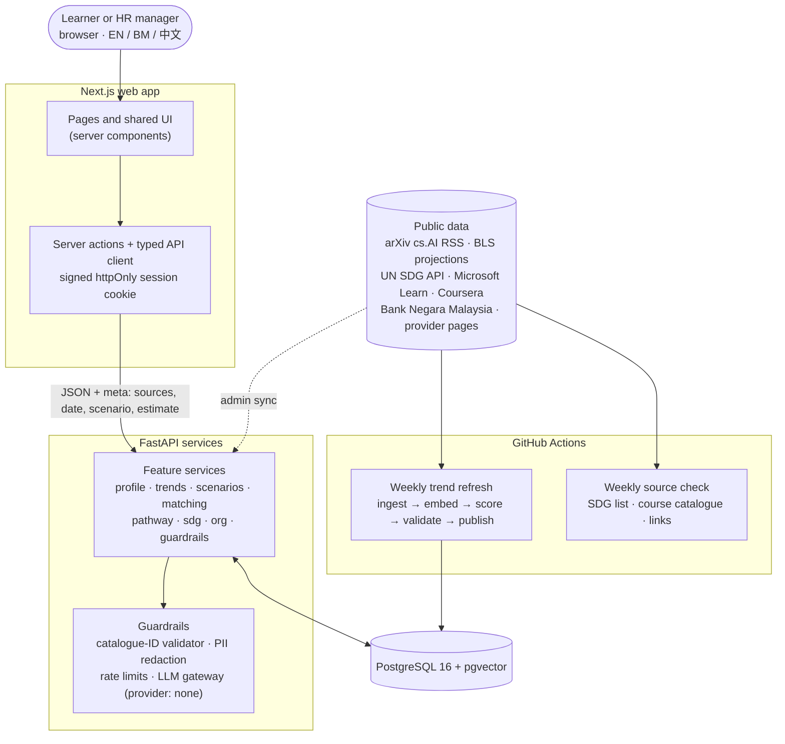

**How the workshop elements connect:**

- **AI component:** an offline sentence-embedding model (not a generative model) (`all-MiniLM-L6-v2`) turns research abstracts into skill signals inside the trend pipeline. A provider interface and validation gateway are built in; only the null provider is implemented (`LLM_PROVIDER=none`). If it is enabled, the model may only select catalogue IDs, which are validated before use.
- **Database architecture:** one PostgreSQL schema with versioned migrations. `pgvector` stores skill embeddings, and typed contracts are generated from Pydantic to TypeScript.
- **Cloud deployment:** containers for web and API, with managed PostgreSQL and scheduled jobs in GitHub Actions (see [§9](#9-design-thinking-and-deployment-strategy)).

**Output contract.** Every response that contains a recommendation, score or trend carries:

```json
{ "sources": [{ "name": "…", "url": "…", "retrieved_at": "YYYY-MM-DD" }],
  "snapshot_date": "YYYY-MM-DD", "observed_from": "YYYY-MM-DD", "observed_to": "YYYY-MM-DD",
  "scenario": "moderate | fast", "is_estimate": true }
```

## 4. Tech stack

| Layer | Technology | Why |
|---|---|---|
| Frontend | Next.js 16 (App Router, server components, server actions), React 19, TypeScript 5.9 (strict), Tailwind CSS 4, lucide-react, next-intl 4 (EN / BM / ZH) | Fast first render, typed end to end, three languages, mobile layout |
| API | FastAPI, Pydantic v2, Uvicorn (Python 3.11) | Explainable logic in small, tested functions; OpenAPI out of the box |
| Contracts | Pydantic → `openapi.json` → `openapi-typescript` → `openapi-fetch` | Frontend and backend cannot drift (`make check` fails on drift) |
| Database | PostgreSQL 16 + pgvector, psycopg 3, SQL migrations (`src/db/migrations`) | Relational core, vectors for skill embeddings, one store for everything |
| Data / ML pipeline | sentence-transformers `all-MiniLM-L6-v2` (offline, CPU), arXiv API, BLS projections, deterministic scoring | Updatable trend signals with no paid API or GPU at request time |
| CV parsing | PyMuPDF (in memory; nothing stored) + skill alias matching against the taxonomy | Skills found only if they exist in the catalogue |
| Auth | Local accounts (scrypt password hashes, signed session tokens); Supabase JWT supported | Real sign-up for individuals and organisations |
| Quality and CI | pytest, ruff, ESLint, `tsc --noEmit`, translation-key parity, contract drift; GitHub Actions | One `make check` gate before every PR |
| Scheduled jobs | GitHub Actions: weekly trend refresh and weekly data-source check | Keeps signals fresh; failed runs publish nothing |

**Sponsor resources:** none are evidenced by the current local configuration. The prototype runs no generative model at request time. Replit and Runpod are hosting candidates in the project plan; the team must confirm actual use and any sponsor entitlement before declaration. See the Phase 2 plan in section 9.

## 5. How it works: flows and sequences

### 5.1 User journey (both modes)

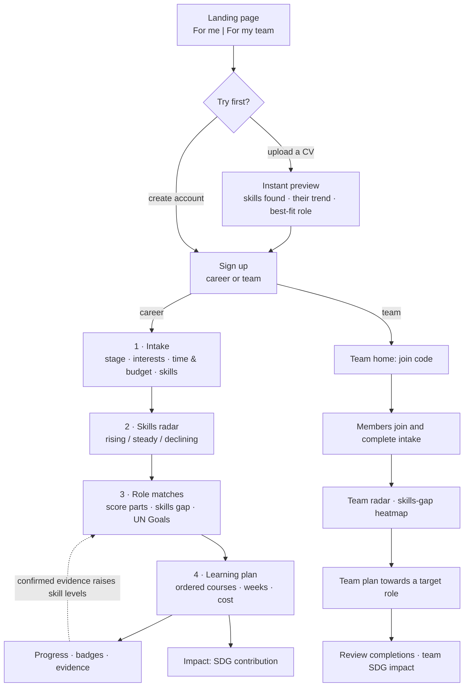

### 5.2 Individual: from CV to a saved plan

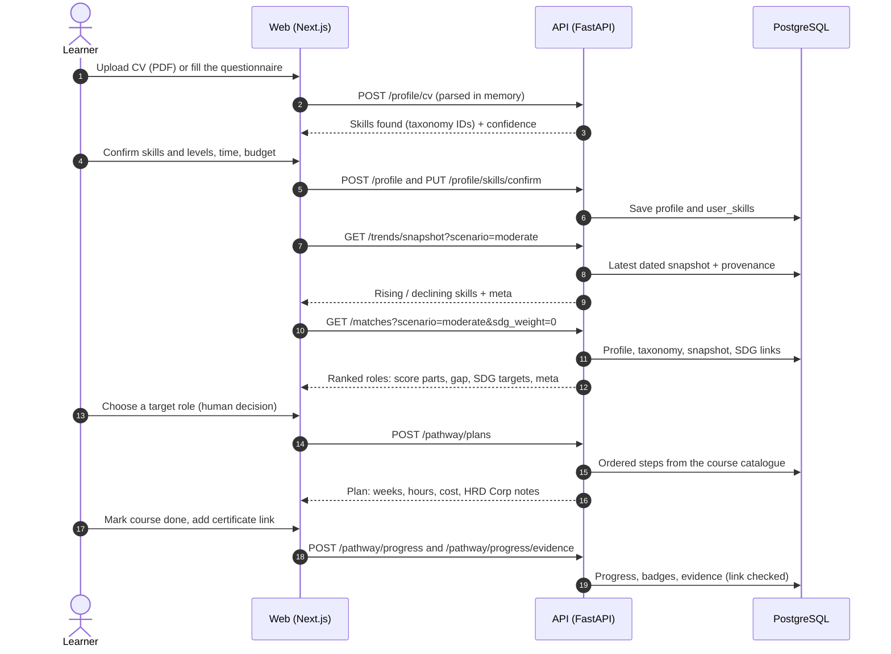

### 5.3 Organisation: from join code to a team plan

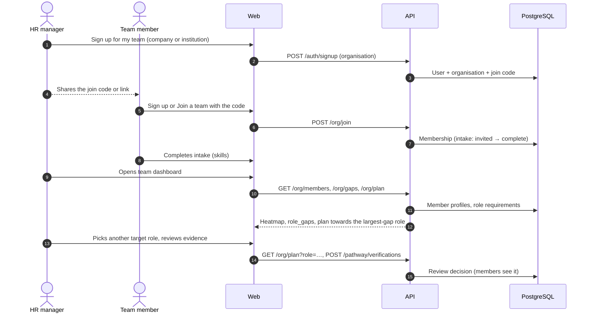

### 5.4 Trend data pipeline (weekly, validated)


## 6. Recommendation logic and graph topology

### 6.1 Explainable match score

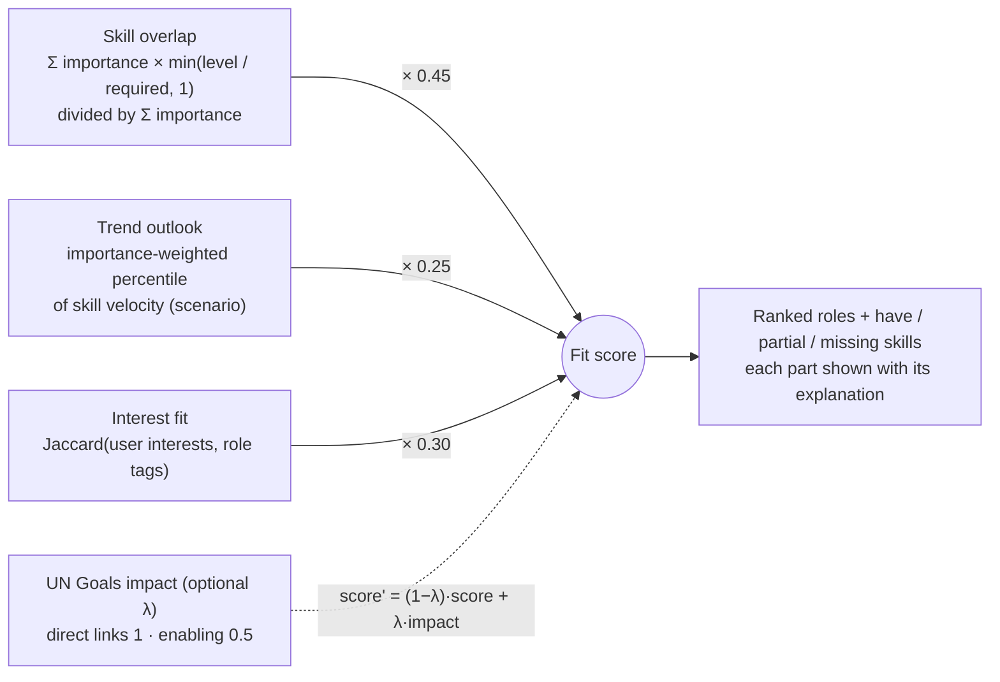

- Protected attributes (age, gender, background) are never read by matching. Counterfactual tests swap personas and require identical results.
- Completed learning can raise a skill's effective matching level when an organisation reviewer confirms it, or when a certificate link passes the provider-page check. That link check confirms reachability and provider domain, not certificate ownership.

### 6.2 Knowledge graph

The catalogue is a graph. Pathways walk it from the learner's skills to a target role.

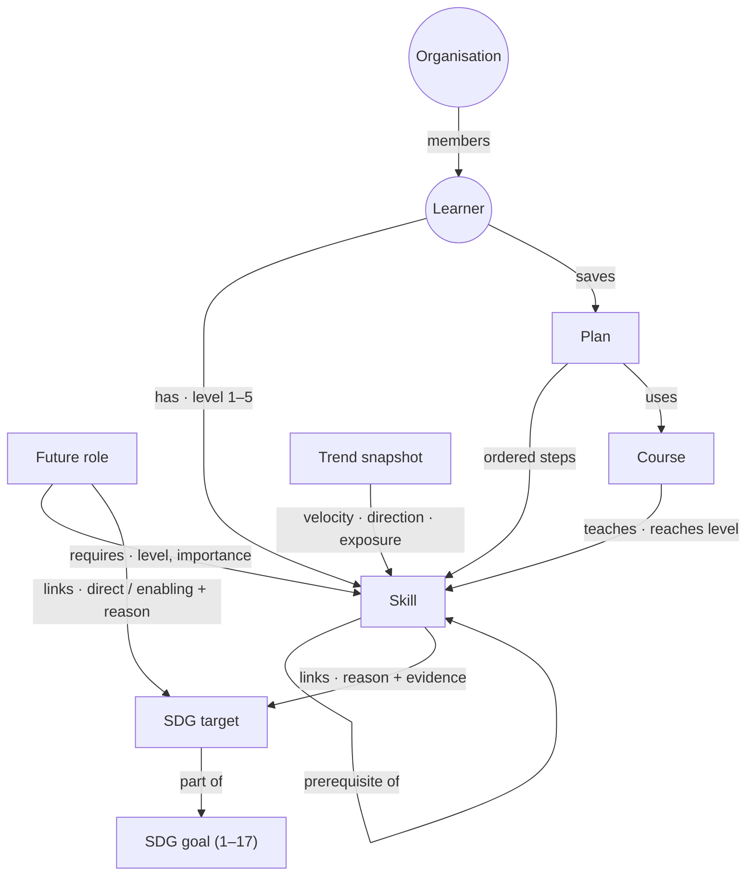

The catalogue holds 7 future roles, 113 skills, 34 sourced courses, and all 17 goals and 169 targets with 140 role and skill links.

## 7. Data model (database schema)

### 7.1 Identity, intake and role requirements

Selected columns from the append-only [SQL migrations](src/db/migrations/), not replacement DDL.
Solid ER relationships below reflect declared foreign keys. Array and JSON references are
explained separately rather than presented as enforced foreign keys.

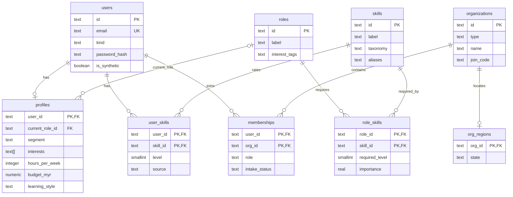

### 7.2 Learning plans and evidence

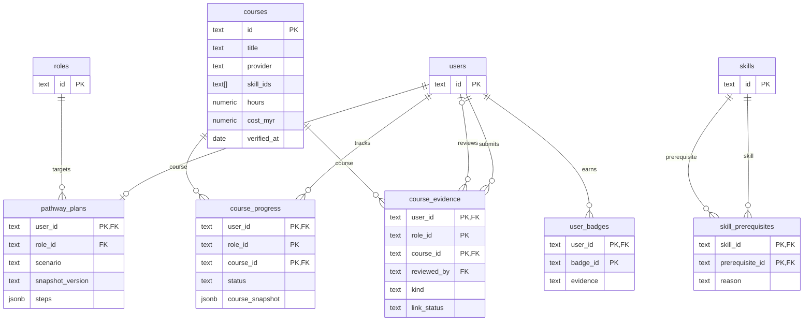

`courses.skill_ids` is an array and `pathway_plans.steps` is JSONB; application logic resolves
those IDs. `role_id` in progress and evidence is part of the composite key, not a declared
foreign key. Evidence has separate submitter and nullable reviewer references to `users`.
`course_progress.course_snapshot` preserves course facts independently of the saved target.
Accepted completions across all targets feed the same effective skill levels to matching,
individual learning plans and team gaps; rejection and undo still revoke that credit.

### 7.3 SDG mappings

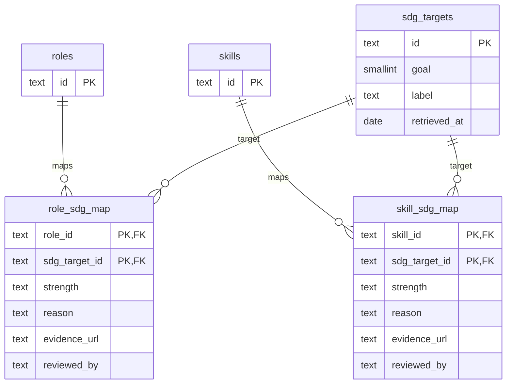

`sdg_targets.goal` resolves to `sdg_goals.id` in application data; the migrations do not
add a foreign-key constraint for it. SDG mapping `reviewed_by` is attribution text,
not an account foreign key. Unreviewed links remain draft mappings.

### 7.4 Trend storage and provenance

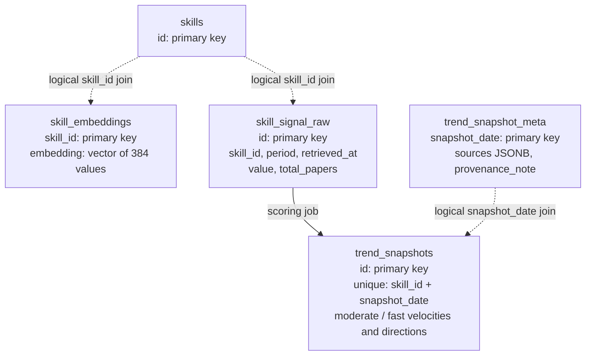

Dotted connections are logical joins, not declared foreign keys. Embeddings, raw signals,
and trend snapshot `skill_id` columns are not constrained to `skills` by the current DDL;
publish-time validation checks taxonomy membership. `trend_snapshot_meta` is joined by date.


The diagram omits some supporting tables:

| Table | Purpose |
|---|---|
| `arxiv_fetch_log` | Audit of each arXiv pull |
| `data_syncs` | Catalogue and SDG sync runs |
| `fx_rates` | Bank Negara Malaysia rates for converting course prices |
| `llm_calls` | Log of LLM gateway calls (empty while `LLM_PROVIDER=none`) |
| `snapshots`, `trend_signals` | Early skeleton tables kept for compatibility |

Migrations are in [`src/db/migrations`](src/db/migrations). New changes always go in a new file.

## 8. Data sources, AI and guardrails

| Source | Type | Used for |
|---|---|---|
| [arXiv API](https://info.arxiv.org/help/api/index.html) (cs.AI) | Public API | Research-attention signal per skill |
| [BLS Employment Projections 2023–2033](https://www.bls.gov/emp/tables/occupational-projections-and-characteristics.htm) | Public dataset | Labour-market baseline per skill |
| [UN SDG API](https://unstats.un.org/SDGAPI/v1/sdg/Goal/List) | Public API | Official 17 goals and 169 targets |
| [Microsoft Learn Catalog API](https://learn.microsoft.com/en-us/training/support/catalog-api) | Public API | Free courses (title, URL, duration) |
| Coursera catalogue API and course pages | Public API / pages | Course availability and pricing checks |
| [Bank Negara Malaysia OpenAPI](https://api.bnm.gov.my/) | Public API | Exchange rates for course prices |
| Provider and university course pages (FMM, MAICSA, UKM, UNIMAS and others) | Verified public pages | HRD Corp-claimable and local courses, with the date checked |
| Adept SDG mapping | Curated (draft, pending human review) | Role and skill → SDG target links with reason and evidence |
| Synthetic personas, teams and CVs | Synthetic | Tests, evaluation and the demo (no real people) |

**AI disclosure:**

- **No generative model runs in the app** (`LLM_PROVIDER=none`). Scores, plans and SDG links come from deterministic, explainable rules over the catalogue.
- **The only model is offline:** `sentence-transformers/all-MiniLM-L6-v2` is used inside the trend pipeline to relate research text to skill labels.
- **If an LLM is ever enabled**, it goes through the F8 gateway (`src/api/app/core/llm/`). The gateway:
  - lets the model only select IDs we supply, and rejects any unknown ID;
  - redacts personal data and filters prompt-injection text;
  - falls back to the rules when the model is unavailable;
  - logs every call.

  `/about` shows the provider and model live.

**Guardrails:**

- Recommendations cite a source and date.
- Predictions are labelled estimates.
- Trend data shows the period it actually measured.
- Nothing invents jobs, courses or statistics: everything comes from the catalogue or a cited source.
- Matching excludes protected attributes and is covered by counterfactual tests.
- The learner chooses the target role; nothing is applied without their acceptance, and re-planning is proposed, not forced.

## 9. Design thinking and deployment strategy

**Design-thinking process** (≤ 200 words, for proposal §3.2):

> **Empathise.** We started from four people the handbook names: Aisyah, a bank operations executive facing
> automation; Wei Jie, a fresh IT graduate; Ravi, a logistics supervisor switching careers; and an HR manager
> planning a team. Their shared moment of need: *"Which skills should I build next, and is it worth it?"*
> **Define.** A useful answer must be explainable, current and costed, so every result shows its parts, source,
> date and an estimate label. **Ideate.** One engine, two modes (individual and team), with the human always
> choosing the target role. **Prototype.** We built thin end-to-end slices first (intake → radar → matches →
> plan), then added the team view, SDG links and scenarios, on real sourced data and synthetic personas.
> **Test.** Automated API and pipeline tests, matching evaluation on labelled personas, counterfactual fairness tests and
> repeated UI reviews at desktop and phone widths drove each iteration. **Deployment readiness.** Typed
> contracts, versioned database migrations, a single quality gate in CI, three languages, and a weekly
> trend-refresh job that never publishes an invalid snapshot make the prototype ready to host for Phase 2.

**Phase 2 deployment plan** (planned, not yet live):

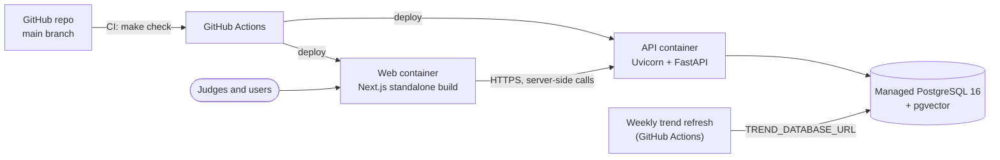

- **Hosting:** Candidates in the team plan are Replit, or Vercel for the web and Render for the API, with Supabase PostgreSQL and pgvector. These are planned options, not evidence of a deployed service or sponsor-credit usage. CI currently validates builds; no automatic deployment workflow is implemented.
- **Configuration:** set `SESSION_SECRET`, `DATABASE_URL`, `AUTH_MODE`, `CORS_ORIGINS` and `API_URL` in the host; add the `TREND_DATABASE_URL` repository secret for the weekly refresh. No secrets are committed; [`.env.example`](.env.example) lists every variable.

## 10. SDG impact framework

This is draft material for proposal §4. Numbers marked *proposed* are targets, not results.

| Field | Draft answer |
|---|---|
| Target SDG sub-targets | **4.4**: increase the number of youth and adults with relevant skills, including technical and vocational skills, for employment and decent jobs. **8.5**: full and productive employment and decent work for all. Supporting: 4.3 (affordable technical and vocational training) and 8.2 (productivity through innovation). |
| Current problem baseline | Hays' 2025 Malaysia findings report 56% AI use and 26% training: a 30 percentage-point difference between reported shares. This is historical survey context, not a measured Adept outcome. [Primary source](https://www.hays.com.my/press-release/content/future-of-work-malaysia-technology-ai-impact). |
| Core measurable KPI | Median time from first visit to a saved, sourced learning plan for a target role, measured on matched fictional cases against a static course-catalogue workflow; also the share of plans whose every step has a source and date (a proposed 100% validity requirement). |
| Phase 2 impact target | *Proposed:* at least 20% lower median time to a valid, evidence-supported plan than the static-catalogue baseline, with no drop in the share of valid plans. The baseline will be measured before Phase 2. |

We don't claim job placements, income gains or national outcomes from the prototype.

## 11. Third-party code, datasets and models

| Type | Name | License | Purpose |
|---|---|---|---|
| Code | Next.js 16, React 19 | MIT | Web framework and UI |
| Code | TypeScript 5.9 | Apache-2.0 | Typed frontend |
| Code | Tailwind CSS 4 | MIT | Styling |
| Code | next-intl 4 | MIT | EN / BM / ZH translations |
| Code | lucide-react | ISC | Icons |
| Code | Inter (via @fontsource-variable/inter) | SIL OFL 1.1 (font), MIT (package) | Installed dependency; not loaded (the UI uses Arial) |
| Code | openapi-fetch, openapi-typescript | MIT | Typed API client generated from the contract |
| Code | class-variance-authority, clsx, tailwind-merge | Apache-2.0 / MIT / MIT | Component class helpers |
| Code | FastAPI, Pydantic v2, pydantic-settings | MIT | API and contracts |
| Code | Uvicorn | BSD-3-Clause | ASGI server |
| Code | psycopg 3, psycopg-pool | LGPL-3.0 | PostgreSQL driver |
| Code | PyJWT | MIT | Supabase token verification |
| Code | PyMuPDF | [AGPL-3.0 or commercial](https://pymupdf.readthedocs.io/en/latest/about.html#license-and-copyright) | In-memory CV text extraction; licence to be reconciled before a commercial deployment |
| Code | PostgreSQL 16, pgvector | PostgreSQL License | Database and vector storage |
| Code | sentence-transformers, PyTorch (pipeline only) | Apache-2.0, BSD-3-Clause | Offline embeddings in the trend job |
| Code | pytest, ruff, ESLint | MIT | Testing and linting |
| Model | sentence-transformers/all-MiniLM-L6-v2 | [Apache-2.0](https://huggingface.co/sentence-transformers/all-MiniLM-L6-v2) | Pre-trained sentence embeddings (not fine-tuned) |
| Dataset | arXiv API metadata (cs.AI) | [arXiv API terms](https://info.arxiv.org/help/api/tou.html); article licences vary | Research signal |
| Dataset | BLS Employment Projections 2023–2033 | US public domain | Labour baseline |
| Dataset | UN SDG API (goals, targets) | UN data terms (free use with attribution) | SDG goals and targets |
| Dataset | Microsoft Learn Catalog API | Microsoft APIs terms of use | Course catalogue |
| Dataset | Bank Negara Malaysia OpenAPI | BNM terms of use | Exchange rates |
| Dataset | Course and provider pages (Coursera, FMM, MAICSA, UKM, UNIMAS, others) | Cited facts, linked to source | Course facts and HRD Corp status |
| Dataset | Synthetic personas, teams, CVs | Created by the team | Tests, evaluation, demo |

## 12. Getting started

### Prerequisites

- Python 3.11 and [uv](https://docs.astral.sh/uv/) (uv can install Python 3.11 for you)
- Node.js 20+ (pnpm runs through `npx` if it isn't installed)
- Docker Desktop, for PostgreSQL 16 + pgvector on host port 5433
- GNU Make (optional). On Windows without make, run `uv run --no-project python src/scripts/dev.py <target>` with the same target names.

### Run the complete Docker stack

```bash
docker compose -p adept up -d --build --wait
```

This starts `adept-web-1`, `adept-api-1` and `adept-db-1` together, applies migrations
and loads seed data. Web: <http://localhost:3000>; API docs: <http://localhost:8000/docs>;
PostgreSQL: `localhost:5433`. Stop with `docker compose -p adept down`; volumes are retained.

### Run it locally for development

```bash
make setup
```

```bash
make dev
```

`make setup` creates `.env` from `.env.example`, creates `.venv`, installs Python and web dependencies, starts the database, and applies migrations and seed data. `make dev` starts the API at <http://localhost:8000/docs> and the web app at <http://localhost:3000>.

### Try the demo (synthetic data only)

1. Open <http://localhost:3000>. On the landing page, upload a synthetic CV for an instant preview (skills found, their trend, best-fit role). Sample CVs are in [`tests/api/profile/fixtures/cvs/`](tests/api/profile/fixtures/cvs/):
   - `cv_aisyah.pdf` (bank operations)
   - `cv_weijie.pdf` (IT graduate)
   - `cv_ravi.pdf` (logistics, career switcher)
2. **Create account → For my career** with a synthetic email (for example `aisyah@example.test`). Then:
   1. complete the intake;
   2. open **Radar**;
   3. open **Roles**: try the AI-pace switch, the UN Goals slider and an older snapshot;
   4. choose a role and save the plan;
   5. mark a course done on **Progress**.
3. **Create account → For my team** (a separate synthetic account). Copy the join code from the dashboard. Sign in as the learner, use **Join a team**, then return to the team account to see the heatmap, team plan and impact.

Use Ravi to show a rank-order change between the 2026-10-13 and 2026-10-20 snapshots. Those snapshots replay October 2024 research windows, and the app labels them as historical data.

### Configuration

All variables are documented in [`.env.example`](.env.example). These matter most:

| Variable | Default | Notes |
|---|---|---|
| `DATABASE_URL` | local Docker database | PostgreSQL with pgvector |
| `AUTH_MODE` | `demo` | Local accounts; `supabase` verifies Supabase JWTs |
| `SESSION_SECRET` | empty | Set in production; locally a random key is kept in `.session-secret` (gitignored) |
| `LLM_PROVIDER` | `none` | No generative model is called |
| `API_URL` | `http://localhost:8000` | Where the web server calls the API |

## 13. Development, testing and CI

| Command | What it does |
|---|---|
| `make check` | Quality gate: ruff, ESLint, translation-key parity, pytest, `tsc --noEmit`, contract drift |
| `make test` | pytest over `tests/` (see the latest run for counts) |
| `make contracts` | Regenerate `src/api/openapi.json` and `src/web/src/lib/api/types.ts` |
| `make db-up` / `make db-down` | Start / stop PostgreSQL + pgvector |
| `make db-migrate` / `make seed` | Apply migrations / load reference data |
| `PYTHONPATH=src/api:src python -m pipelines.trends.run --dry-run` | Validate a trend refresh without publishing |

**GitHub Actions:**

- `ci.yml` runs the backend, frontend, contract and database jobs on every PR.
- `trends-refresh.yml` runs the weekly trend refresh when `TREND_DATABASE_URL` is set.
- `data-sources.yml` runs a weekly check that the public sources still answer.

## 14. Repository layout and team

The root layout is set by the hackathon committee.

```
docs/                 project context, team rules, tasks, decisions log, submission drafts
src/api/              FastAPI app: core/ (config, auth, security, llm gateway), contracts/, features/<f>/
src/web/              Next.js app: src/app (routes), src/features/<f>, src/components, messages/<locale>
src/pipelines/<f>/    offline data jobs (trends, matching, sdg, pathway)
src/db/               migrations/ (timestamped SQL), migrate.py, seed.py
src/data/seed/<f>/    reference and synthetic seed data
tests/                api/<feature>/ and pipelines/<feature>/ tests, synthetic CV fixtures
submission/           proposal, pitch deck, demo video link
```

| Feature | Owner | Code |
|---|---|---|
| F1 Skills profile intake | M2 | `profile` |
| F2 AI-trend signal layer | M1 | `trends`, `src/pipelines/trends` |
| F3 Scenarios and uncertainty | M1 | `scenarios` |
| F4 Future-role matching | M2 | `matching`, `src/pipelines/matching` |
| F5 Reskilling pathway | M3 | `pathway`, `src/pipelines/pathway` |
| F6 SDG mapping | M3 | `sdg`, `src/pipelines/sdg` |
| F7 Organisation mode | M4 | `org` |
| F8 Guardrails and transparency | M3 | `guardrails`, `src/api/app/core/{llm,security}` |
| Core | M4 | shell, shared UI, auth, `src/web/src/features/core` |

**Further reading:**

- [docs/PROJECT_CONTEXT.md](docs/PROJECT_CONTEXT.md): the brief
- [docs/SOLUTION_DESIGN.md](docs/SOLUTION_DESIGN.md): the solution design
- [docs/architecture.md](docs/architecture.md): architecture notes
- [docs/decisions.md](docs/decisions.md): decisions log
- [docs/FEATURE_STATUS_AND_FIX_HANDOFF.md](docs/FEATURE_STATUS_AND_FIX_HANDOFF.md): feature status

Licence: Apache License 2.0, see [LICENSE](LICENSE).
