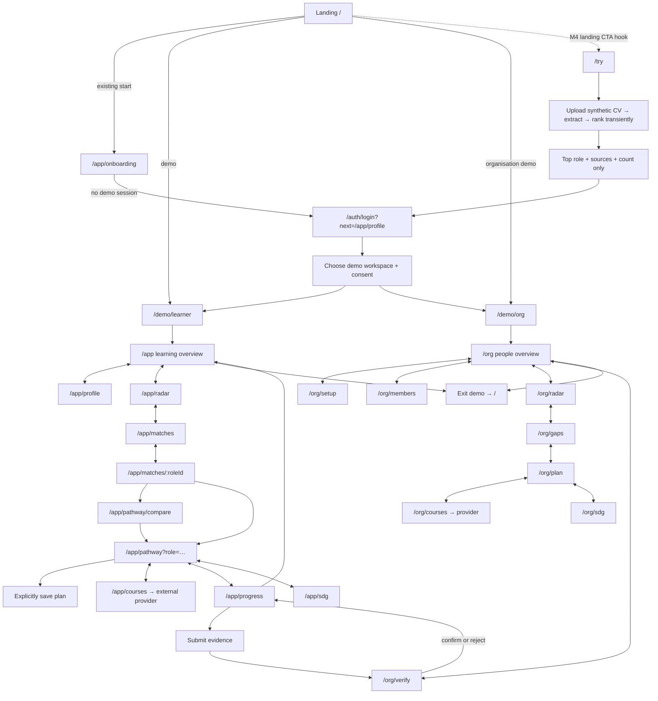
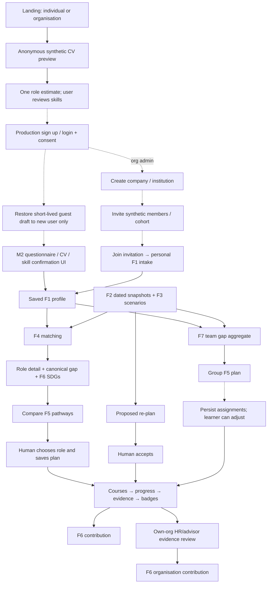

# M3 / Core workspace handoff

Branch: `feat/core-m3-workspace-navigation`, based on M2 remote commit `1839426`.
The original checkout was fast-forwarded after preserving its untracked revision-3
`uv.lock` in the user's temporary directory. Upstream already tracks revision 5.

## Run

## Verification

- Python suite in database-free mode: 539 passed, 21 skipped (live database and
  external-source checks). Lint, strict TypeScript and translation-key parity pass.
- Four navigation tests cover context propagation and safe return URL boundaries:
  `node --experimental-strip-types --test tests/web-navigation.test.ts` (Node 22.18+).
- `python src/scripts/smoke_workspace.py` checks 20 workspace routes, public pages,
  anonymous deep-link routing, synthetic guest upload, and cross-origin rejection.
- Browser verified: choose role → saved pathway → complete course → progress,
  activity points and badge; HR overview → heatmap → selected group plan; synthetic
  PDF → top-one guest preview; mobile preview has no horizontal page overflow.
- Fresh Compose database runs eight migrations and seeds successfully. The existing
  team's database is left untouched; verification uses project `adept-m3` and host
  PostgreSQL port 55433.

## Docker startup

```sh
docker compose up --build
```

Open http://localhost:3000. API docs: http://localhost:8000/docs.
Compose starts PostgreSQL, waits for it, runs append-only migrations and idempotent
seed insertion, starts the API, then starts the production Next.js server.
M3 plans/progress/evidence use PostgreSQL and survive container recreation.
M1's existing dated offline fixtures remain available when its live tables are empty.
Do not run `docker compose down -v` unless you intend to erase demo progress.
Local defaults are synthetic demo credentials, bound to loopback, not a hosted deployment.
An existing malformed root `.env` must be corrected before Compose can read the file.

## Entry points

- `/try`: anonymous synthetic PDF/text upload with explicit consent, 5 MB cap,
  pending/error/empty/truncated states and server-side top-one response.
- `/auth/login?mode=individual&next=/app/pathway`: explicit demo entry with safe
  same-mode return URL. Signup/consent/join explain their current demo scope.
- `/app`: individual learning dashboard; real saved-plan progress and badges.
- `/org`: HR/cohort dashboard; counts from the existing member API.
- `/journey`: clickable route atlas, also linked from both workspace sidebars.

Landing remains owned by M4. Its future primary "Try a synthetic CV" button should
link to `/try`. This branch does not modify landing code.

## Current implemented navigation



## Intended full account journey and outstanding ownership

Dotted edges below describe planned integration, not implemented capabilities.



## Back, next and state rules

| Surface         | Back / previous            | Next / action                           | State                                               |
| --------------- | -------------------------- | --------------------------------------- | --------------------------------------------------- |
| Guest preview   | Landing                    | Demo entry, then profile                | Raw upload never persisted                          |
| Auth            | Landing or preview link    | Allowlisted `/app/*` or `/org/*` target | No external/open redirect                           |
| Dashboard       | Overview                   | Sidebar or feature card                 | URL scenario, role, snapshot                        |
| Profile         | Onboarding                 | Radar                                   | Saved F1 profile, owned by M2                       |
| Radar           | Profile / members          | Matches / team gaps                     | Existing M1 feature owns snapshot consumption       |
| Match detail    | Matches                    | Pathway / compare                       | Role ID must survive link                           |
| Pathway compare | Pathway                    | Preview selected role, then save        | Scenario plus selected role                         |
| Pathway         | Matches                    | Progress                                | Browser history remains native                      |
| Course library  | Overview                   | Provider in a new tab                   | Filters local to library; context should be carried |
| Progress        | Pathway                    | SDG contribution                        | API-owned progress and evidence                     |
| Evidence review | Group plan                 | Organisation SDGs                       | Existing API validates own-org reviewer             |
| SDG             | Progress / evidence review | Overview                                | F6 attribution retained                             |

"Previous step" is the deterministic journey parent, not a disguised history-back button.
Browser Back uses actual history. Neither control claims to recover unsaved M2 forms.
Sidebar and journey controls preserve `role`, `scenario`, `snapshot_date`.
Preserving a date in a URL alone does not make M1/M2 pages support replay.
No snapshot selector is added until their API/UI handoff is wired consistently.

## Integration boundaries

- M1 and M2 owned code is unchanged. Guest adapter imports M2's public
  `extract_cv`, `load_roles`, `rank_roles`, and bounded `fetch_snapshot`.
- No copied scoring formula. Anonymous ranking uses extracted, unconfirmed skills
  and missing-interest neutral contribution from M2; it is labelled preliminary.
- Guest response includes no full ranking, role detail, gap breakdown, or raw CV.
  This is a restricted preview response, not a production paywall: demo mode is public.
- No anonymous profile is written into Aisyah or any other existing account.
  Production guest-to-account draft claiming needs a signed, expiring token and F1
  confirmation; it is deliberately shown as pending rather than faked.
- Existing F1/F4 web components remain M2's responsibility; organisation creation,
  invitations, membership writes and learning assignments are pending backend work.
- Demo mode layouts guide learners/admins into their correct workspace.
  Production Supabase login/session handling is not completed by this branch.
- The source/date/estimate bar remains visible. Course and SDG catalogue records
  still determine recommendations; no invented course or role is added.
- Activity reward: 100 points per completed unique plan course; one level per 500.
  Points are recomputed from current progress, not a durable currency. Undoing a
  completion reverses points. Badges retain self-report/certificate/org evidence.
- New workspace copy uses English fallback in MS/ZH files pending human translation;
  existing feature translations and key parity are retained.
