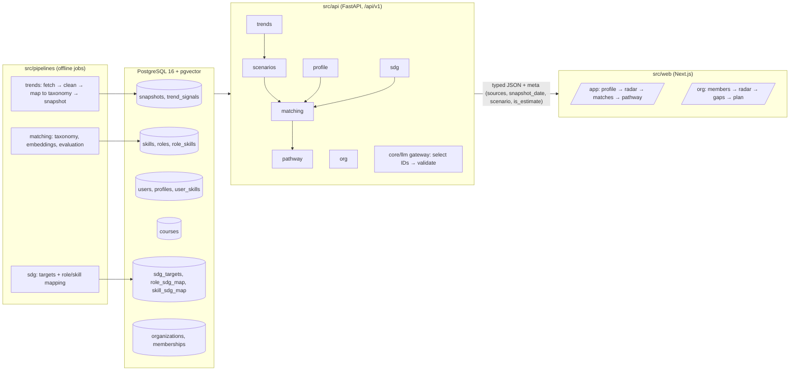

# Architecture

## System flow

1. **Profile (F1)**: questionnaire or CV upload → skills normalised to taxonomy IDs → user confirms.
2. **Trends (F2)**: pipelines store dated, versioned snapshots; the radar reads the latest one.
3. **Scenarios (F3)**: each role gets an outlook with low/high range under *moderate* and *fast*.
4. **Matching (F4)**: score = Σ weight × value over components (skill overlap, trend outlook,
   interest fit); shown as parts, with have / partial / missing skills.
5. **Pathway (F5)**: ordered steps from the course catalogue, weeks from hours per week.
6. **SDG (F6)**: every role and skill links to ≥1 SDG target with a one-line reason.
7. **Organisation (F7)**: aggregates of the same engine for a team or cohort.
8. **Guardrails (F8)**: an LLM, if used, only selects IDs already in the database; `validate_ids`
   rejects anything else before it reaches the user.

## Output contract

Every response with a recommendation, score or trend carries `meta`:
`{sources: [{name, url, retrieved_at}], snapshot_date, scenario, is_estimate}`
(`src/api/app/contracts/common.py`). The web renders it with `MetaBar` (EstimateLabel + SourceBadge).

## Contracts pipeline

Pydantic models (`src/api/app/contracts/`) → `src/api/openapi.json` → `openapi-typescript` →
`src/web/src/lib/api/types.ts` → `openapi-fetch` client (`src/web/src/lib/api/`). `make check`
regenerates both files and fails if they differ from what is committed.

## Anti-conflict mechanisms

- API routers are auto-discovered from `src/api/app/features/*/router.py`; nobody edits `main.py`.
- Each feature owns its folders: API feature, web feature, contracts file, translation
  namespace (`messages/<locale>/<feature>.json`), seed folder, pipeline folder, tests folder.
- Page files under `src/web/src/app` are thin and only render a feature component.
- Shared UI lives only in `src/web/src/components`; navigation in `src/web/src/config/navigation.ts`.
- Seed loader is generic (CSV name = table name), so seed data never needs code changes.
- Migrations are new timestamped files only.

## Auth

`AUTH_MODE=demo`: `/demo/learner` and `/demo/org` set an `adept_demo` cookie (persona `aisyah`
or `demo-company`); the web forwards it to the API as `X-Demo-User`. `AUTH_MODE=supabase` is
reserved for the deployed environment and not implemented yet.

## Scenario and locale state

- Scenario: URL query `?scenario=moderate|fast`, set by `ScenarioToggle`, read by every page.
- Locale: `NEXT_LOCALE` cookie (en, ms, zh), set by `LocaleSwitcher`; no locale prefix in URLs.
