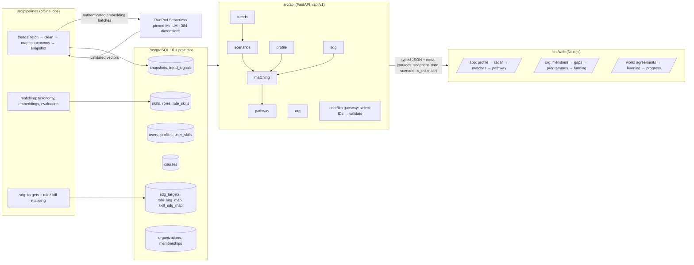

# Architecture

## System flow

1. **Profile (F1)**: questionnaire or CV upload → skills normalised to taxonomy IDs → user confirms.
2. **Trends (F2)**: pipelines store dated, versioned snapshots; the radar reads the latest one.
3. **Scenarios (F3)**: each role gets an outlook with low/high range under *moderate* and *fast*.
4. **Matching (F4)**: score = Σ weight × value over components (skill overlap, trend outlook,
   interest fit); shown as parts, with have / partial / missing skills.
5. **Pathway (F5)**: ordered steps from the course catalogue, weeks from hours per week.
6. **SDG (F6)**: every role and skill links to ≥1 SDG target with a one-line reason.
7. **Organisation (F7)**: aggregates of the same engine for a team or cohort.
8. **Guardrails (F8)**: an LLM, if used, only selects IDs already in the database; `validate_ids`
   rejects anything else before it reaches the user.

## Public server and root deployment

The root `.replit` builds and starts through `src/scripts/replit.py`. Next.js is the
only public HTTP listener (`0.0.0.0:3000`, mapped to external port 80). Its route
handlers forward `/api/v1/*` to FastAPI bound to `127.0.0.1:8000`; server actions
use that same private API. `/api/healthz` and `/api/v1` check API/database readiness
and return 503 while unavailable. The supervisor validates production secrets,
waits for API readiness and stops both processes if either exits.

Production startup does not migrate, seed or invoke models. CI exercises the exact
root build and supervised startup against disposable PostgreSQL. Local Compose
provides only the database. Product code stays under `src/`; artifact metadata,
the Express supervisor, Drizzle scaffold and mockup app are no longer needed.
See [Replit operations](../replit.md) for required configuration and saved-command
overrides to check before publishing.

## Workspace and assistant boundaries

Every account has a personal workspace. `X-Workspace` selects a membership-checked
organisation workspace for programme progress, evidence and funding. Employee `/work`
views and manager `/org` views share services; private personal plans and assistant
conversations remain separate.

Adi uses Runpod `glm-5.3` as the configured primary and separately authenticated Gemini
only on primary failure. Catalogue IDs pass through the validation gateway; provider
failure can fall back to the deterministic guide. Keys stay in server environment variables.
See [configuration](../README.md#getting-started) and the
[provider guide](../src/api/app/core/llm/FEATURE.md).

## Hosted trend inference and scheduled publication

MiniLM is deployed at `https://api.runpod.ai/v2/ta14jd0by2ijl2` using the public image
`ghcr.io/pecel-lelele/adept-minilm:latest`. The queue-based worker contains the pinned
model weights, loads them offline and returns 384-dimensional embeddings. It does not
connect to the database. Adi's GLM endpoint and Gemini CV embeddings are separate services.

GitHub Actions separates CI checks, upstream source audits, worker image publication and
trend refresh. The refresh runs Mondays at 03:41 UTC or by manual dispatch. It verifies
database access before ingestion or paid inference, then scores, validates and atomically
writes `trend_snapshots` and `trend_snapshot_meta`. Missing settings skip the refresh
with a notice, so a green run alone does not establish publication.

The refresh maps repository secret `TREND_DATABASE_URL` to process `DATABASE_URL` and
uses secret `TRENDS_RUNPOD_API_KEY` plus variable `TRENDS_RUNPOD_ENDPOINT_ID`.
Replit's published API must read that same production database. The development hostname
`helium` is private to Replit; the first integrated refresh failed saving there despite
successful embedding work. Publishing Replit creates a separate production database.

The live inference test passed on 24 October 2026. This does not establish fresh two-week
research history, sufficient skill coverage or a published snapshot. Page requests serve
stored snapshots without MiniLM inference. Demo-enabled reads can use labelled fixtures
when database snapshots are unavailable; strict production reads fail instead. See the
[operations guide](../src/pipelines/trends/runpod/DEPLOYMENT_HANDOFF.md).

## Output contract

Every response with a recommendation, score or trend carries `meta`:
`{sources: [{name, url, retrieved_at}], snapshot_date, scenario, is_estimate}`
(`src/api/app/contracts/common.py`). The web renders it with `MetaBar` (EstimateLabel + SourceBadge).

## Contracts pipeline

Pydantic models (`src/api/app/contracts/`) → `src/api/openapi.json` → `openapi-typescript` →
`src/web/src/lib/api/types.ts` → `openapi-fetch` client (`src/web/src/lib/api/`). `make check`
regenerates both files and fails if they differ from what is committed.

## Anti-conflict mechanisms

- API routers are auto-discovered from `src/api/app/features/*/router.py`; nobody edits `main.py`.
- Each feature owns its folders: API feature, web feature, contracts file, translation
  namespace (`messages/<locale>/<feature>.json`), seed folder, pipeline folder, tests folder.
- Page files under `src/web/src/app` are thin and only render a feature component.
- Shared UI lives only in `src/web/src/components`; navigation in `src/web/src/config/navigation.ts`.
- Seed loading uses explicit reference-table specifications and dependency-ordered upserts;
  local accounts and test-persona fixtures are not overwritten by reference refreshes.
- Migrations are new timestamped files only.

## Auth

`AUTH_MODE=demo` (local accounts): `POST /auth/signup` and `/auth/login` return a signed session
token (scrypt password hashes in `users`); the web keeps it in the httpOnly `adept_session` cookie
and forwards it to the API as `X-Demo-User`. `AUTH_MODE=supabase` verifies bearer tokens with the configured JWT verifier;
the local Compose environment uses local accounts.

## Scenario and locale state

- Scenario: URL query `?scenario=moderate|fast`, set by `ScenarioToggle`, read by every page.
- Locale: `NEXT_LOCALE` cookie (en, ms, zh), set by `LocaleSwitcher`; no locale prefix in URLs.
