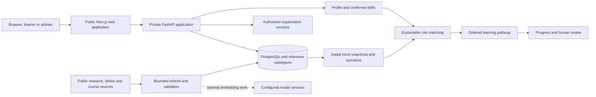

# Adept final-round pitch and PRD plan

Prepared from the repository and working tree inspected on 31 October 2026. Intended presentation milestone: 1 November 2026. This is an authoring plan, not a completed slide deck, commercial forecast, or verification of a 1 November deployment.

## 1. The product definition and central argument

**Adept helps people and organisations decide which skills to build next, why those skills matter, and how to learn them within their time and budget.**

Longer product definition: Adept is a career and workforce reskilling decision-support platform. It combines confirmed skill levels, dated AI and labour signals, explainable role matching, and ordered learning plans. Individuals use it to choose their next step; career centres and HR/L&D teams use the same engine to guide cohorts and review learning programmes.

What it is trying to solve: people and advisers face a fragmented decision between understanding current capability, interpreting changing skill demand, selecting a suitable role, and finding a feasible learning plan. Adept can support those decisions; it cannot create jobs, guarantee placement, certify competence from self-ratings, or independently solve national underemployment.

Pitch question: **Why should a customer adopt and pay for Adept?**

PRD question: **What product have we built, what improved since the preliminary round, and what evidence and engineering are needed to deliver it sustainably?**

The pitch communicates customer value, market entry, economics and the next investment decision. The PRD explains journeys, requirements, architecture, methods, feasibility, implementation and commercial dependencies. Give a CEO the value of a capability; put the code and formulas in the PRD.

## 2. Evidence rules for both deliverables

Use four explicit labels throughout the authoring notes:

| Label | Meaning | Example |
| --- | --- | --- |
| External statistic | A dated, sourced observation or forecast from another organisation | DOSM 2024 graduate underemployment; WEF employer expectations for 2030 |
| Implemented | Present in inspected source or a specifically recorded verification | Guest skill confirmation; ordered course plans; browser-tested signup handoff |
| Pilot target | An outcome Adept intends to test, not a result | At least 20% less time to a valid plan |
| Planning assumption | A hypothetical input to a market, pricing, budget or ROI model | RM12,000 annual campus subscription |

Do not turn implementation coverage, catalogue rows or software test counts into people impacted. Do not label an invented impact number as “estimated” without a model, inputs and a measurement plan.

The repository's human KPI evidence still records **zero attempted human trials**, zero valid matched pairs and null planning-time reduction. Its separate 15 completed synthetic API journeys are automated functional/timing evidence, not 15 users and not proof of human speed-up. The existing reduction target is **20%**; keep it consistent rather than casually replacing it with 50% or 80%.

Latest checks recorded in this session: 1,985 Python tests passed, 50 skipped, 129 web tests passed; four desktop/mobile browser tests passed for guest rating and PDF/signup/onboarding flows. These establish specific functional evidence, not production scale, customer traction or employability outcomes. Recheck counts against the final submitted revision.

## 3. Pitch deck: 15 slides including cover and closing

Timing assumption for drafting: approximately five minutes of narration, with a separate optional 60–90 second demo. The actual final-round speaking/demo allowance must be confirmed before locking the script. Do not inherit an old preliminary timing requirement without checking it.

### Slide 1 — Adept: know what to learn next

**Purpose:** make “what is Adept?” immediately understandable.

On-slide copy:
- Career and workforce reskilling guidance
- Know your skills. Choose a role. Build a plan.

Visual/layout: logo in the top-left; large product statement across the left two-thirds; a simple Skills → Role → Learning plan strip along the bottom. One genuine product screenshot crop on the right if available. Team Pecel Lele in a small footer. No stack logos.

Narration: “Adept helps people and organisations decide which skills to build next. It connects what someone can do today to a suitable future role and a learning plan they can actually follow.”

### Slide 2 — 1.60 million employed graduates work below their qualifications

**Purpose:** establish the Malaysian problem with one clear statistic.

On-slide copy:
- **1.60M** employed graduates
- **32.2%** in skill-related underemployment
- Malaysia, 2024

Visual/layout: 1.60M takes roughly half the slide. Beside it, a 100-person grid with 32 people highlighted; label 32.2% precisely so the whole-person illustration is visibly rounded. These are two expressions of the same problem, not two separate populations.

Narration: “The issue is more than getting any job. DOSM reports that 1.60 million employed graduates worked below their qualification level in 2024. Adept addresses the skills and planning decisions within that larger structural problem.”

Source: [DOSM, Graduates Statistics 2024, published 31 October 2025, pages 2–3](https://www.dosm.gov.my/uploads/release-content/file_20260401145140.pdf). Do not call this unemployment, all Malaysian workers, or evidence that AI caused the mismatch.

### Slide 3 — Skills are changing while people are choosing what to learn

**Purpose:** explain why a one-off assessment is insufficient.

On-slide copy:
- **39%** of existing skills expected to change or become outdated
- **59 / 100** workers expected to need training
- Global employer outlook, 2025–2030

Visual/layout: two large figures, with a 100-unit training graphic for 59/100. One short bridge sentence: “Plans need to adapt as skill demand changes.” Avoid an invented exponential AI adoption graph.

Narration: “The World Economic Forum's employer survey expects substantial skill change by 2030. The opportunity is not another static course list. It is helping people revisit their choices as evidence changes.”

Source: [WEF, Future of Jobs Report 2025, key findings](https://www.weforum.org/publications/the-future-of-jobs-report-2025). These are global expectations across multiple drivers, not Malaysia-only observations or AI-only effects.

### Slide 4 — The hardest step is connecting the decisions

**Purpose:** make the customer workflow problem concrete.

On-slide copy:
- What can I do?
- Which role fits?
- What should I learn first?

Visual/layout: a fragmented left-to-right workflow showing CV, market information, role requirements and course search as separate decisions. End at an uncertain plan. No made-up number of hours wasted. The proposed problem should later be validated in adviser interviews.

Narration: “A learner can find job adverts and courses, but still struggle to connect them into a sensible next step. An adviser faces the same task repeatedly across a cohort.”

### Slide 5 — One guided route from skills to action

**Purpose:** introduce the solution and its impact mechanism.

On-slide copy:
- Confirm your skills
- Understand your options
- Follow a practical learning plan

Visual/layout: one horizontal product journey: confirmed skills → sourced outlook → role and gap → ordered courses → review progress. Keep the human review point visible. Use “2 modes, 1 planning engine” as a small supporting label if space permits.

Narration: “Adept joins those decisions. People confirm their own skill levels, see why a role fits, and receive courses ordered around the gaps, their time and their budget. Advisers can review the same logic.”

Business interpretation: clearer decisions, less repeated planning work, and more practical learning choices. These are value hypotheses until a pilot measures them.

### Slide 6 — For the learner: a clear next step

**Purpose:** show product, not a technical architecture.

On-slide copy:
- Confirm skills from a CV
- See role fit and skill gaps
- Get a plan within time and budget

Visual/layout: allocate 65–70% to a real screenshot of role matching or an ordered pathway; three short callouts in the remaining space. Use one synthetic learner consistently. Show guest upload/rating briefly in the demo, including the filename carried into onboarding after signup.

Narration: “The learner checks the skills found in their CV rather than accepting a default rating. Their confirmed levels inform the outlook. After signup, the processed filename and ratings carry into onboarding, so they do not have to upload again.”

Screenshot placeholders until supplied: `[Actual match screenshot — synthetic profile]`, `[Actual pathway screenshot — same profile]`. Do not draw fake results, inflate fit, or imply the original PDF is stored or downloadable.

### Slide 7 — For the organisation: turn shared gaps into reviewed learning

**Purpose:** show the institutional buyer's value.

On-slide copy:
- See cohort skill gaps
- Review learning programmes
- Track agreed progress

Visual/layout: one genuine organisation gap/programme screenshot with three numbered annotations. Small arrow: Manager proposal → Member agreement → Progress. Do not show real employee records.

Narration: “Career centres and HR teams can see shared capability gaps and prepare learning programmes. Members retain control over sharing and agreement, so this supports development rather than automating personnel decisions.”

Commercial implication: the individual is the user; the institution or employer is the likely paying customer. This is a proposed route to market, not a signed buyer relationship.

### Slide 8 — Pilot target: 20% less time to a valid plan

**Purpose:** provide a quantified, defensible impact ambition.

On-slide copy:
- **20%** less planning time — pilot target
- Preserve plan quality
- Measure before claiming impact

Visual/layout: two bars labelled “Illustrative manual: 30 minutes” and “Target: 24 minutes.” Bars start at zero; the target bar uses an outline or hatch. A small equation can show 100 plans × 6 minutes = 10 adviser-hours saved. Put “illustrative baseline; not measured” beside the bars, not hidden in speaker notes.

Narration: “Our first impact target is a 20% reduction in time to a valid plan. If a measured baseline were 30 minutes, that would mean 24 minutes—a potential ten hours released per hundred plans. We will test the time and quality together.”

Quality means sourced, actionable, valid catalogue entities, feasible sequencing and disclosed uncovered gaps. Ten hours of released capacity is not automatically ten hours of cash savings. Do not claim a percentage reduction in national unemployment or a placement uplift.

### Slide 9 — Start with career centres and TVET advisers

**Purpose:** distinguish users, buyers and the initial market.

On-slide copy:
- Users: students and career switchers
- Buyers: career centres and TVET providers
- Expansion: employer HR/L&D

Visual/layout: three connected groups: learner → adviser/team → institution. Highlight career centres/TVET as the proposed first segment; show HR expansion as the next ring. Avoid presenting all audiences as equally urgent launch markets.

Narration: “Our proposed first customers are career centres and TVET providers. They have a defined cohort and a repeatable advising workflow. That gives us a practical place to test usefulness before expanding into employer learning teams.”

Why this segment is a hypothesis: access, procurement speed, adviser pain and budget ownership still need interviews. Switch the initial segment if evidence shows HR buyers have stronger demand.

### Slide 10 — Size the opportunity from customers we can reach

**Purpose:** replace inflated TAM claims with a testable commercial model.

On-slide copy:
- **10** institutions — acquisition scenario
- **500** learner seats each
- **RM120k** annual recurring revenue scenario

Visual/layout: three large numbers connected by equations: 10 × RM12,000/year = RM120,000 ARR; 10 × 500 seats = 5,000 contracted seats. Label every number “illustrative scenario.” Contracted seats are not active users, completions or people helped.

Narration: “Rather than treating every Malaysian graduate as a paying customer, we start with a bottom-up scenario: ten institutional subscriptions at twelve thousand ringgit a year. The next task is to validate that price and the reachable buyer list.”

This is an obtainable-customer scenario, not a verified TAM/SAM. Add an official count of eligible institutions and a named prospect pipeline only when those have been checked. Do not multiply the 1.60 million problem population by an arbitrary subscription fee.

### Slide 11 — Why choose Adept for this workflow?

**Purpose:** state a focused position without misrepresenting competitors.

On-slide copy:
- Malaysia-focused planning context
- Explainable, dated recommendations
- Individual and cohort decisions

Visual/layout: four rows comparing the customer's options, with columns “Useful strength” and “What Adept focuses on.” Use short phrases, not an all-green feature checklist or unsupported “only platform” badge.

| Option | Publicly supported strength / comparison basis | Adept's proposed position |
| --- | --- | --- |
| Manual advising and spreadsheets | A workflow alternative; interview to validate strengths and pain | Repeatable structured planning with adviser review |
| Coursera Career Academy | Career-linked skills, credentials and applied learning | Guide a feasible learning choice across the curated catalogue; do not compete on owning course content |
| LinkedIn Learning Career Hub | Career paths, skill intelligence and personalised development plans | Test a Malaysia-oriented institutional workflow with dated explanations and explicit consent |
| Adept prototype | Inspectable end-to-end source and functional demo | Local context and planning process; commercial advantage and willingness to pay remain unvalidated |

Narration: “Established platforms already connect skills, careers and learning. Our proposed advantage is a focused Malaysian planning workflow: local budget context, visible evidence and human-reviewed development, tested with a small institutional customer base.”

Sources: [Coursera Career Academy](https://www.coursera.org/campus/career-academy/), [LinkedIn Learning Career Hub](https://business.linkedin.com/learn/career-hub). A current public description does not establish a competitor's complete feature set at the preliminary cutoff. Do not infer an absent feature from its absence on a page. No signed partnerships or superior outcomes are established.

### Slide 12 — Acquire through a measured institutional pilot

**Purpose:** show how Adept can enter and remain in the market.

On-slide copy:
- Discover: interview users and budget owners
- Pilot: prove planning value
- Renew: earn repeat use

Visual/layout: a funnel with decision gates, not a fabricated sales pipeline. Proposed discovery: 10 budget-owner interviews → seek 2 pilot institutions → test 1 cohort per institution → discuss paid renewal if evidence supports it. Label these as planned activities, not traction.

Narration: “Our entry strategy is a bounded pilot, not a national launch. We will test the advising problem with buyers, measure whether the product saves useful planning work, and use repeat engagement and paid renewal to decide whether to expand.”

Survival metrics: active advising sessions, valid plans, support effort per institution, course-start/completion signals, willingness to pay, acquisition cost and renewal. Sell a maintained workflow and service, not merely access to a one-off AI answer.

Partner roles to pursue: institutions provide advising context and cohort access; employers review relevance; training providers improve course coverage and referral options. These are prospective collaborations. Maintain disclosure and independent ranking if referral revenue is explored.

### Slide 13 — Institutions fund access; learners get a clear path

**Purpose:** explain the payer, revenue and cost model.

On-slide copy:
- Proposed campus plan: **RM12k/year**
- Illustrative contribution: **RM8k/account/year**
- Subscription + optional onboarding services

Visual/layout: simple money flow: Institution → Adept subscription → learner/adviser access. Beside it, a single account economics bar: RM12,000 revenue − RM4,000 assumed direct annual delivery cost = RM8,000 contribution, about 67%. All price/cost/margin figures are planning assumptions requiring validation.

Narration: “The proposed model is an institutional subscription, with optional onboarding and reporting services. In this illustrative case, twelve thousand ringgit of annual revenue and four thousand in direct delivery cost leaves eight thousand before sales, development and other overheads.”

Do not call contribution profit. Do not claim billing, checkout, commission contracts or recurring commercial revenue are implemented. Adept's current funding records and external payment references are not a complete commercial billing system.

Secondary offers to test later: a corporate plan based on active seats/cohorts, paid setup/training, and institution-approved reporting. Keep a useful individual entry tier. Do not monetise raw CVs or sell personal profiles. Provider affiliation must not secretly change recommendation ranking.

### Slide 14 — RM100k to turn the prototype into a measured pilot

**Purpose:** connect money to product milestones and operational capacity.

On-slide copy:
- Product reliability and onboarding
- Pilot delivery and evaluation
- Trusted data and operations

Visual/layout: labelled horizontal funding allocation bars on the left; a three-stage roadmap on the right. Use “Illustrative RM100k pilot budget” explicitly. If the actual ask differs, recalculate rather than keeping this number for visual effect.

| Proposed allocation | RM | Product outcome to fund |
| --- | ---: | --- |
| Product engineering, reliability and security work | 40,000 | Robust onboarding, recoverable flows, access controls and operational readiness |
| Pilot onboarding, training and support | 25,000 | Adviser setup, supported cohort use and buyer feedback |
| Catalogue/data quality and coverage | 15,000 | Better reviewed mappings, freshness and provider verification |
| Hosting, storage and controlled inference budget | 10,000 | Measured cost per workflow and monitored operations |
| Independent usability/plan-quality evaluation | 5,000 | Validity review and matched timing evidence |
| Contingency | 5,000 | Bounded unplanned delivery costs |
| Total | 100,000 | Pilot programme budget, not a vendor quote or audited cost estimate |

Roadmap: months 0–3 validate usability and buyer demand; months 3–6 deliver bounded institutional pilots; months 6–12 expand only after adoption, renewal, quality and cost gates. These periods are proposed planning stages.

Narration: “The next investment is in proving repeatable value: stronger product reliability, supported pilots, trusted data and independent evaluation. We would expand capacity and integrations after measuring demand, rather than spending first on unnecessary infrastructure.”

### Slide 15 — Help people choose their next skill with confidence

**Purpose:** close on a concrete next decision.

On-slide copy:
- Seeking **2 pilot partners**
- Validate **20% less planning time**
- Build a practical path to better opportunities

Visual/layout: one strong closing line; two clearly separated asks for pilot access and funding/mentorship. Team names and roles, verified demo link/QR, and contact information supplied by the team. If RM100k is not the actual ask, keep it off this slide.

Narration: “We are seeking pilot partners to test whether Adept helps advisers and learners make a valid plan with less repeated work. Our immediate goal is evidence of useful planning—not a promise of guaranteed employment.”

## 4. Deck design and chart production brief

- Format: 16:9, at most 15 slides including cover and close. Keep source details in readable footers and full notes/source register; do not add an uncounted appendix to evade the cap.
- Typography: one familiar sans-serif family. Titles approximately 36–44 pt, main numbers 80–110 pt, body/callouts 24–28 pt. Source notes normally 14–16 pt. Shorten content before shrinking it.
- Density: one claim per slide; usually three bullets maximum; roughly 20–35 visible narrative words excluding chart labels and citations. Tables are authoring briefs, not paragraphs to paste wholesale onto slides.
- Palette: Adept's existing white/soft neutral backgrounds, dark green headings and green accents. Use amber for caution/gaps and a distinct outline/hatch for proposed targets. Never distinguish a critical meaning by colour alone.
- Layout: favor one large number, one chart, one genuine screenshot or one simple process diagram. Use flat compositions and whitespace rather than repeated miniature dashboards/cards.
- Screenshots: use supplied/current screenshots without redrawing or changing results. Keep the same synthetic learner across learner screens. Crop to the relevant task, preserve readable text, and include a short caption. Until supplied, use labelled placeholders.
- Graphs: use editable charts with actual source data. Bars start at zero. Label year, geography, population and forecast/target status. No decorative growth curves, invented customer logos, unexplained percentages or 3D charts.
- Demo: show one complete learner story and one brief institutional view. Do not spend the demo signing in repeatedly or navigating unrelated menus. Have a disclosed local/synthetic fallback; do not present it as a live production feed.

### Chart/source register

| Slide | Data or visual | Exact basis | Status |
| --- | --- | --- | --- |
| 2 | 1.60M and 32.2% | Employed graduates in skill-related underemployment, Malaysia 2024; DOSM release | External observation |
| 3 | 39%; 59/100 | Global employer expectations for skill change/training, 2025–2030; WEF 2025 | External forecast |
| 4 | Fragmented decisions | Proposed problem framing; validate in interviews | Hypothesis, no numeric baseline |
| 6–7 | Product screenshots | Current synthetic learner and organisation views | Implemented, revision-specific |
| 8 | 30 → 24 minutes; 10 hours/100 plans | Hypothetical baseline × existing 20% target | Illustrative target model |
| 10 | 10 accounts; 5,000 seats; RM120k ARR | 10 × 500 seats; 10 × RM12k annual subscription | Commercial scenario |
| 13 | RM8k contribution; 67% | RM12k less RM4k direct annual cost; 8/12 | Unit-economics assumption |
| 14 | RM100k allocation | Proposed spending priorities above | Budget assumption |

Optional alternative problem chart, not another slide: DOSM's graduate underemployment rates for 2020–2024 are 29.5%, 33.8%, 34.2%, 32.4%, 32.2%. Use the whole series and show the recent decline honestly; do not select points to imply uninterrupted deterioration. A headcount increase and a rate decrease can coexist. Do not mix the report's national series with its differently constructed international comparison.

## 5. Impact model and evidence collection

### What Adept can plausibly influence

| Outcome level | What to measure | What it establishes |
| --- | --- | --- |
| Immediate product output | Confirmed skills, sourced role options, valid ordered plans | The workflow produced useful, reviewable artefacts |
| User/adviser process | Time to a valid plan, corrections, task completion, comprehension | Whether planning is easier or faster |
| Learning behaviour | Plan adoption, course starts, reviewed progress/completion | Whether users act on plans |
| Longer-term outcome | Independently assessed capability, role transitions, employment quality | Requires longitudinal research and cannot be inferred from early usage |

Primary target: at least 20% reduction in paired median time to a valid plan, while reporting quality and failures. Formula: `(manual paired median − Adept paired median) / manual paired median × 100`. The current repository protocol starts with 3 anonymous human testers × 5 synthetic cases = 15 matched pairs and 30 trials. Counterbalance task order and use an independent validity reviewer. Three testers are three people, not fifteen.

Proposed additional pilot metrics: valid-plan share, completion/failure share, comprehension of why a role was recommended, course relevance, support minutes per account and willingness to continue/pay. Agree thresholds before measuring. Do not cherry-pick only successful or fast trials.

Illustrative capacity model: if 100 valid plans otherwise take 30 minutes each, a 20% reduction releases 600 minutes or 10 hours. At an assumed fully loaded RM50/hour, that is RM500 of capacity value per 100 plans, not necessarily reduced payroll. At 1,000 plans it is RM5,000; planning-time savings alone would not justify a RM12,000 subscription under these assumptions. The buyer case must also validate cohort reach, decision quality, progress visibility or higher planning volume. This is a hypothesis to test, not an ROI promise.

SDG narrative: connect accessible learning and skill development to SDG 4, with decent-work relevance to SDG 8. Show the specific stored target and reason in the product. Curated alignment is not measured achievement of a UN indicator, and projected reach is not observed social impact.

## 6. PRD: recommended document structure

The PRD can be a detailed Markdown/Word/PDF document. The 15-slide cap is treated as applying to the pitch deck, not this written specification. Confirm the final submission template separately; do not use this structure to override official report section/word limits.

| Section | Contents | Required artefact |
| --- | --- | --- |
| 1. Product definition | What Adept is, the decision problem, intended outcome, boundaries | One-sentence definition and problem-to-outcome map |
| 2. Users and buying context | Learners, advisers, HR managers and members; buyer versus user | Personas, jobs-to-be-done and proposed first segment |
| 3. Preliminary-to-final changes | Verified baseline, final source, local improvements, evidence | Before/after table with code references and revision status |
| 4. Product journeys | Guest entry, signup handoff, individual planning, cohort programme review | State/sequence diagrams and acceptance criteria |
| 5. Overall architecture | Browser/public web, private API, direct feature calls, storage and refresh | One overall architecture diagram plus request sequence |
| 6. Technical improvements | Data freshness/provenance, scoring, search, plan behaviour, recovery and permissions | Method notes, contracts and targeted regression evidence |
| 7. Feasibility and validation | What runs, evidence limits, deployment dependencies, freshness, costs and risks | Functional evidence matrix and measurement protocol |
| 8. Market implementation | Pilot workflow, account setup, advising support, partner roles and governance | Pilot operating plan and go/no-go criteria |
| 9. Scalability | Load/cost measurement, data jobs, retries, isolation, observability and capacity gates | Capacity test plan and staged technical roadmap |
| 10. Funding and roadmap | Investment → product capability → measurable milestone | Budget/milestone table with owners |
| 11. Business model and revenues | Pricing hypotheses, subscriptions, services, contribution and breakeven | Assumption ledger and sensitivity model |
| 12. Open decisions and evidence appendix | Unverified commercial assumptions, final deployment checks and sources | Decision register, tests, screenshots and references |

### Baseline and comparison discipline

Provisional preliminary baseline: commit `2a802c6c08a6cae3cedf98ab7a63be8c14382661`, dated **24 October 2026, 23:59:37 +08:00**, selected from the current branch's first-parent history before 25 October. It is a reproducible code cutoff, not proof of what judges saw. Replace it with the actual preliminary demo/submission commit if different.

Final comparison: current committed `HEAD` inspected in this task (`17ae5e9`) plus identified working-tree changes. The guest confirmation and filename handoff are local changes, not evidence of a merged PR or deployed final release. Freeze and verify the actual 1 November build before presenting it as the final submitted system.

Most of the core F1–F8 flow, organisation programmes, assistant guide and plan-diff function already existed in the baseline. Do not describe the preliminary round as an empty mockup or claim all of those features were created afterwards.

### Preliminary → final improvement matrix

| Area | Before 25 October, verified code baseline | Final inspected behaviour | Why a user/business cares | Evidence/status |
| --- | --- | --- | --- | --- |
| Guest assessment | Upload immediately returned inferred-level preview, role and gate | Explicit unselected guest ratings; all skills required; Save recalculates; Edit retains ratings | A guest's confirmed proficiency informs the preview rather than an unreviewed default | Local working-tree improvement; `CvPreview.tsx`, preview router, browser regressions |
| Signup continuity | Guest skill IDs/levels could transfer; no processed filename handoff | Session handoff carries basename and confirmed levels into an account draft; processed-file card, Replace CV and reload restore | Avoids the impression that users must repeat their upload | Local working-tree improvement; `profile/cv-handoff.ts`, `intake-draft.ts`, `IntakeWizard.tsx`; desktop/mobile tests |
| Skill search | Catalogue matching/aliases and optional CV suggestions already existed | Explicit authenticated resolver adds bounded alias/fuzzy/semantic candidates; ambiguity can abstain | Easier to find an approved equivalent without inventing a skill | Added resolver module and tests; `profile/skill_resolver.py` |
| Trend refresh | Dated snapshots and offline trend processing already existed | In-app refresh orchestration, stored measured inputs, fenced publication, freshness/error status and recovery controls | Makes updates inspectable and reduces opaque stale-data behaviour | Added `features/data_refresh/`; deployment/source operation still needs separate proof |
| Trend exploration | Snapshot/radar/scenario views already existed | Accumulated daily observations, rolling windows and multi-skill date-range series | Users can inspect how evidence changes rather than seeing an unexplained static score | `trends/series.py`, refresh modules and pipeline changes; current radar UI also has local edits |
| Role scoring | Weighted skill/trend/interest scoring already existed; trend percentile scale and Jaccard interest overlap | Shared robust trend scale across scenarios and neutral-plus-interest bonus | Clearer scenario comparisons and less surprising interest behaviour | `matching/scoring.py` diff; evaluate ranking quality separately from formula regressions |
| Role context | Roles and SDG mappings already existed | Reviewed historical MyCOL context and counterfactual improvement information | More grounded explanations about occupations and possible skill improvements | `critical_occupations.py`, matching presentation; historical reference is not a current vacancy forecast |
| Learning plans | Ordered plans, time/budget inputs and plan-diff support already existed | Subsequent settings/replanning fixes better connect changed constraints to plan behaviour | A revised budget or available time should make a meaningful, explainable difference | Pathway engine/service/replan and frontend diffs; do not call replanning entirely new |
| Organisation mode | Programmes, membership, consent and acceptance flows already existed | Subsequent funding, record-scope and programme correctness fixes | More trustworthy review and progress/funding handling | `org/` diffs; not a newly invented organisation mode |
| Assistant and recovery | Assistant guide and a guarded gateway already existed | Broader grounded routing/context handling, bounded recovery and user-facing error paths | Guidance is easier to use without losing the underlying human-controlled workflow | Assistant/core diffs; optional provider enablement must be checked at runtime |
| Public impact view | No equivalent `features/impact` module at baseline | Public impact module and source-backed presentation added | Provides a clearer view of what the product can demonstrate | Added source module; distinguish synthetic/product figures from real people helped |

Evidence links for the new guest work: [CV preview](../src/web/src/features/core/components/CvPreview.tsx), [preview API](../src/api/app/features/preview/router.py), [handoff](../src/web/src/features/profile/cv-handoff.ts), [onboarding](../src/web/src/features/profile/components/IntakeWizard.tsx), [onboarding browser regression](../tests/e2e/cv-onboarding.spec.ts).

### Product journeys and acceptance criteria

Guest journey: upload public/synthetic CV → extract catalogue skills → assign every level 1–5 → validate all rated → Save outlook → show fit/strengths/gaps → show account gate → signup → consume metadata/ratings into account draft → complete onboarding → save to full app.

Institutional journey: create/select authorised workspace → invite consenting members → inspect aggregate gaps → prepare a programme against objectives/headcounts/budget → manager review → member agreement → scoped learning/progress/evidence.

| Requirement | Acceptance criterion |
| --- | --- |
| Meaningful guest self-assessment | No default level; incomplete rating cannot reach results; counter matches detected skills |
| Rating-driven preview | Saved confirmed levels reach production matching; changing levels can change the computed fit |
| Clear gap semantics | Guest levels 1–2 are development areas and 3–5 are strengths; role-required proficiency gaps remain separately explained |
| No repeated upload after signup | Processed basename and levels appear in step 4 in the same-tab signup flow; empty upload prompt is hidden |
| Honest file representation | Filename card says processed/imported; no promise of stored/downloadable PDF bytes |
| Recoverable replacement | Successful replacement updates CV-derived skills and filename; failed replacement preserves prior state; manual picks are retained |
| Safe handoff and refresh | Treat browser data as untrusted; allowlisted IDs and integer levels only; consume guest data into account-scoped session draft; restore on refresh |
| Source transparency | Recommendations retain source, actual snapshot date, scenario and estimate/fallback information |
| Human decisions | Users review skills/plans; managers review proposals; members control sharing and acceptance; no autonomous personnel decisions |

### Architecture to explain in the PRD

Explain two distinct flows: the online user request reads stored evidence and executes the planning logic; the refresh pipeline acquires and processes new public evidence separately. Shared backend features call each other in-process. Do not describe this as a microservice architecture simply because it has modules or external model workers.

For the guest handoff, the browser stores minimal filename metadata and confirmed IDs/levels, not raw CV bytes. API processing is in memory under parser limits. The account draft survives navigation/refresh within the supported browser session. A lost/blocked browser storage session is a limitation; this is not a permanent document repository.

Document the data/ML chain explicitly: public source → cleaning and validation → catalogue mapping/features → measured trend/scoring method → coverage/quality/regression evaluation → attributed stored snapshot serving. A research trend score is not a calibrated Malaysian job-vacancy forecast.

### Technical methods to document, not put on CEO slides

- Skill extraction/confirmation and catalogue ID constraints; alias/fuzzy/optional semantic selection with abstention; never surface invented catalogue entities.
- Matching components, weights, required-level credit, interest contribution and the shared scenario trend scale. Explain that fit is a decision-support score, not a probability of employment.
- Course selection/prerequisites, estimated weeks from stated hours, budget/cost caveats, uncovered gaps and explicit settings-driven replanning.
- Snapshot window, retrieval versus observation dates, coverage, replay/live distinction, fallback provenance and refresh publication/recovery controls.
- Server-side authentication, membership/workspace/manager checks; consent and personal/work separation; bounded uploads/fetches and sanitised errors.
- Generated OpenAPI/TypeScript contracts and meaningful API/browser regressions. Test quantity alone does not establish forecast accuracy or complete security.
- Optional model configuration and its exact purpose. Model services for offline embeddings, optional CV suggestions and optional assistant guidance are distinct. Inspect the enabled runtime configuration before claiming which model ran.

### Feasibility and readiness

Current reference seeds recounted for this plan: 48 role records, 33 target-role profiles, 142 skill records and 104 course records; 92 course rows store a learning price of RM0. Equivalent skill IDs exist, so 142 is a row count, not necessarily 142 unique canonical competencies. These are reference-file counts, not production database counts, market size, users or demonstrated outcomes. RM0 learning price does not guarantee free certificates.

Use a readiness table with `implemented`, `functionally verified`, `operationally unverified`, and `pilot evidence pending` statuses. For every important claim attach the relevant revision, test, synthetic screenshot, source date or measurement record. Do not call “production ready” merely because a local build works.

Key unresolved questions: real user/adviser benefit; willingness to pay; catalogue relevance/coverage; freshness and source failure frequency; provider operating costs; support effort; deployable database/migration configuration; and capacity under concurrent workload. Current competition guardrails restrict demo/test data to public/synthetic information. Any future commercial collection of real personal CVs requires an explicit approved data-policy, consent, retention and governance decision before implementation.

### Market implementation and scale roadmap

| Stage | Product/market milestone | Engineering and operational work | Gate before expansion |
| --- | --- | --- | --- |
| Final demonstration | One coherent learner story and an institutional example | Freeze revision; verify deployment, data source/date, failure states and demo fallback | Repeatable functional demonstration |
| Months 0–3, proposed | Validate adviser workflow and buyer interest | Run matched human timing/validity protocol with synthetic cases; interview budget owners; measure support/cost | Evidence of value and a defined pilot sponsor |
| Months 3–6, proposed | Two bounded institutional pilots if recruited | Onboarding, account/workspace operations, reviewed catalogue coverage, monitoring and support runbook | Acceptable task success/quality and operating cost; paid continuation discussion |
| Months 6–12, proposed | Repeatable institutional sales and selected HR expansion | Load tests, database tuning/backups, shared rate limiting, bounded background work, usage-cost controls and targeted integrations | Renewal/retention and unit economics support expansion |
| Beyond, conditional | Broader sectors, coverage and integrations | Add worker/replica capacity only after bottlenecks are measured; strengthen recovery and permission regression coverage | Demonstrated demand, reliable operations and sustainable cost |

Do not promise a number of concurrent users, uptime SLA, automated national coverage or a large infrastructure migration before load/cost testing. Money should first buy validated catalogue coverage, reliable workflows, supported customers and measurement. Retain the modular monolith while it fits; separate workers or services only for demonstrated bottlenecks or operational boundaries.

### Revenue, contribution and profit model

Recommended initial hypothesis: an annual institutional subscription, optional setup/support services, and a useful free individual entry flow. Validate prices with buyers. Do not sell user data or secretly prefer paid course referrals.

Illustrative campus-only annual model:

- Price: RM12,000 per paying institution/year.
- Assumed direct delivery cost: RM4,000 per institution/year, including allocated hosting/inference, onboarding/support and data maintenance. Measure these categories to avoid double-counting staff or omitting support.
- Contribution: RM8,000/account/year, about 66.7% of subscription revenue.
- Illustrative fixed annual operating cost: RM200,000, separately covering the team, sales, product/security and administration not already allocated as direct delivery cost.
- Breakeven: RM200,000 / RM8,000 = 25 paying institution-years, before taxes, financing, capital expenditure and timing of receipts. This is a planning case, not a profit forecast.

| Paying institutions, illustrative | Subscription revenue | Assumed direct delivery cost | Contribution | Operating result after assumed RM200k fixed annual costs |
| ---: | ---: | ---: | ---: | ---: |
| 10 | RM120,000 | RM40,000 | RM80,000 | −RM120,000 |
| 25 | RM300,000 | RM100,000 | RM200,000 | RM0 |
| 50 | RM600,000 | RM200,000 | RM400,000 | RM200,000 |

Exclude uncontracted service/referral income from this table. A RM100k pilot grant/raise is financing, not subscription revenue; do not add it to ARR or confuse the one-off pilot budget with recurring annual operating cost.

Acquisition and retention: measure acquisition cost as attributable sales/marketing spend divided by new paying accounts. Divide that cost by monthly contribution to estimate payback. For example, an assumed RM3,000 acquisition cost and RM8,000 annual contribution imply approximately 4.5 months of contribution payback; both inputs are illustrative. Do not publish lifetime value until retention and servicing-cost evidence support the model. Track activation, paid continuation, renewal, expansion and churn separately from registered learner counts.

Sensitivity matters: at the same RM12k annual price, RM6k direct annual delivery cost gives 50% contribution and requires 34 account-years to cover RM200k fixed costs, rounding up. RM8k direct cost gives approximately 33% contribution and requires 50 account-years. Support intensity, catalogue work and paid inference must therefore be measured, not treated as free.

Commercial product work after the competition, if the model is validated: buyer-approved subscription terms, institution/seat entitlements, invoicing, renewal/cancellation handling and an appropriate payment-provider integration. These are future commercial requirements; existing programme funding records do not implement them. Keep the current competition's payment-system scope boundary separate from this later roadmap. Distinguish contracted ARR, recognised revenue and collected cash in financial reporting.

Collaborations to investigate: career centres/TVET advisers for workflow validation, employers for requirement review, and course providers for coverage and transparent learning options. Logos in the catalogue, hackathon sponsors, or linked courses do not establish a commercial partnership. Before promising referral commissions, data access or co-branded programmes, establish the actual arrangement and preserve independent recommendations.

## 7. Production checklist and judge questions

Before authoring the final slides:

1. Confirm the actual preliminary demo commit, final submitted revision, pitch duration, demo allocation and report template.
2. Choose the initial customer segment and real funding/partner ask; replace illustrative pricing/budgets only with agreed assumptions or evidence.
3. Capture genuine synthetic screenshots: guest ratings, processed filename in onboarding, explained match, ordered pathway, organisation gaps/programme and source/scenario context.
4. Run the human KPI protocol if possible. If not, keep the 20% label as target and state that human outcome measurement is pending.
5. Verify the dated DOSM/WEF sources, especially whether a newer release becomes available before the 1 November presentation. Keep data year separate from retrieval/presentation date.
6. Validate graph arithmetic, speaker-note sources and every actual/target/assumption label. Rehearse from the projected slides; remove text that requires reading a paragraph aloud.
7. Validate the demo/QR link and deployed source/snapshot. Keep local synthetic evidence and live production evidence clearly distinguished.

Questions the team should be ready to answer:

- What exactly does Adept produce that a learner or adviser can use immediately?
- What is the verified improvement over the preliminary demonstration?
- Why would a career centre pay when LinkedIn, Coursera and manual advising already exist?
- Which part of the proposed impact has actually been measured?
- What does a fit percentage mean, and what does it not mean?
- What happens when a skill, course, source or model is unavailable?
- What is the expected cost of serving and supporting one institution?
- How do you protect personal/workspace boundaries and keep humans in control?
- What will the next RM100k achieve, and what evidence would make you stop or change direction?

## 8. Source and evidence map

External sources checked during planning:

- [DOSM Graduates Statistics 2024 — official release](https://www.dosm.gov.my/uploads/release-content/file_20260401145140.pdf): 1.60 million / 32.2% graduate skill-related underemployment, data year 2024, publication 31 October 2025.
- [WEF Future of Jobs Report 2025](https://www.weforum.org/publications/the-future-of-jobs-report-2025): 39% skills-change expectation and 59/100 training need by 2030, global employer survey.
- [Coursera Career Academy](https://www.coursera.org/campus/career-academy/): provider's public description of career-linked credentials and applied learning; not evidence of an Adept partnership.
- [LinkedIn Learning Career Hub](https://business.linkedin.com/learn/career-hub): provider's public description of skill intelligence, career paths and personalised learning; not evidence of an Adept partnership or an exhaustive comparison.

Repository references:

- [Project context](project-context.md), [architecture](architecture.md), [product/pitch source dossier](project-pitch-reference.md).
- [Final-round rubric/evidence checklist](submission/rubric-check.md), [submission proposal](submission/submission-proposal.md).
- [Human KPI protocol](evidence/kpi-time-to-plan.md), [human measurement status](evidence/kpi-human-summary.json), [separate automated API journey evidence](evidence/kpi-automated-journeys.md).
- [Role seeds](../src/data/seed/taxonomy/roles.csv), [skill seeds](../src/data/seed/taxonomy/skills.csv), [course seeds](../src/data/seed/courses/courses.csv).
- [Refresh feature](../src/api/app/features/data_refresh/FEATURE.md), [matching method](../src/api/app/features/matching/scoring.py), [pathway engine](../src/api/app/features/pathway/engine.py).

No new human trial, deployment, revenue, customer, partnership or national-impact result was created by this planning task.
