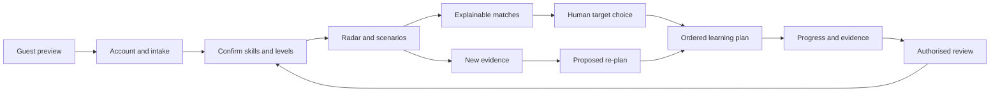
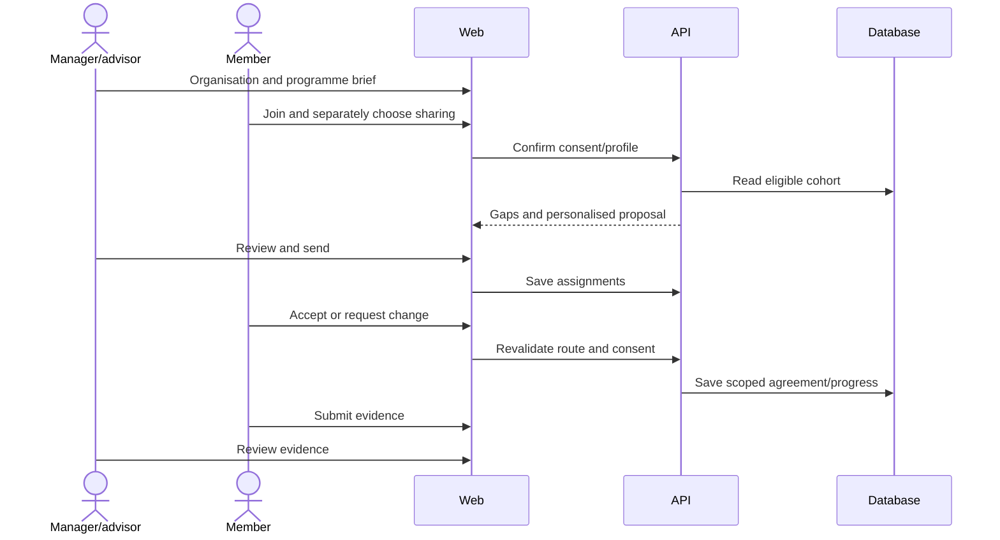
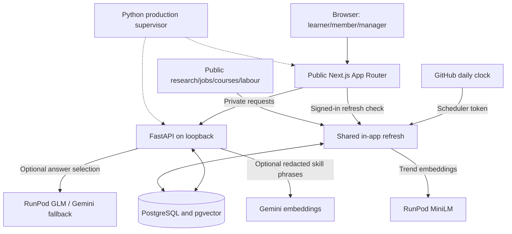
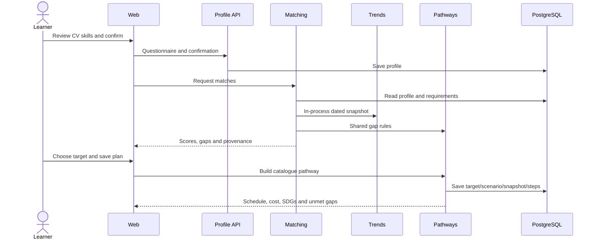
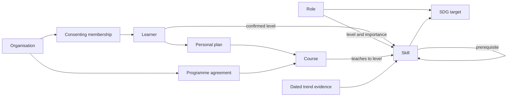
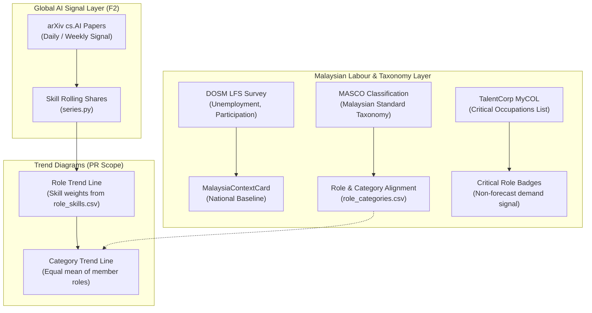

# Adept: Complete Product, System and Pitch Reference

Prepared 31 October 2026 from repository source on branch `fix-ui-flaws2`, including the inspected local source state. This dossier expands beyond the README and repeats essential context so a pitch writer can use it independently. It describes implemented source, recorded evidence and explicit limitations; it does not establish the deployed revision or human outcomes. External source claims were not independently reverified during this extraction.

## Contents

1. Product story and audience
2. Current reference catalogue
3. Complete capability inventory
4. Individual journey
5. Organisation and employee journeys
6. System architecture and request flow
7. AI, scoring, forecasting and pathway methods
8. Data sources, refresh and provenance
9. Storage, contracts and integrations
10. Security, consent, fairness and human control
11. Technology stack and engineering quality
12. Complete page/route map
13. Evidence, limitations and documentation corrections
14. Pitch structure, demo and Q&A
15. Source map and endpoint appendix

## 1. Product story and audience

**Adept turns changing AI skill signals into explainable career choices and practical reskilling plans for people and organisations.**

Adept connects current skills to sourced future-role profiles, explains missing capabilities, builds an ordered learning plan within time and budget, and relates roles and skills to UN Sustainable Development Goal targets. Employers use the same engine to understand shared gaps and prepare reviewable learning agreements.

Suggested pitch line: **“See the change. Find your next role. Build the skills to get there.”** This is proposed wording, not a measured outcome.

| Item                 | Project context                                                      |
| -------------------- | -------------------------------------------------------------------- |
| Product / team       | Adept / Pecel Lele                                                   |
| Competition          | SDC XMUM Hackathon, Domain 1: The Aiversecity Future-Ready Workforce |
| Country focus        | Malaysia                                                             |
| Main SDG             | SDG 4: Quality Education                                             |
| Priority targets     | 4.3, 4.4, 8.2, 8.5                                                   |
| Other priority goals | 5, 8, 9, 10; definitions cover all 17                                |
| Main modes           | Individual `/app`; organisation manager/advisor `/org`               |
| Supporting contexts  | Employee/student `/work`; internal administrator `/admin`            |

### Problem and value

Workers must choose what to learn while AI changes the value of their skills. Static course lists do not explain adjacent role suitability, the learning gap, feasible effort or why a recommendation changed. Employers face the same decision at workforce scale: which capabilities, for whom, by when and at what cost.

Individual loop: **Profile → dated signals → scenarios → explainable role ranking → gaps → ordered learning → reviewed evidence → updated skills and plans.**

Organisation loop: **Business objective → consenting cohort → gaps/readiness → personalised proposals → manager review → member agreement → scoped progress/evidence.**

| User                    | Need                                                        | Product response                                                 |
| ----------------------- | ----------------------------------------------------------- | ---------------------------------------------------------------- |
| Working adult           | Understand current-role exposure and adjacent opportunities | Skills context and plans fitting limited weekly time             |
| Graduate                | Choose a direction with limited experience                  | Interests, existing partial skills and affordable learning       |
| Career switcher         | Preserve transferable capability                            | Held skill levels reduce the remaining gap                       |
| HR/L&D                  | Develop a team against business priorities                  | Cohort analytics, objectives, headcounts, budgets and agreements |
| TVET/university advisor | Guide students/cohorts                                      | Institution context using the shared planning engine             |
| Employee/student member | Review a proposal and control sharing                       | Separate work context and explicit agreement decisions           |

Career segment affects guidance/intake; matching itself uses skills and interests, not age, name or segment identity.

### Defensible differentiators

These are product characteristics, not a verified competitor comparison:

- One engine serves personal career planning and workforce development.
- Dated, versioned signals and replay make evidence changes inspectable.
- Match components and gaps explain the result.
- Plans respect prerequisites, time and budget, with unresolved gaps visible.
- Scenario/replay changes lead to proposed, human-accepted re-planning.
- Target-level SDG reasons can influence ranking through optional weighting.
- Catalogue grounding and validated assistant answers constrain invented entities.
- Malaysia-oriented MYR budgets, BNM conversion, local training, HRD notes and job eligibility context.
- Consent, small-cohort protection and member agreements keep people involved.

## 2. Current reference catalogue

Recounted directly from seed CSVs during this task. These are **reference-file counts**, not verified production database counts. Runtime readers can prefer database records. Older documents/reports describe earlier versions.

| Content                            |             Count | Interpretation                                     |
| ---------------------------------- | ----------------: | -------------------------------------------------- |
| All role records                   |                48 | Current and future-role profiles                   |
| Target roles                       |                33 | `is_target=true`, future ranking scope             |
| Non-target/current roles           |                15 | Context roles excluded from target ranking         |
| Skill records                      |               142 | Raw rows; legacy equivalent IDs exist              |
| Role–skill edges                   |               234 | Required proficiency/importance relationships      |
| Course records                     |               104 | Dated learning catalogue                           |
| Stored MYR 0 learning-cost courses |                92 | About 88.5%; certificates are not necessarily free |
| Total listed hours                 |             835.5 | Catalogue duration sum, not training delivered     |
| Course languages                   | English and Malay | Different from three UI locales                    |
| SDG goals / targets                |          17 / 169 | Official definition coverage                       |
| Role–target links                  |                88 | Curated alignment edges                            |
| Skill–target links                 |               167 | Curated alignment edges                            |

Sources: [roles](../src/data/seed/taxonomy/roles.csv), [skills](../src/data/seed/taxonomy/skills.csv), [requirements](../src/data/seed/taxonomy/role_skills.csv), [courses](../src/data/seed/courses/courses.csv), [SDGs](../src/data/seed/sdg/).

Do not call link counts “people impacted.” Do not equate 142 rows with 142 distinct canonical competencies: `excel-basic` resolves to `excel`, and `robotic-process-automation` to `rpa`; effective levels take the maximum rather than double-counting.

Coverage includes AI/data/software, cloud/cybersecurity, operations/business, finance/compliance, sustainability/energy, manufacturing/logistics, agriculture/health, education and customer-facing work. Target IDs include `data-analyst`, `machine-learning-engineer`, `data-engineer`, `cloud-solutions-architect`, `cybersecurity-analyst`, `ai-product-manager`, `responsible-ai-officer`, `process-automation-analyst`, `solar-pv-engineer`, `health-informatics-specialist` and `tvet-digital-skills-trainer`.

Use current stored labels in slides. Labels now use official occupation wording with focus qualifiers where appropriate. Curated focus requirements and an occupation crosswalk do not validate new job forecasts or professional licensing eligibility.

## 3. Complete capability inventory

“Implemented” means represented in current source/routes/components, not that every external integration was operated successfully during this extraction.

| Area             | Capabilities                                                                          | Boundaries/results                                       |
| ---------------- | ------------------------------------------------------------------------------------- | -------------------------------------------------------- |
| Public entry     | Individual/team switch, guest CV preview                                              | Partial skills/trend/role result before account creation |
| Accounts         | Signup, login/logout, current account, export, password-confirmed deletion            | Signed accounts; last-manager orphaning protection       |
| F1 intake        | Four-step questionnaire, PDF/DOCX/text extraction, warnings/confidence, manual picker | User confirms skill IDs and levels                       |
| F1 resolution    | Alias search, exact/fuzzy and optional semantic suggestions                           | Ambiguous inputs abstain; suggestions do not auto-save   |
| F2 radar         | Rising/stable/declining skills, role context, dated metadata                          | Estimate/coverage/fallback labels                        |
| F2 history       | Snapshot picker, replay, differences and explanations                                 | Historical evidence remains labelled                     |
| F2 chart         | Removed from the UI on 2026-11-01 (M4-100); `series`/`compare` remain API-only        | Future work after a verified fresh snapshot cadence      |
| F2 Malaysia      | National labour context and limited MyCOL reference                                   | Separate from current vacancies/ranking evidence         |
| F3 scenarios     | Moderate/fast settings and role low/high ranges                                       | Heuristics, not calibrated confidence intervals          |
| F4 matching      | Ranked targets, component explanations, have/partial/missing gaps                     | Deterministic weighted suitability score                 |
| F4 comparisons   | Alternative-scenario rank/score; skill-improvement counterfactuals                    | Same profile/snapshot context where data available       |
| F4 SDG weighting | Optional sustainability preference                                                    | Changes ranking priorities, not proven social impact     |
| F5 comparison    | Compare roles before choosing                                                         | Weeks, cost, gap, trend coverage and SDGs                |
| F5 planning      | Prerequisites, ordered courses, weekly schedule, budget/style constraints             | Catalogue-only; unmet levels remain explicit             |
| F5 catalogue     | Filter by skill, format, audience, provider type, price, HRD                          | Dated prices and certificate caveats                     |
| F5 persistence   | Saved plan, history, proposed re-plan and acceptance                                  | User retains target/plan decision                        |
| F5 progress      | Completion status, historical course facts, evidence and badges                       | Completion is separate from earned capability            |
| F5 review        | Certificate URL checks, manager/advisor confirmation/rejection                        | URL reachability alone is not ownership proof            |
| F6 SDG           | Official definitions, role/skill alignment with reasons/strength/review               | Draft mapping status visible                             |
| F6 summaries     | Personal, organisation and regional contribution views                                | Mapped alignment, not measured UN outcomes               |
| F7 setup         | Company/institution, profile/settings, join code/rotation, membership removal         | Join code grants membership, not manager rights          |
| F7 privacy       | Multiple workspaces and separate join/sharing consent                                 | Personal/employer data boundaries                        |
| F7 analytics     | Intake roster, heatmap, readiness and group planning                                  | Completed sharing cohort; default minimum three          |
| F7 packages      | Free-first, member-budget-capped and broader catalogue options                        | Token rejects stale proposals                            |
| F7 budgets       | Annual MYR member planning budgets                                                    | Employer pays directly; no payment execution             |
| F7 programmes    | Objective/roles/headcounts/cohort/deadline/budget/format restrictions                 | Personalised routes and feasibility notes                |
| F7 assignments   | Manager review/send, agreement statuses                                               | In-app learning proposals, not personnel decisions       |
| Employee         | Own programmes, agreement accept/change/optional decline                              | Separate `/work` context                                 |
| Employee         | Scoped progress and explicit sharing of personal learning                             | No automatic exposure of private plans                   |
| Jobs             | Saved board, role openings, counts, text/work-mode/role filters                       | Original external apply links                            |
| Jobs             | Named skill demand and current/after-plan fit                                         | Heuristic coverage, not hiring eligibility               |
| Certifications   | Role-related exams, official fee evidence, conversion and prep links                  | Exam credentials differ from learning achievements       |
| Adi              | Contextual EN/MS/ZH guide and follow-up chips                                         | Server-authored facts; bounded validated model selection |
| F8 transparency  | About, disclosure, sources and fairness endpoints                                     | Provider/method/limitation visibility                    |
| Public evidence  | Impact summary and synthetic calculations                                             | Read-only, no private caller profile needed              |
| Operations       | Shared durable refresh; progress/status/freshness; admin source/snapshot tools        | Last-good retention and explicit failures                |
| UX               | Mobile navigation, locale/scenario state, loading/recovery states                     | Shared product UI rather than separate apps              |

## 4. Individual journey

### Guest to confirmed profile

1. Enter `/`, choose “For me,” and optionally upload a synthetic CV for a preview.
2. The preview validates/parses bytes and resolves known skills. Unknown-only extraction does not fabricate a role/score; zero recognised skills is not zero actual capability.
3. Sign up or log in and continue intake. Upload results never overwrite saved skills without confirmation.
4. `/app/onboarding` captures working/graduate/switcher context, current role where applicable, interests, weekly hours, budget, learning style and skills.
5. Review extracted candidates, add/remove catalogue entries and confirm levels 1–5. Wishes such as “want to learn SQL” are excluded from existing capability.
6. Save the confirmed profile. `/app/profile` supports later review and organisation joining.

### Explore and choose

7. `/app/radar` shows stored skill signals with sources, observation dates, scenario and estimate/fallback labels.
8. Inspect historical snapshots, differences and the observed rolling-share chart. The chart has its own metadata.
9. `/app/matches` shows ranked target roles, skill/trend/interest components, have/partial/missing gaps and coverage.
10. Role detail adds explanations, SDG reasons, scenario comparisons, skill counterfactuals and related openings/exams.
11. Adjust optional SDG weighting or compare candidate pathways at `/app/pathway/compare`.
12. Choose the target yourself. An automated demonstration choosing the first-ranked role is a test choice, not the application's decision policy.

### Learn, review and adapt

13. `/app/pathway` builds ordered catalogue learning with course links, hours, weeks, cost and unresolved skill levels.
14. Save target/scenario/snapshot/steps. A preview is not automatically a saved plan.
15. Browse more learning at `/app/courses`. Exams/professional credentials are shown separately from course achievements.
16. `/app/progress` tracks completion and evidence. Original course facts/history survive retargeting and re-planning.
17. Only reviewed `org_confirmed` evidence contributes earned skill credit. Marking complete or submitting a reachable URL alone does not raise effective matching levels.
18. Confirmed intake plus accepted learning forms effective skills. Rejection/undo removes corresponding learning credit.
19. New evidence/settings can propose a plan change; accept or retain the saved plan.
20. `/app/sdg` explains target alignment; `/app/jobs` leads to external applications. Adi explains authorised loaded facts.



A working-adult demo can emphasise limited weekly study time; a graduate demo interests and entry learning; a switcher demo transferable skills already satisfying requirements. Use actual output values from the chosen synthetic case, not invented outcomes.

## 5. Organisation and employee journeys

### Setup and participation

1. The manager/advisor chooses team signup and company/institution context. The organisation and join code are created.
2. `/org/setup` edits organisation information/rotates the code. The manager shares the code/link through their chosen channel; this is not an implemented automatic email claim.
3. Members join via signup, `/auth/join` or in-app joining. Joining requires explicit consent; sharing skill levels is separately optional.
4. Members complete personal intake. Only completed, available, consenting profiles enter shared skills analytics.
5. Every account retains a personal workspace. Organisation membership does not reveal the private personal plan or Adi conversation.

### Diagnose and compare learning

6. `/org/radar` shows dated context; `/org/gaps` compares target requirements with the eligible cohort.
7. `ORG_MIN_COHORT=3` by default. Below it heatmap gaps are null/suppressed, never zero/green. Plans, packages, programme generation and organisation SDG contribution also enforce the minimum, including selected subsets.
8. The current default target is the strongest existing team skill fit; managers can choose another.
9. `/org/plan` reuses F5 for group/member learning. Package options are free-first, member-budget-capped and broader-catalogue; options may coincide when free learning supplies the same coverage.
10. Annual MYR budgets inform choices. Selection is token/hash-checked for stale facts; it is not enrolment, funding approval or a hiring decision.

### Business-led programme

11. `/org/programmes/new` captures title, 1–4 objectives, up to five role/headcount targets, up to 50 people, deadline, paid study hours, total/member budgets, mandatory status, certificates, HRD and formats.
12. Objective categories: AI adoption, process automation, data-driven work, customer experience, cybersecurity, sustainability/ESG, compliance/risk, smart manufacturing, digital health, people/learning, digital marketing and redeploying at-risk capability.
13. Stored mappings suggest target roles; HR confirms priorities and people.
14. A deterministic readiness allocator proposes routes within headcounts. HR reviews before sending: this is a learning proposal, not an autonomous personnel decision.
15. Foundation is readiness below 30%, applied 30% to below 70%, advanced at least 70%. These are internal heuristics, not accredited competency bands.
16. F5 builds individual routes under restrictions and remaining budget. Proposals disclose cost, needed/available weeks, weekly hours, open gaps, unassigned members and headcount shortfalls.
17. Allocation is greedy by readiness, not globally optimal. Deterministic budget-consumption order can leave later members cheaper/free options; notes disclose this.
18. HR reviews and sends in-app. The token changes with relevant profile/catalogue/price/budget inputs; stale proposals are rejected.

### Member agreement and progress

19. `/work` shows own programmes; `/work/plan` presents target, route, deadline, paid hours, budget, cost and optional/mandatory terms.
20. Accept, decline an optional programme or request changes. Reasons include pace, schedule, language, accessibility, existing skill, upfront cost and other concerns. Mandatory programmes cannot be declined through this workflow; change requests remain available.
21. Acceptance revalidates current skills/catalogue/prices and programme commitment. Sharing-off requires explicit consent before exposing a refreshed route to managers.
22. `/work/skills` controls sharing; `/work/progress` holds organisation-scoped progress/evidence. Personal completions cross contexts only by explicit sharing.
23. `/org/programmes` tracks decisions; `/org/verify` supports authorised evidence review. Accepted learning updates applicable gaps; private context remains separate.
24. `/org/sdg` aggregates applicable target alignment under the same privacy rules.



### Finance and institution boundaries

**The organisation pays training providers directly.** `/org/funding` manages budgets, not payments. Member purchase requests, receipt uploads and reimbursement claims were retired. `/work/funding` redirects to `/work/plan`; `/app/funding` redirects to `/app/pathway`. Historical claims may remain for export/deletion, not as current features.

HRD Corp claimability does not mean approved funding or automatic MYR 0 upfront cost. Institution mode adapts terminology/advisor context around the same services. Older tasks mention advisor notes/report export as extras; do not promise a dedicated institutional reporting module without demonstrating its current implementation.

## 6. System architecture and request flow

Adept is a feature-organised application with one shared FastAPI backend and one public Next.js server, not one microservice per feature.



### Deployment topology

- Root production build/start is managed by `src/scripts/replit.py`.
- Next.js is the public listener, normally `0.0.0.0:3000` behind Replit's edge.
- FastAPI is private at `127.0.0.1:8000`; browser API requests use the same-origin Next.js proxy. Server actions also use the private API.
- The supervisor validates configuration, waits for readiness and manages both processes.
- Build/start does not migrate, seed or run inference. Local Compose provides PostgreSQL only.

### Authenticated request sequence

1. The browser sends the httpOnly signed session cookie to Next.js.
2. The web server handles/forwards the account session through the intended private API headers.
3. The public proxy strips caller-supplied internal identity headers; client-IP trust follows the configured proxy boundary.
4. FastAPI resolves signed identity. Workspace selections are checked against actual membership and role.
5. Routers validate typed inputs; services call repositories/reference readers.
6. Matching, pathway and SDG calls use direct Python functions, not internal HTTP self-calls.
7. Responses return typed facts and recommendation metadata; UI renders explanations, dates, estimate and fallback labels.



## 7. AI, scoring, forecasting and pathway methods

### 7.1 Distinct model responsibilities

| Component                 | Technology                                                              | Actual responsibility                                                |
| ------------------------- | ----------------------------------------------------------------------- | -------------------------------------------------------------------- |
| Research mapping          | Pinned `all-MiniLM-L6-v2`, RunPod, 384 dimensions                       | Embed research/skill text for cosine mention mapping                 |
| Optional skill suggestion | `gemini-embedding-001`, 768 dimensions, pgvector                        | Suggest an existing catalogue equivalent for a short redacted phrase |
| Adi                       | Configurable RunPod `glm-5.3`, separately authenticated Gemini failover | Select allowed server-authored answer-block IDs                      |

Role ranking, gap calculation, planning, programme allocation and SDG aggregation are deterministic code. There is no end-to-end trained employment predictor here. `LLM_PROVIDER=none` is the default; optional providers require deployment configuration.

Trend refresh additionally supports calibrated Gemini embeddings if MiniLM fails. That fallback is separate from Adi failover and CV suggestion indexing. It requires stored MiniLM calibration evidence and records actual method/model.

### 7.2 Intake method

Validate declared/inferred type and actual bytes; extract PDF using PyMuPDF, DOCX with bounded ZIP/XML, and text under decoding rules. Current parser constants include 30 PDF pages, 200,000 extracted characters, a five-second PDF deadline, two PDF slots, a configured child memory limit, 8 MiB DOCX XML and 2,000 archive entries. Resource enforcement depends on the supported execution environment; constants do not establish perfect parser safety.

Normalise text, remove contact information and model-addressed instruction lines, handle sections and exclude negated/future-learning wishes. Alias matching returns catalogue candidates. Confidence is a bounded match-hit heuristic, not a competence probability. Raw CV files are not persisted.

Manual search filters labels, IDs and approved aliases locally. Explicit resolution adds fuzzy candidates at score ≥0.83 and lead ≥0.05; semantic top-one needs cosine ≥0.80 and lead ≥0.015 against a ready index. Ambiguous cases abstain. The resolver requires at least four letters/digits, caps length and is rate limited.

Both upload screens currently request `include_suggestions=false` because they do not display optional semantic results. The API supports them for other callers. Only short redacted phrases leave the API when optional suggestions are used, not the full CV. Missing/stale index or provider failure preserves exact matching. Suggestions never auto-save.

Sources: [profile feature](../src/api/app/features/profile/FEATURE.md), [parser](../src/api/app/features/profile/cv_parser.py).

### 7.3 Trend scorer and scenarios

```text
frequency(skill, period) = mentions / papers
research_velocity = ln((recent_frequency + 0.0001) / (previous_frequency + 0.0001))
base_velocity = 0.6 × research_velocity + 0.4 × labour_baseline
moderate_velocity = clamp(base_velocity, -2, 2)
if base_velocity < 0:
    fast_velocity = clamp(base_velocity × (1 + exposure × 1.5), -2, 2)
else:
    fast_velocity = clamp(base_velocity × (1 + (1 - exposure) × 1.5), -2, 2)
rising: v > 0.05; declining: v < -0.05; stable: otherwise
```

Research attention is a proxy, and BLS 2023–2033 is a static US labour baseline. These are not observed Malaysian vacancy growth. Exposure and weights are assumptions; missing coverage remains visible.

Role outlooks aggregate required-skill signals by importance. Variation/missing coverage widen heuristic low/high ranges; these are not calibrated confidence intervals. Mixed positive and negative skills can cancel differently, so a role's fast scenario is not forced to be more extreme.

The latest automatic pipeline accumulates paper evidence and compares rolling seven-day windows. Older ISO-week pipelines remain for compatibility/reconstruction; older diagrams are not the final authority on cadence.

Sources: [scorer](../src/pipelines/trends/score.py), [scenario service](../src/api/app/features/scenarios/service.py).

### 7.4 Explainable matching

```text
skill_credit = min(current_level / required_level, 1)
skill_fit = Σ(importance × skill_credit) / Σ importance
interest_fit = 0.5 + 0.5 × matched_declared_interests / declared_interests
base_score = 0.45 × skill_fit + 0.25 × trend_fit + 0.30 × interest_contribution
optional_score = (1 - λ) × base_score + λ × SDG_impact
```

No interests/no matching role tags produces neutral contribution 0.5; undeclared interests are also labelled not provided. Declared interests add a bonus above neutral rather than a penalty below it.

Trend velocities use a robust shared scale for both scenarios:

```text
c = clamp(velocity, -2, 2)
s = median absolute clamped velocity across both scenarios
position = 0.5 + 0.5 × tanh(2 × asinh(c/s) / asinh(2/s))
```

The code handles zero/empty scales with neutral values. This replaces old percentile descriptions. Role trend fit weights required skills; missing signals reduce reported coverage, not fabricate evidence.

Tie breaks use role IDs. Same-profile/snapshot comparisons expose alternative scenario score/rank when inputs exist. Counterfactuals raise a selected skill to the requirement and rerun the production ranker across roles. Neither score nor improved rank is employment probability.

Gap buckets: have = meets required level, partial = positive but insufficient, missing = absent. `MatchProfile` accepts skills/interests, not protected identity attributes.

Sources: [scoring](../src/api/app/features/matching/scoring.py), [service](../src/api/app/features/matching/service.py), [SDG weighting](../src/api/app/features/matching/sdg_weight.py).

### 7.5 Pathway algorithm

1. Compare effective skill levels with role requirements.
2. Prioritise importance × proportional gap × trend multiplier.
3. Add prerequisite foundations even outside direct role requirements.
4. Topologically sort; foundations inherit urgency. Reject cycles.
5. Select existing courses in ascending skill level under price/format/budget constraints; account for duration and learning preference. Book multi-skill courses once.
6. Respect prerequisite capability; an unavailable foundation can block dependent learning.
7. Schedule cumulative hours into contiguous weeks. Total weeks = ceiling(total hours / weekly hours).
8. Keep unavailable courses/insufficient target levels explicit as unmet gaps.

Scenario-modelled inputs are not amplified twice. Classroom preference favours taught formats; video/reading favours self-paced; hands-on/mixed has no separate catalogue format preference. Hours change schedule, budget changes paid feasibility, certificate-required programmes exclude unknown certificate-price options. HRD eligibility does not zero upfront price.

Plans are heuristic learning estimates, not qualification/licensing assurance. Re-planning compares saved evidence/settings and proposes additions/removals/reordering. Historical course facts survive retargeting/retirement. Only reviewed accepted evidence raises effective levels; rejection/undo revokes credit.

Sources: [engine](../src/api/app/features/pathway/engine.py), [service](../src/api/app/features/pathway/service.py), [feature](../src/api/app/features/pathway/FEATURE.md).

### 7.6 SDG method

Official wording comes from the UN SDG API. Curated role/skill edges contain target, reason, direct/enabling strength, evidence and reviewer/status. Draft mappings stay labelled.

Contribution combines applicable role/skill/plan links. Alignment methods use direct weight 1 and enabling 0.5 with applicable normalisation/capping. Free-learning plans can support a 4.3 access explanation with certificate-fee disclosure. Summaries may show all 17 definitions without claiming contribution to all 17.

This is mapped alignment, not measured emissions reduction, job creation or UN-indicator achievement.

Source: [SDG feature](../src/api/app/features/sdg/FEATURE.md).

### 7.7 Job openings and professional exams

Supported public feeds are deduplicated, filtered for Malaysia eligibility and mapped using ordered title rules. Skills resolve to the same catalogue; a skills-only role fallback was removed for precision concerns. Ad descriptions are processed for features, not retained as raw text. Posting metadata/source/apply URLs persist.

A skill is met at the required proficiency, defaulting to level 2 outside role requirements. At least two recognised skills are needed to rate an ad. “Within reach” means at least 60% of its named catalogue skills met; after-plan includes planned levels. This excludes experience/licensing/visa and other unmodelled requirements and is not employer acceptance.

Stale ads remain visibly labelled after fresh entries but are excluded from fresh/readiness totals. Posting `last_seen` differs from feed fetch time. Applications happen externally; Adept does not apply or share the profile with employers.

Exam cards distinguish official fee/date, BNM MYR estimate, role coverage, preparing courses and mentions in ads. Course completion, course certificate and professional certification remain distinct.

Sources: [jobs feature](../src/api/app/features/jobs/FEATURE.md), [fit](../src/api/app/features/jobs/fit.py).

### 7.8 Adi grounded guidance

Signed-in Adi gathers authorised profile, matches, saved-plan facts, effective progress and relevant team/trend context. Server-authored EN/MS/ZH blocks contain displayed text/figures.

Intent routing refuses personnel decisions, injection, other people's private data and invented entities. A configured model selects one/two allowed blocks through `select_ids_or_fallback` and `validate_ids`; unchecked generated prose is not rendered. Specific questions constrain selection to relevant blocks.

Missing/failing/invalid providers use a deterministic guide. Requests use deadlines, bounded outstanding work, account concurrency and cancellable I/O. Actual answering provider/model is disclosed; at most three grounded chips follow. Chat explains rather than enrols/applies/pays/edits plans. Account changes reset/abort conversation state.

Sources: [assistant feature](../src/api/app/features/assistant/FEATURE.md), [gateway](../src/api/app/core/llm/gateway.py).

## 8. Data sources, refresh and provenance

| Source                                         | Purpose                           | Limit                                                |
| ---------------------------------------------- | --------------------------------- | ---------------------------------------------------- |
| arXiv cs.AI                                    | Research attention                | Bounded sample, not census/job demand                |
| BLS 2023–2033                                  | Labour component                  | Static US baseline                                   |
| O*NET crosswalk/Adept taxonomy                 | Occupation anchors/requirements   | Focus profiles/requirements can be curated estimates |
| Microsoft Learn/cited course providers         | Courses/hours/prices              | Dated facts; certificate fees separate               |
| Local universities/industry/training providers | Malaysia-oriented learning        | Availability/HRD funding requires confirmation       |
| UN Statistics Division                         | Goals/targets                     | Official definitions differ from curated mapping     |
| BNM                                            | Currency conversion               | Dated estimate, not checkout price                   |
| DOSM/OpenDOSM Labour Force Survey              | National labour context           | Not individual vacancy/role score                    |
| Public employer/job boards                     | Saved openings                    | Source permissions and location rules                |
| Official exam providers                        | Exam fees/facts                   | No credential/payment issuance                       |
| Frozen MyCOL reference                         | Limited critical-occupation badge | Historical mapping, not vacancy/ranking boost        |
| Synthetic CV/personas                          | Demo/regression/evidence          | No human adoption/outcome claim                      |

Providers include Microsoft Learn, Coursera/university offerings, UNIMAS, UKMSHAPE, UTMSPACE, FMM, IBFIM, MAICSA and other dated records. A provider label is source attribution, not partnership/endorsement.

Legacy job connectors are broader than automatic refresh permits. The automatic path follows `docs/data-refresh.md` assessments, including allowed configured Greenhouse/Lever/Ashby feeds and compatible optional keyed sources. Unsupported/undocumented/denied paths are skipped. Do not claim universal scraping of JobStreet, LinkedIn, Indeed or MyFutureJobs.

### Shared refresh

GitHub runs daily at 03:41 UTC/manual dispatch and calls the app with a scheduler token, not direct private-DB access. Dashboard/radar/admin use the same durable background job. Advisory lock, heartbeat, lease-loss handling and replacement fencing constrain one site-wide worker/publication owner.

Runs/steps persist; one source failure retains its last good data while others may succeed. Cheap current-input checks avoid unnecessary network/inference. Cooldown, rate limits and failed-trend backoff apply, with specified admin exemptions. I/O uses time/size bounds and active cancellation. A worker losing ownership cannot reconnect and publish. UI retains existing cards while showing progress, elapsed time, warm-up, failures and partial success.

Legacy workflow/rescore remains separate; the latest feature notes describe `trends-refresh.yml` as manual backup rather than the primary scheduled path.

### Accumulated paper evidence

Current source starts history on 6 October 2026, processes at most 14 days/50 papers per day per run, lags announcements by three days and refetches early days after five days for settled coverage. Backfill can require multiple runs.

Matched public paper IDs/submission days, model/method and skill IDs persist. Snapshots compare the latest seven stored days to the preceding seven. With no new day, stored counts still compare against atomically published measured inputs: corrections/failed publication can cause an inference-free rebuild. Stored measurements support reconstruction without fabricating retrieval freshness.

RunPod MiniLM is primary; Gemini fallback requires calibrated stored MiniLM evidence. Without it, refresh fails and keeps last good data. The chart counts rolling observed shares from stored papers with one SQL snapshot for denominators/counts. Empty history has no invented observation period.

Sources: [automatic trends](../src/api/app/features/data_refresh/automatic_trends.py), [paper store](../src/api/app/features/data_refresh/trend_store.py), [series](../src/api/app/features/trends/series.py), [refresh operations](data-refresh.md).

### Attribution contract

Recommendation/score/trend results carry `RecommendationMeta`: source name/URL/retrieval dates, selected snapshot, scenario and estimate status, with additional fallback/replay/origin/window disclosure where applicable.

```text
meta.sources[] = {name, url, retrieved_at}
meta.snapshot_date = selected evidence snapshot
meta.scenario = moderate | fast | both (comparison attribution only)
meta.is_estimate = true for estimates
```

Observation period, retrieval date, publication/snapshot date, URL check and fact verification mean different things. A successful URL check cannot make an old fee newly verified. Production matching requests strict snapshots and fails when authoritative data is unavailable. Development/demo fallback is explicitly labelled. October 2024 replay is not current 2026 research.

## 9. Storage, contracts and integrations

| Domain              | Main stored concepts                                                                           |
| ------------------- | ---------------------------------------------------------------------------------------------- |
| Identity/membership | Users/passwords, organisations, memberships, roles, consent/sharing and intake status          |
| Learner             | Profile and confirmed skill levels                                                             |
| Catalogue           | Skills/aliases, roles/target flags, requirements, prerequisites and courses                    |
| Learning            | Saved plans/history, scoped progress, course fact snapshots, evidence, badges                  |
| Programmes          | Briefs, assignments, annual budgets and historical funding state                               |
| Trends              | Embeddings/raw signals, paper mentions/fetched days, snapshots, provenance and measured inputs |
| Jobs                | Posting metadata, source fetch logs and certification catalogue                                |
| SDGs                | Goals, targets, role/skill links and organisation regions                                      |
| Operations          | Refresh runs/steps, sync logs, FX rates and provider-call records                              |

Programme/funding state uses `learning_funding` JSON for some concepts; not every concept is a separate normalised table. Course skill arrays and plan-step JSON require application ID validation. Logical joins in diagrams are not all SQL foreign keys. The knowledge graph is relational/JSON/array-backed, not a separate graph database.



Matching reads trends in-process, shares gap rules with pathways, and obtains SDG links through the SDG layer. Organisation plans reuse F5. Reference readers are DB-first with defined seed/fallback support. Historical course facts preserve learning across catalogue changes; workspace selectors still require membership/manager checks.

Contracts flow: **Pydantic → generated OpenAPI → openapi-typescript → openapi-fetch**. API routers are feature-auto-discovered; Next.js pages are thin feature wrappers. Migrations are append-only timestamped up/down files and applied explicitly; startup does not migrate/seed.

## 10. Security, consent, fairness and human control

### Product boundaries

- Public reference data and synthetic demonstrations only; public personal CVs are not acceptable fixtures.
- Raw CVs are not persisted. Optional suggestions send short redacted skill phrases rather than full CVs.
- Passwords use scrypt; browsers hold signed httpOnly session cookies. `AUTH_MODE=demo` names the signed local-account flow, not automatic demo access.
- Production startup rejects unsafe auth/session/proxy settings; raw fixture IDs/default-user settings are test-only.
- Manager/advisor access is enforced in API services, not just navigation.
- Joining, sharing skill levels and sharing learning records have distinct consent boundaries.
- Small cohorts are suppressed/blocked for relevant derived analytics/planning.
- Personal plans/conversations remain separate from employer programmes/progress.
- Evidence review is restricted to authorised reviewers and current submissions. URL reachability is not credential ownership.
- Last-manager deletion cannot silently orphan team records.

### Defence in depth

Source includes body/upload/parser limits, sanitisation/redaction, bounded rate-limit state, session validation, security headers, exact CORS, admin allowlists, restricted fetch/redirect handling and operation deadlines. Next.js/FastAPI share a proxy secret; forwarded-IP processing requires configured verified hops. Replit documentation records one hop; direct local development normally uses zero.

Correct deployment remains necessary. Documentation cannot guarantee perfect security. ID validation does not alone establish truth or authorisation; prompt filters are supporting controls.

### Fairness and human decisions

Matching accepts skills/interests; pathways use skill/time/budget/preferences rather than protected identities. Counterfactual identity substitutions and input scans provide limited regression evidence. They do not prove equal outcomes across populations or eliminate bias in source data, budgets or suggestions.

People choose targets, save/accept plans, review evidence and accept/request changes to agreements. Managers set programme objectives and review allocations. Adi cannot hire/fire/promote/admit, apply, enrol or pay. Mandatory programmes remain reviewable through change requests; they are not AI personnel decisions.

## 11. Technology stack and engineering quality

Versions describe inspected manifests, not every installed/deployed package. Python bounds are constraints; lockfiles define exact resolution.

| Layer               | Current source technology                                        | Purpose                                              |
| ------------------- | ---------------------------------------------------------------- | ---------------------------------------------------- |
| Backend             | Python >=3.11, documented runtime 3.11                           | Services, methods, pipelines and supervisor          |
| API                 | FastAPI >=0.161.1; Uvicorn >=0.54.0                              | Private typed ASGI API                               |
| Validation          | Pydantic v2; pydantic-settings >=2.16.1                          | Contracts, settings and OpenAPI                      |
| SQL access          | psycopg >=3.3.6; psycopg-pool >=3.3.3                            | SQL and connection pools                             |
| Database            | PostgreSQL; local/CI 16 + pgvector                               | Relational state/vector search                       |
| Deployment DB       | Replit integrated PostgreSQL                                     | Exact deployed version not established here          |
| Web                 | Next.js 16.4.2 App Router                                        | Pages/server actions/API proxy                       |
| UI runtime          | React/React DOM 19.3.1                                           | Current manifest values                              |
| Types               | TypeScript 5.9.3 strict                                          | Client correctness                                   |
| Styling             | Tailwind CSS 4.1.18; local shadcn-style primitives               | Responsive shared UI                                 |
| Localisation        | next-intl 4.14.9                                                 | English, Malay, Chinese                              |
| Charts              | Recharts 2.15.4                                                  | Trend series                                         |
| Mascot              | Three.js 0.180.0                                                 | Adi 3D mascot                                        |
| UI utilities        | lucide-react, CVA, clsx, tailwind-merge                          | Icons, variants and classes                          |
| Typed API           | openapi-fetch 0.14.1; openapi-typescript 7.9.1                   | Contract-generated calls/types                       |
| PDF                 | PyMuPDF <2                                                       | In-memory extraction                                 |
| DOCX                | Python ZIP/XML library                                           | Bounded extraction                                   |
| HTTP                | HTTPX >=0.28.1                                                   | External/provider requests                           |
| Trend model         | RunPod MiniLM, 384 dimensions                                    | Research mapping                                     |
| Optional embeddings | Gemini, 768 dimensions                                           | Skill suggestions/calibrated trend fallback paths    |
| Assistant           | RunPod GLM-5.3 / configured Gemini fallback                      | Validated answer selection                           |
| JS packages         | pnpm 10.29.3 workspace/lock                                      | Reproducible dependencies                            |
| Python packages     | pyproject.toml, uv.lock, requirements workflow                   | Reproducible dependencies                            |
| Quality             | Ruff, pytest, ESLint, TypeScript, Node tests, Playwright tooling | Static checks and regressions                        |
| Automation          | GitHub Actions                                                   | CI, audits, refresh clock, guarded image publication |
| Hosting             | Replit and Python supervisor                                     | Public web/private API pair                          |

Fontsource Inter assets are installed, but current styling documentation describes system/Arial fallbacks, not a live Google Fonts service. Express/Drizzle/mockup/generated scaffold artifacts are not the product architecture. Older declarations contain different React versions; the current package manifest is used above.

### Quality model

`make check`, or `python src/scripts/dev.py check`, runs Python lint/format validation, translation parity, pytest, offline Node tests, TypeScript and contract regeneration/drift. Tests default to isolated in-memory/CSV data and unreachable DB unless explicitly opted in; paid providers are disabled by the test setup.

CI/integration source covers auth/workspaces, cohort privacy, parser edge cases, grounding/sources, prerequisites, evidence, refresh/publication races and root production/proxy behaviour. Test existence is not a current passing result; cite the actual gate/CI output for the final revision.

### Six-stage methodology for technical slides

| Stage        | Implementation                                                                                        |
| ------------ | ----------------------------------------------------------------------------------------------------- |
| Source       | Public research, occupation/SDG/courses/exams, synthetic profiles                                     |
| Cleaning     | Validate type/bytes, redact, normalise, deduplicate, check eligibility/dates                          |
| Features     | Skill IDs/levels, mentions, requirements, interests, prerequisites, prices, targets                   |
| Model/method | Embedding similarity, deterministic scoring/scenarios, constrained graph planning                     |
| Evaluation   | Production-code regression, catalogue/source validation, synthetic ranking/fairness and dated reports |
| Serving      | Saved evidence, typed APIs/UI, attribution and human review                                           |

## 12. Complete page/route map

| Context       | Route                                | Purpose                         |
| ------------- | ------------------------------------ | ------------------------------- |
| Public        | `/`                                  | Mode switch and CV preview      |
| Public        | `/try`                               | Redirect to home preview anchor |
| Public        | `/about`                             | Methods/models/sources/limits   |
| Public        | `/impact`                            | Coverage and synthetic evidence |
| Public        | `/faq`                               | Product questions               |
| Public        | `/privacy`, `/terms`                 | Policy pages                    |
| Account       | `/auth/signup`, `/auth/login`        | Signed account entry            |
| Account       | `/auth/join`, `/auth/consent`        | Join and explicit consent       |
| Personal      | `/app`                               | Home/next actions               |
| Personal      | `/app/onboarding`                    | Four-step intake                |
| Personal      | `/app/profile`, `/app/join`          | Profile/skills and join a team  |
| Personal      | `/app/radar`                         | Radar/history/chart             |
| Personal      | `/app/matches`                       | Ranked targets                  |
| Personal      | `/app/matches/[roleId]`              | Role detail/gaps/evidence       |
| Personal      | `/app/pathway/compare`               | Target comparison               |
| Personal      | `/app/pathway`                       | Preview/save/re-plan            |
| Personal      | `/app/progress`                      | Completion/history/evidence     |
| Personal      | `/app/courses`, `/app/jobs`          | Course and openings browsers    |
| Personal      | `/app/sdg`                           | Personal alignment              |
| Compatibility | `/app/funding`                       | Redirect to pathway             |
| Manager       | `/org`                               | Organisation overview           |
| Manager       | `/org/members`                       | Membership/intake/code          |
| Manager       | `/org/radar`, `/org/gaps`            | Signals/privacy-gated heatmap   |
| Manager       | `/org/plan`                          | Group plan/packages             |
| Manager       | `/org/programmes`                    | Programme status                |
| Manager       | `/org/programmes/new`                | Programme wizard                |
| Manager       | `/org/funding`                       | Training budgets                |
| Manager       | `/org/courses`, `/org/verify`        | Catalogue/evidence review       |
| Manager       | `/org/sdg`, `/org/setup`             | Alignment/settings              |
| Employee      | `/work`                              | Own programmes                  |
| Employee      | `/work/skills`                       | Sharing controls                |
| Employee      | `/work/plan`                         | Agreements                      |
| Employee      | `/work/progress`                     | Scoped learning                 |
| Compatibility | `/work/funding`                      | Redirect to work plan           |
| Admin         | `/admin`                             | Internal entry                  |
| Admin         | `/admin/sources`, `/admin/snapshots` | Source/snapshot operations      |

Current navigation presents six personal stages: skills, radar, roles, plan, progress and impact. The original handbook four-step story covers the first four; progress/impact form the ongoing loop. Organisation navigation groups four core steps plus management tools.

Locale uses the `NEXT_LOCALE` cookie without required locale URL prefixes. Scenario uses `?scenario=moderate|fast`; explicit historical selections use date context. Chart state uses `from`, `to`, `skill`. Workspace selectors are checked on the server.

## 13. Evidence, limitations and documentation corrections

### What this extraction establishes

Implemented source exists for both primary modes and employee/admin contexts. Catalogue files were recounted. Core methods and privacy/grounding mechanisms were inspected. This task did not operate the hosted app, call paid models, publish snapshots or run a human study. Deployed counts/version/current uptime require separate verification.

### Recorded evidence, not newly measured results

| Existing record                | Result                                                                              | Scope/limit                                                                             |
| ------------------------------ | ----------------------------------------------------------------------------------- | --------------------------------------------------------------------------------------- |
| Automated journeys, 30 October | 15/15 completed across five synthetic profiles; profile medians about 0.091–0.236 s | Local TestClient, CSV/in-memory, fixture trends; no browser/network/human decision time |
| Earlier raw-ID attempt         | 10/15 complete; five upload HTTP 429s                                               | Separate failed run, not pooled with later success                                      |
| Human KPI                      | 0 testers/trials; no manual baseline/reduction                                      | Planning improvement remains a target                                                   |
| Impact report                  | Five synthetic personas and scenario/free-learning results                          | Older catalogue/fixture state, not human outcomes                                       |
| Fairness report                | 75 identity/segment swaps, recorded max rank change 0                               | Limited dated regression, not population fairness                                       |
| MiniLM handoff                 | Historical live inference success                                                   | Not latest worker/deployment or snapshot publication proof                              |

Sources: [automated journeys](evidence/kpi-automated-journeys.md), [human protocol](evidence/kpi-time-to-plan.md), [impact report](evidence/impact-evidence.md), [worker handoff](../src/pipelines/trends/runpod/DEPLOYMENT_HANDOFF.md).

Do not reuse old matching benchmark percentages as current accuracy without rerunning against final catalogue/labels. A proposed 20% planning-time reduction is not achieved human evidence.

### Corrections required in pitch material

| Older description                                  | Current evidence                                            |
| -------------------------------------------------- | ----------------------------------------------------------- |
| 31 roles / 140 skills / 98 courses                 | Current seed: 48 roles / 142 skill records / 104 courses    |
| 34 roles in impact report                          | Earlier report; latest file recount is not a report rerun   |
| Trend component is percentile                      | Shared asinh/tanh normalisation                             |
| Weekly-only research updates                       | Latest accumulated store compares rolling seven-day windows |
| GitHub always writes direct to app DB              | Shared automatic clock calls app; legacy pipeline separate  |
| Fast role outlook must be more extreme             | Mixed skill aggregates can cancel differently               |
| HRD-eligible automatically free                    | Eligibility is not funding/payment approval                 |
| Reachable certificate earns skill credit           | Only authorised confirmed evidence earns credit             |
| Completion always raises score                     | Depends on evidence review and actual gap                   |
| Largest-gap default team role                      | Current default strongest team fit                          |
| Tiny teams see numeric gaps                        | Cohort suppression/planning minimum applies                 |
| Joining implies sharing                            | Separate explicit choices                                   |
| Employee reimbursement active                      | Retired; employer pays directly                             |
| Three UI languages = three course languages        | UI EN/MS/ZH; course rows EN/MS                              |
| SDG mapping proves achieved impact                 | Curated alignment with review limits                        |
| Public reachability proves current source deployed | Revision and snapshot need separate checks                  |

### Remaining limits

- Research samples/heuristic weights are not validated employment forecasts.
- Expanded role coverage has uneven trends/courses; some levels/foundations remain unmet.
- Short learning does not establish regulated qualification or full employer eligibility.
- Interest fit is not a psychometric assessment.
- Programme allocation is greedy and budget-order-sensitive.
- Job-fit labels model recognised named skills only.
- External feeds/prices/postings can fail/change; source permissions and last-good labels matter.
- Refresh requires deployed migrations/settings/providers; a green no-op does not prove publication.
- Optional model configuration and current production load/latency/cost require measurement.
- No human employment outcomes, paid-customer traction, revenue, market sizing, production SLA or scale benchmark is established here.

## 14. Pitch structure, demonstration and Q&A

### Suggested 12-slide structure

| Slide | Main message                                        | Evidence/visual                                           |
| ----- | --------------------------------------------------- | --------------------------------------------------------- |
| 1     | Adept turns changing skills into actionable choices | Name/value proposition                                    |
| 2     | Reskilling decisions are fragmented                 | Worker/team pain; separately verified external statistics |
| 3     | One engine, two main modes                          | Audience comparison                                       |
| 4     | Profile → radar → role → plan                       | Journey diagram                                           |
| 5     | A learner can understand the next step              | Synthetic CV, components, gap and plan                    |
| 6     | Recommendations are inspectable                     | Actual source/date and component card                     |
| 7     | Futures change; plans can adapt                     | Actual scenario/replay/re-plan result                     |
| 8     | Team strategy becomes reviewable agreements         | Eligible cohort, proposal, member agreement               |
| 9     | Bounded AI plus deterministic methods               | System diagram/model responsibility table                 |
| 10    | Sustainability and access are explicit              | Target reason, free-learning/fee caveat, language/consent |
| 11    | Evidence and feasibility                            | Current file counts; dated local/synthetic results        |
| 12    | Next validation and ask                             | Proposed pilot/support and team                           |

The local final-round checklist records innovation 25%, technical execution 25%, impact/feasibility 20%, fit 15%, presentation 10%, UX 5%. This is extracted from local material, not independently verified with organisers during this task.

### Demonstration sequence

1. Use a selected synthetic CV from `docs/demo-cvs/`; show one review/edit so confirmation is visible.
2. Open radar and point to actual dates/sources/replay/fallback.
3. Explain one role's components/gaps. Toggle scenario and show the actual result even if rank is unchanged.
4. Compare/select target; show course order, time/cost and an unresolved limitation.
5. Distinguish submitted completion from confirmed capability.
6. Switch to an organisation with at least three completed consenting synthetic profiles for numeric analytics. Otherwise show suppression honestly.
7. Review a programme proposal and member agreement/change request; show workspace privacy.
8. Ask Adi about loaded plan facts and show About/Impact provenance.

Do not trigger paid refresh just to appear live without owner authorisation. A stored dated snapshot can demonstrate provenance; describe it accurately.

### Judge Q&A

| Question                      | Defensible answer                                                                                                                                  |
| ----------------------------- | -------------------------------------------------------------------------------------------------------------------------------------------------- |
| Just a chatbot?               | Ranking/planning is deterministic; Adi explains checked authorised facts.                                                                          |
| Invented courses?             | IDs resolve to catalogue records; missing coverage stays a gap.                                                                                    |
| Employment probability?       | No, a weighted suitability estimate.                                                                                                               |
| Predicts Malaysian demand?    | Research attention/static labour assumptions, with separate Malaysia openings/context; not calibrated vacancy prediction.                          |
| Why AI?                       | Embeddings map text to known skills; optional selection routes grounded answers.                                                                   |
| What changes with data?       | Validated snapshots can change trend/priorities and propose plan changes; not every profile must move.                                             |
| Can HR see private plans?     | Separate contexts and server-side membership/sharing checks.                                                                                       |
| Only two consenting learners? | Default cohort privacy suppresses/blocks relevant derived analytics.                                                                               |
| Certificate proof?            | Reachability is not ownership; reviewed confirmation earns capability credit.                                                                      |
| Who pays?                     | Provider purchases are external; organisations pay training directly.                                                                              |
| SDG impact proven?            | Definitions are official; curated alignment is not measured outcome.                                                                               |
| Impact measured?              | Synthetic/local evidence exists; human planning/employment outcomes unmeasured.                                                                    |
| Scale?                        | Stored snapshots avoid normal-page inference, pooled SQL/bounded workers/shared refresh reduce duplication; load capacity still needs measurement. |

### Proposed next validation/commercial hypotheses

These are proposals, not implemented traction or an agreed revenue model:

- Run the matched manual-vs-Adept usability protocol; report valid plans, failures and completion as well as time.
- Pilot with an HR/L&D or career-centre partner using approved synthetic cases first; resolve real-data requirements before personal-data collection.
- Validate forecasting assumptions, review SDG drafts and fill unmet course/prerequisite coverage.
- Measure deployed refresh reliability, latency/model spend/load before unit economics or SLA claims.
- Explore employer/institution subscriptions while preserving accessible personal guidance; willingness to pay/pricing needs research.

Do not invent market size, customer logos, partnerships, savings, accuracy or paid subscriptions to fill slides.

## 15. Source map and endpoint appendix

### Primary internal evidence

| Topic               | Source                                                                                                                                                                          |
| ------------------- | ------------------------------------------------------------------------------------------------------------------------------------------------------------------------------- |
| Mission/audience    | [Project context](project-context.md)                                                                                                                                           |
| Topology            | [Architecture](architecture.md), [supervisor](../src/scripts/replit.py)                                                                                                         |
| History/corrections | [Decisions](decisions.md)                                                                                                                                                       |
| Scope/plans         | [Tasks](tasks.md), feature documents                                                                                                                                            |
| Routes              | [Navigation](../src/web/src/config/navigation.ts), `src/web/src/app/**/page.tsx`                                                                                                |
| Auth/privacy        | [Accounts](../src/api/app/features/accounts/service.py), [auth](../src/api/app/core/auth.py), core/security                                                                     |
| Intake              | [Profile](../src/api/app/features/profile/FEATURE.md)                                                                                                                           |
| Radar/scenarios     | [Trends](../src/api/app/features/trends/FEATURE.md), [scenarios](../src/api/app/features/scenarios/FEATURE.md)                                                                  |
| Matching            | [Feature](../src/api/app/features/matching/FEATURE.md), [scoring](../src/api/app/features/matching/scoring.py)                                                                  |
| Learning            | [Pathway](../src/api/app/features/pathway/FEATURE.md), engine/service/verification                                                                                              |
| Organisation        | [Feature](../src/api/app/features/org/FEATURE.md), [programme contract](../src/api/app/contracts/programmes.py), [programme service](../src/api/app/features/org/programmes.py) |
| Openings/exams      | [Jobs](../src/api/app/features/jobs/FEATURE.md)                                                                                                                                 |
| SDGs                | [Feature](../src/api/app/features/sdg/FEATURE.md)                                                                                                                               |
| Adi/grounding       | [Assistant](../src/api/app/features/assistant/FEATURE.md), [LLM](../src/api/app/core/llm/FEATURE.md)                                                                            |
| Refresh             | [Feature](../src/api/app/features/data_refresh/FEATURE.md), [guide](data-refresh.md)                                                                                            |
| Evidence            | [Impact](evidence/impact-evidence.md), [journeys](evidence/kpi-automated-journeys.md), [human protocol](evidence/kpi-time-to-plan.md)                                           |
| Pitch/submission    | [Rubric](submission/rubric-check.md), [declaration](submission/submission-technical-declaration.md), [demo](demo-script.md)                                                     |
| Package truth       | [Python](../pyproject.toml), [web](../src/web/package.json), [root](../package.json), lockfiles                                                                                 |
| Data model          | [Migrations](../src/db/migrations/), contracts/repositories                                                                                                                     |

### Backend endpoint inventory

Extracted from checked-in `src/api/openapi.json` during document creation. These are declared operations, not anonymous-access guarantees. Read router/service permissions, rate limits and prerequisites. Deprecated operations remain marked. Browser-only Next.js handlers/actions/redirects are not all represented in FastAPI OpenAPI.

| Method | Path                                             | Summary                                          |
| ------ | ------------------------------------------------ | ------------------------------------------------ |
| GET    | `/api/v1/meta/version`                           | Version                                          |
| GET    | `/api/v1/health`                                 | Health                                           |
| GET    | `/api/v1/meta/data-freshness`                    | Data Freshness                                   |
| GET    | `/api/v1/meta/overview`                          | Platform Overview                                |
| POST   | `/api/v1/auth/signup`                            | Signup                                           |
| POST   | `/api/v1/auth/login`                             | Login                                            |
| POST   | `/api/v1/auth/logout`                            | Logout                                           |
| GET    | `/api/v1/auth/me`                                | Me                                               |
| GET    | `/api/v1/auth/me/export`                         | Export Me                                        |
| POST   | `/api/v1/auth/me/delete`                         | Delete Me                                        |
| POST   | `/api/v1/assistant/chat`                         | Chat                                             |
| GET    | `/api/v1/data/freshness`                         | Data Freshness                                   |
| POST   | `/api/v1/data/refresh/run`                       | Scheduled Run                                    |
| POST   | `/api/v1/data/refresh/check`                     | User Refresh                                     |
| GET    | `/api/v1/data/refresh/status/{run_id}`           | Run Status                                       |
| GET    | `/api/v1/data/refresh/recent`                    | Recent Runs                                      |
| POST   | `/api/v1/data/refresh/{source}`                  | Refresh Source                                   |
| GET    | `/api/v1/guardrails/disclosure`                  | Get Disclosure                                   |
| GET    | `/api/v1/guardrails/sources`                     | Get Sources                                      |
| GET    | `/api/v1/guardrails/fairness`                    | Get Fairness                                     |
| GET    | `/api/v1/impact/summary`                         | Get Summary                                      |
| GET    | `/api/v1/jobs/summary`                           | Summary                                          |
| GET    | `/api/v1/jobs/board`                             | Board                                            |
| GET    | `/api/v1/jobs/roles/{role_id}`                   | Role Openings                                    |
| GET    | `/api/v1/jobs/certifications`                    | Certifications                                   |
| GET    | `/api/v1/matches`                                | List Matches                                     |
| GET    | `/api/v1/matches/replay`                         | Replay                                           |
| GET    | `/api/v1/matches/{role_id}`                      | Get Match                                        |
| GET    | `/api/v1/org/packages`                           | Get Packages                                     |
| POST   | `/api/v1/org/packages/select`                    | Select Package                                   |
| GET    | `/api/v1/org/packages/assigned`                  | Get Assigned Package                             |
| POST   | `/api/v1/org/packages/assigned/accept`           | Accept Assigned Package                          |
| GET    | `/api/v1/org/programmes/options`                 | Programme Options                                |
| POST   | `/api/v1/org/programmes/generate`                | Generate Programme                               |
| POST   | `/api/v1/org/programmes`                         | Send Programme                                   |
| GET    | `/api/v1/org/programmes`                         | List Programmes                                  |
| GET    | `/api/v1/org/programmes/mine`                    | My Programmes                                    |
| POST   | `/api/v1/org/programmes/{programme_id}/decision` | Decide Programme                                 |
| GET    | `/api/v1/org/funding/{year}`                     | Get Funding                                      |
| PUT    | `/api/v1/org/funding/{year}/budget`              | Set Member Budget                                |
| GET    | `/api/v1/org/me`                                 | Get My Org                                       |
| PUT    | `/api/v1/org/me`                                 | Update My Org                                    |
| POST   | `/api/v1/org/me/join-code`                       | Rotate Join Code                                 |
| POST   | `/api/v1/org/join`                               | Join Org                                         |
| GET    | `/api/v1/org/workspaces`                         | List Workspaces                                  |
| PUT    | `/api/v1/org/me/sharing`                         | Set Sharing                                      |
| GET    | `/api/v1/org/members`                            | List Members                                     |
| DELETE | `/api/v1/org/members/{member_id}`                | Remove Member                                    |
| GET    | `/api/v1/org/gaps`                               | Get Gaps                                         |
| GET    | `/api/v1/org/plan`                               | Get Plan                                         |
| GET    | `/api/v1/pathway`                                | Get Pathway                                      |
| GET    | `/api/v1/pathway/compare`                        | Compare Roles                                    |
| GET    | `/api/v1/pathway/catalogue`                      | Get Catalogue                                    |
| POST   | `/api/v1/pathway/catalogue/sync`                 | Sync Catalogue                                   |
| POST   | `/api/v1/pathway/plans`                          | Save Plan                                        |
| GET    | `/api/v1/pathway/plans/me`                       | Get Replan Status                                |
| POST   | `/api/v1/pathway/plans/me/accept-replan`         | Accept Replan                                    |
| GET    | `/api/v1/pathway/progress`                       | Get Progress                                     |
| POST   | `/api/v1/pathway/progress`                       | Update Progress                                  |
| POST   | `/api/v1/pathway/progress/evidence`              | Submit Evidence                                  |
| POST   | `/api/v1/pathway/progress/share`                 | Share Completion                                 |
| GET    | `/api/v1/pathway/verifications`                  | Get Verification Queue                           |
| POST   | `/api/v1/pathway/verifications`                  | Review Completion                                |
| POST   | `/api/v1/preview/cv`                             | Preview Cv                                       |
| POST   | `/api/v1/profile/questionnaire`                  | Submit intake questionnaire (M2-02)              |
| POST   | `/api/v1/profile`                                | Upsert core profile fields (legacy) (deprecated) |
| GET    | `/api/v1/profile/skills/catalogue`               | Skill bank for the skill picker                  |
| POST   | `/api/v1/profile/skills/resolve`                 | Suggest catalogue skills for a submitted search  |
| GET    | `/api/v1/profile/me`                             | Get current user profile                         |
| POST   | `/api/v1/profile/cv`                             | Upload CV for skill extraction (M2-01)           |
| PUT    | `/api/v1/profile/skills/confirm`                 | Confirm and persist final skill list (M2-03)     |
| PUT    | `/api/v1/profile/skills`                         | Replace skill list (legacy) (deprecated)         |
| GET    | `/api/v1/scenarios`                              | List Scenarios                                   |
| GET    | `/api/v1/scenarios/outlook`                      | Get Outlook                                      |
| POST   | `/api/v1/sdg/sync`                               | Sync Sdg                                         |
| GET    | `/api/v1/sdg/goals`                              | List Goals                                       |
| GET    | `/api/v1/sdg/roles/{role_id}`                    | Get Role Sdg                                     |
| GET    | `/api/v1/sdg/roles/{role_id}/alignment`          | Get Role Alignment                               |
| GET    | `/api/v1/sdg/skills/{skill_id}`                  | Get Skill Sdg                                    |
| GET    | `/api/v1/sdg/contribution/me`                    | Get My Contribution                              |
| GET    | `/api/v1/sdg/contribution/org`                   | Get Org Contribution                             |
| GET    | `/api/v1/sdg/regions`                            | List Regions                                     |
| GET    | `/api/v1/sdg/contribution/region/{state}`        | Get Region Contribution                          |
| GET    | `/api/v1/trends/malaysia-context`                | Malaysia Context                                 |
| GET    | `/api/v1/trends/snapshot`                        | Get Snapshot                                     |
| GET    | `/api/v1/trends/series`                          | Get Series                                       |
| GET    | `/api/v1/trends/radar`                           | Get Radar                                        |
| GET    | `/api/v1/trends/roles/{role_id}`                 | Get Role Trend                                   |
| POST   | `/api/v1/trends/refresh`                         | Start Refresh                                    |
| GET    | `/api/v1/trends/refresh/status`                  | Refresh Status                                   |
| POST   | `/api/v1/trends/refresh/rescore`                 | Rescore                                          |

Handover: feat/jobs-malaysia-focus (commit 2ddf5d9)

Context for anyone picking up from an older pull. This changes how job openings are selected and displayed. It does not touch trends, scoring, scenarios, SDG, org, auth, or the matching formula.

What this is, in one line

The openings surfaces previously served only postings physically located in Malaysia. They now also serve remote postings that are eligible for Malaysia, with each posting badged by how it relates to Malaysia so we never overclaim eligibility.

Why

The brief was to make the jobs surfaces Malaysia-focused. Investigation found the opposite of the expected problem: decision M4-087 already filtered openings to in-Malaysia only, dropping every remote posting that didn’t name a Malaysian place. That was defensible but too strict — it hid remote roles genuinely open to Malaysian applicants. So this adds rather than filters.

It does not make the catalogue “Malaysian.” Of ~443 role-assigned board openings, 407 were already in Malaysia. The change surfaces 3 explicitly-Malaysia-eligible remote roles and 33 worldwide-remote ones. Describe it accurately.

The classifier

malaysia_relevance() in pipelines/jobs/sources.py — a derived field, no migration. It extends the existing in_malaysia() place-string match rather than replacing it. Four states:

State Rule Served?
in_malaysia location resolves to a Malaysian place Yes
remote_explicit_my remote and remote_scope explicitly names Malaysia/APAC/Asia Yes
remote_assumed_worldwide remote, but the feed stated no region (remote_scope() defaults to “Worldwide”) Yes, flagged
not_malaysia names a non-Malaysian place, or neither of the above No — hidden

The key design decision: an absent region is not a Malaysia claim. remote_scope() returns “Worldwide” both when a feed says worldwide and when it says nothing at all, and stored rows don’t preserve which. So all of those get the cautious badge. Rows contradicting themselves — e.g. location: "LATAM - Remote" with scope: "Malaysia" — are classified not_malaysia and hidden; location wins over a claimed scope. Multi-city listings naming a Malaysian city stay in_malaysia.

Badges (what the user sees)
“In Malaysia” — green
“Remote · open to Malaysia” — default tone
“Remote · worldwide” — new quiet tone (text contrast 5.48:1)

A new chip tone was added rather than reusing outline, because outline is used by Badge elsewhere and changing it would have altered other pages. Open item: the quiet tone is currently very subtle and is being strengthened.

Counts are split, never blended: e.g. "407 in Malaysia · 3 remote open to Malaysia · 33 remote worldwide". Each card shows employer, the raw location, the badge, the apply url, and the source_name credit.

Where the data comes from

No new data source for trends. The additions come from remote boards already configured in the repo: Himalayas, Jobicy, Remote OK, Remotive. Employer ATS boards (Greenhouse, Lever, Ashby) are unchanged. Workday and Jibe remain excluded from the automatic refresh (undocumented career-site endpoints), and jooble-my / web3career remain skipped for missing API keys — there’s a test asserting Workday stays out.

Scope boundaries — important if you’re merging
repository.openings() was not changed behaviourally. It keeps its in-Malaysia-only rule and still returns the same rows. Only its row-to-Posting mapping was extracted into a shared private helper. A new function, malaysia_relevant_openings(), serves the new behaviour.
Only /app/jobs and /app/matches/[roleId] consume it. OpeningItem and /jobs/roles/{id} changes sit behind props that default off, so /app/pathway, /org/plan, MatchesView and CareerRoadmap render exactly as before.
The daily refresh was changed (Option B) so the newly-served remote rows aren’t auto-closed after 14 days and silently vanish. That’s the one deliberate widening beyond the serving layer.
M4-087 status

Not a full reversal. M4-087 is overridden only for serving on those two surfaces, plus the refresh change. All other surfaces and rules still follow it. Recorded as M4-095 in docs/decisions.md.

Known gaps (accepted, logged in M4-095)
The /app/matches chip and “View all N” on pathway count in-Malaysia only, while the board they link to also counts remote — so a role may read 35 on pathway and 38 on the match page.
CareerRoadmap keeps its blended count.
Certification “asked for in N ads” counts stay in-Malaysia only.
Role-page match/skill-demand numbers can differ from /app/pathway for the same role. This breaks the old FEATURE.md “numbers match the plan page” promise; FEATURE.md now notes it.
Freshness counts exclude remote jobs, so the comment at data_refresh/repository.py:168 claiming they match the visible board is out of date.
On the jobs page in BM, the “Public job feeds…” line still renders in English (it comes from the shared data-freshness note).
Verification status
make check passes in full: 1,989 pytest passed / 50 skipped, 123/123 web tests, lint, en/ms/zh key parity, contract drift in sync, typecheck clean.
New tests cover the classifier states and the refresh behaviour, including the LATAM-contradiction case and that Workday stays excluded.
Browser-verified against the CSV backend on a production build: split counts, both badge types, a role with only remote jobs, the empty state, pathway/org unchanged, all three languages, phone width, no console errors.
Not verified: real Postgres, and the live refresh against the four remote feeds. Whether those rows actually stay alive in production is unproven.
/about text was updated in all three languages to disclose the remote boards and the badge meanings. docs/data-refresh.md updated.
Before merging

origin/main has moved. A trial merge shows no conflicts, but openapi.json and types.ts changed on both sides — take main’s version and regenerate both, never hand-merge. Re-run the full gate on the merged result; the merged state hasn’t been tested. 27 files changed; .worktrees/ excluded.

# Trend Diagrams — What Exists vs. What the PR Wants to Build

> **Superseded (2026-11-01, M4-100).** This chart plan was cancelled: the Radar trend-line, range and movers cards and the page-level snapshot picker were removed from the UI. The files named below (`TrendRangeCard.tsx`, `TrendLinesChart.tsx`) no longer exist; the backend `series`/`compare` endpoints remain API-only. Kept as history; do not implement from it.

_(With Malaysian Labour Context: DOSM, MASCO & TalentCorp MyCOL)_

> [!IMPORTANT]
> This document explains the chart/diagram changes from the PR, plus the **Malaysian labour data sources (DOSM, MASCO, TalentCorp)** and how they anchor the trend radar and role categories in real national evidence.

---

## 1. How the Charts Work Today (Current Baseline)

### Where the chart lives

The "Trend over time" card sits inside the **radar page** (`/app/radar` or `/org/radar`). It is rendered by two files:

- `TrendRangeCard.tsx` — the outer card (date pickers, skill selector, accessible table)
- `TrendLinesChart.tsx` — the Recharts `LineChart` inside the card

### What the chart currently plots

**Skills only.** Each line shows one skill's _7-day rolling share_ of sampled arXiv papers. No roles, no categories.

```
User picks → a date range + up to 8 skills
Chart shows → one smooth line per skill (type="monotone", gaps stay as gaps)
Table below → one row per day × one column per skill
Footer row → start-to-end change (Δ percentage points)
```

### Current limits (hard-coded in two places)

| Constant       | Backend (`series.py`) | Frontend (`TrendRangeCard.tsx`) |
| -------------- | --------------------- | ------------------------------- |
| `MAX_SKILLS`   | 8                     | 8                               |
| `MAX_DAYS`     | **120**               | **120**                         |
| `DEFAULT_DAYS` | 28                    | —                               |

> [!WARNING]
> The PR says about 300 days must work. Both `MAX_DAYS = 120` constants must be raised **together** in the same change — one in `series.py` and one in `TrendRangeCard.tsx`.

---

## 2. Malaysian Data Layer: DOSM, MASCO & TalentCorp (How It Connects)

Adept does **not** rely solely on global AI paper counts (arXiv). It strictly grounds AI forecasts in **official Malaysian labour market evidence**. Here is how each dataset works and connects to the trends:



### A. DOSM (Department of Statistics Malaysia)

- **What it is**: Monthly Labour Force Survey (LFS) from `open.dosm.gov.my`.
- **Where it lives**: `src/api/app/features/trends/labour.py` and `MalaysiaContextCard.tsx`.
- **Metrics tracked**: National unemployment rate (e.g. 2.9%), labour force participation rate (71.0%), employment-to-population ratio (68.9%).
- **Role in Trend Diagrams**: Shown directly on the radar page alongside the charts to provide real macroeconomic context. **Hard rule:** DOSM figures are _observed survey facts_ (`is_estimate: false`), kept strictly separated from predicted AI role trajectories so user decisions are grounded in real Malaysian workforce capacity.

### B. MASCO (Malaysia Standard Classification of Occupations)

- **What it is**: The official Malaysian national occupational structure managed by the Ministry of Human Resources (MOHR). Uses 4-digit codes (e.g., `2524` for _Data Professionals_, `2149` for _Engineering Professionals_).
- **Where it lives**: Stored in `docs/reference/critical-occupations.csv` and crosswalked against Adept's 48 target roles in `roles.csv`.
- **Relevance to the PR's "Categories"**:
  - The PR asks for `role_categories.csv` grouping the 48 roles into high-level categories (e.g. _"Data Science & Analytics"_, _"Industrial Engineering"_).
  - The PR instruction states: _"Look at taxonomy and interest_tags values in roles.csv. If an official grouping such as O\*NET SOC major groups works, use it. Otherwise hand-review the list. Either way, log the rule."_
  - MASCO 2-digit/4-digit codes and O*NET SOC major groups provide the **official non-hallucinated taxonomy foundation** ensuring category names are real government-recognized groups, never invented by an LLM.

### C. TalentCorp & MyCOL (Malaysia Critical Occupations List)

- **What it is**: Annual list published by TalentCorp Malaysia identifying occupations experiencing acute shortages and high industry demand across Malaysia's economy (66 Table-7 occupation groups).
- **Where it lives**: `docs/reference/critical-occupations.md` and `critical-occupation-roles.csv`.
- **Connection to Trend Radar**:
  - Mapped roles (like `data-analyst` → MASCO `2524`) receive an official Malaysian Critical Occupation badge.
  - **Zero-hallucination constraint**: Only roles verified against the printed report PDF pages are badged (e.g. Data Analyst verified on Table 7, PDF p. 137).
  - When comparing roles on the trend chart, MyCOL provides the verified domestic policy signal: even if an AI trend shows high disruption exposure, MyCOL indicates whether the Malaysian government still actively needs this talent.

---

## 3. What the PR Wants to Add — Chart-Only Changes

### 3a. Extend the date range cap

Raise `MAX_DAYS` from 120 to ~300 in **both** `series.py` and `TrendRangeCard.tsx`. For long ranges, aggregate data to **weekly points** so the line chart remains readable.

### 3b. Range presets

Add 1-click preset buttons: **1W**, **1M**, **3M**, **6M**, and **Custom** to prefill date inputs.

### 3c. Skills | Roles | Categories switch (Tabs)

The card currently only shows skills. The PR adds a 3-way tab switch:

```
[Skills]  [Roles]  [Categories]
```

#### How Role Scores are calculated:

For each day:
$$\text{Role Score} = \sum (\text{Skill Rolling Share} \times \text{Skill Importance}) \div \sum \text{Skill Importance}$$

- Uses the `importance` column from `role_skills.csv`.
- If **any** required skill for that role has no observation that day, the role's point is left **empty** (null gap, never interpolated).
- UI Label: _"derived from arXiv skill signals, not observed role demand."_

#### How Category Scores are calculated:

- Defined in a new hand-reviewed seed file: `src/data/seed/taxonomy/role_categories.csv` (mapping each of the 48 roles to an official category, validated against MASCO / O*NET SOC taxonomy).
- Category line = **equal-weight arithmetic mean** of all member roles for each day.
- Categories can **never** be generated at runtime or by an LLM.

### 3d. Comparison mode (Rebase to 100)

A toggle switches the chart between raw share percentages and rebased indices:

- Rebase anchor: the first date where **all** compared lines have valid (non-null) data is set to $100$.
- Subsequent days: $\frac{\text{Value}_t}{\text{Value}_{\text{base}}} \times 100$.
- If no mutual non-null day exists $\rightarrow$ automatic fallback to raw mode with an informative UI notice.
- Supports **Role vs Role**, **Category vs Category**, and **Role vs Category** (up to 8 lines).

### 3e. Projection lines (Dashed)

After the last observed day, show a dashed projection line for **moderate** and **fast** scenarios:

- Uses the **exact existing velocity multipliers** from `service.py` / `score.py` (no new invented formulas).
- Linear projection: _"if this pace continues"_, clamped at $\ge 0$.
- Horizon options: **30 d**, **90 d (default)**, **180 d**, **1 y**.
- Visual & metadata requirement: Labelled _"pace continuation, not a prediction"_; API sets `is_estimate: true`.

### 3f. Stats table below the chart

Replaces/extends the simple change row with full summary metrics:

| Line                      | Start | End  | Change   | Moderate projected | Fast projected |
| ------------------------- | ----- | ---- | -------- | ------------------ | -------------- |
| Data Analyst (MASCO 2524) | 42.1  | 61.3 | +19.2 pp | 75.4               | 89.2           |

### 3g. Dashboard home card

A compact card on the dashboard showing the **top 3 risers and top 3 fallers** for the selected time window, with clickable links that deep-link directly into the radar chart with those entities pre-selected in the URL.

---

## 4. Summary of Files That Will Change

| Layer              | File                                         | Changes Required                                                                    |
| ------------------ | -------------------------------------------- | ----------------------------------------------------------------------------------- |
| **Taxonomy Seed**  | `src/data/seed/taxonomy/role_categories.csv` | **New file**: reviewed category-to-role mappings grounded in MASCO / O*NET SOC      |
| **API Contract**   | `src/api/app/contracts/trends.py`            | Add role/category series schemas, rebase flags, projection endpoints                |
| **Backend Logic**  | `src/api/app/features/trends/series.py`      | Implement role weighting, category averaging, weekly downsampling, raise `MAX_DAYS` |
| **Backend Router** | `src/api/app/features/trends/router.py`      | Add `tab`, `entity_ids`, `horizon`, `rebase` query parameters                       |
| **Frontend UI**    | `TrendRangeCard.tsx`                         | Add tab switcher, range presets, rebase toggle, stats table                         |
| **Frontend Chart** | `TrendLinesChart.tsx`                        | Add dashed projection lines for moderate/fast scenarios                             |
| **Dashboard**      | Home / Overview card                         | Compact Top 3 Risers / Fallers card with deep-links                                 |
| **Translations**   | `messages/{en,ms,zh}/trends.json`            | Add i18n keys for presets, tabs, rebasing, and Malaysian context labels             |

---

## 5. Non-Negotiable Rules Checklist

- [x] **No gap interpolation**: `connectNulls={false}` must stay. Missing data stays as gaps.
- [x] **Zero hallucinated categories**: Must be rooted in reviewed taxonomy (`role_categories.csv`), referencing official MASCO / O*NET standards.
- [x] **Attribution separation**: Observed trend lines have `is_estimate: false`; dashed projections have `is_estimate: true`.
- [x] **Preserve DOSM & MyCOL provenance**: Retain existing official URLs and retrieval dates in `RecommendationMeta`.
- [x] **Run `make contracts`** after modifying `contracts/trends.py`.
- [x] **`make check`** must pass cleanly before merging.
