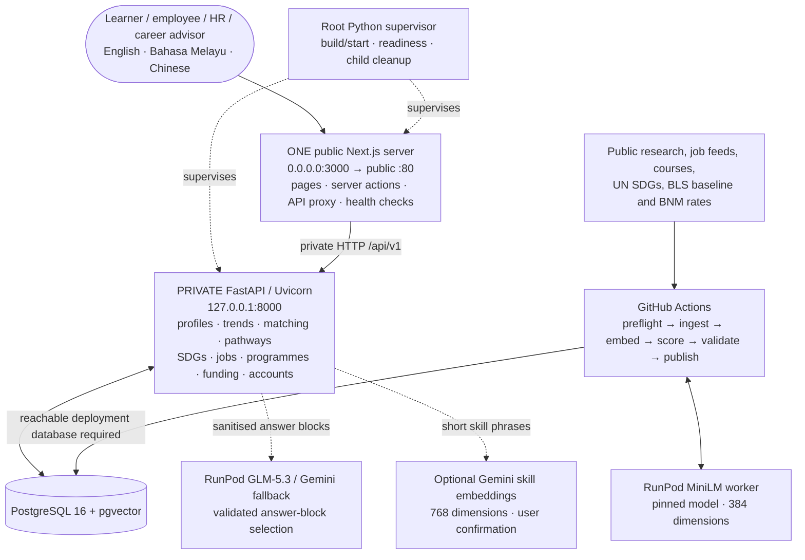

# Adept: preliminary project proposal

Draft prepared on 22 October 2026 against the supplied **SDC Hackathon Submission Template**.
Section numbering and answer limits follow that template. The supplied proposal deadline is
25 October 2026. This Markdown is working material for the final PDF, not a signed submission.

**Team-only completion items:** registration name, leader details, affiliation, workshop
attendance, prior-work ownership, employment IP declarations and signature. These cannot be
verified from the code. Add personal contact details privately in the submission PDF rather
than committing them to this public repository. Do not treat an unchecked box as a declaration.

Updated 24 October 2026 for the root-only, single-public-server deployment, current dependencies, job feeds, certifications and organisation workflows. This source describes the proposed code revision; publishing that revision remains an owner action.

## 1. Team and project overview

| Template field | Response |
|---|---|
| Team name | Pecel Lele (repository team record; confirm exact registration spelling). |
| Selected domain | Domain 1: The Aiversecity Future-Ready Workforce. |
| Selected SDG track | SDG 4: Quality Education; primary target 4.4, supported by 4.3, 8.2 and 8.5. |
| Project / solution name | Adept. |
| Name (leader) | Team to complete privately in the submission PDF. |
| Email and phone (leader) | Team to complete privately in the submission PDF; not retained in this repository. |
| University affiliation(s) | Xiamen University Malaysia, as recorded in the project README. |
| Number of team members | 4, as recorded in the project README; confirm registration matches. |

## 2. Executive summary and problem statement

### 2.1 The problem context

<!-- answer:start proposal-2.1 limit=250 -->
AI changes the tasks employers value, but workers and training providers often lack a clear
connection between those changes, a person's existing skills and an affordable next step.
Working adults facing automation, graduates entering the workforce and career switchers can
find many courses without knowing which skill gaps those courses address. HR and career
advisors face the same problem across teams and student cohorts.

Hays' 2025 Malaysia findings reported that 56% of professionals used AI tools at work, while
26% had received training to use them. The 30 percentage-point difference between these
reported shares illustrates a training challenge; it is not an estimate of how many individual
AI users lack training. These historical survey findings are context, not a measurement of
Adept's impact or of the Malaysian workforce in 2026.

The practical problem is deciding what to learn next, why it matters and whether the learning
fits available time and funding. Unexplained rankings and stale course lists make this harder,
especially for people with limited budgets. Adept addresses that decision with dated evidence,
an explicit skills gap and a costed reskilling pathway, supporting access to relevant technical
and vocational learning under SDG 4.
<!-- answer:end proposal-2.1 -->

Source: [Hays Malaysia, 2025 findings](https://www.hays.com.my/press-release/content/future-of-work-malaysia-technology-ai-impact).

### 2.2 The proposed AI solution

<!-- answer:start proposal-2.2 limit=300 -->
Adept connects a confirmed skills profile to changing evidence, explainable future-role matches,
and a personalised learning plan. Learners complete a questionnaire or upload a synthetic
PDF, DOCX or text CV, review catalogue skills and proficiency, and set interests, learning
preferences, time and budget. Optional Gemini embeddings suggest catalogue matches for
unfamiliar skill phrases; users approve additions.

The research pipeline uses pinned all-MiniLM-L6-v2 embeddings on RunPod Serverless, combines
arXiv research attention with a committed labour baseline, and validates dated snapshots.
The radar supports moderate and fast scenarios, historical replay and re-planning. Role
rankings expose skill, trend and interest contributions, gaps and optional SDG weighting.
These are estimates for decision support, not calibrated employment forecasts.

For a target role, the pathway engine orders sourced courses by prerequisites and learning
constraints, shows duration and cost, and tracks progress and evidence. Public job feeds
connect roles and training to current openings; a separate catalogue links relevant paid
certification exams with dated fees and preparation courses.

Organisation managers inspect shared skills and team gaps, create costed programmes, make
funding decisions and review completions. Members accept or respond to programme assignments
in a separate work workspace; personal plans remain separate. Accepted evidence can raise
effective skill levels across future plans.

Adi optionally uses RunPod GLM-5.3 with Gemini failover to select validated, server-authored
answer blocks; failures use a deterministic guide. Next.js is the single public server,
FastAPI stays private, and PostgreSQL stores durable records. Recommendations carry sources,
dates, scenarios and estimate labels. People make career and learning decisions; Adept
never makes hiring, firing or admission decisions.

<!-- answer:end proposal-2.2 -->

## 3. Technical architecture and implementation plan

### 3.1 Conceptual tech stack

| Component | Implemented technology | Role |
|---|---|---|
| Interface | Next.js 16.4.2, React 19.2.9, TypeScript 5.9.3 | Personal `/app`, employee `/work`, manager/advisor `/org` and internal `/admin` views; server actions and same-origin API routes. |
| Presentation | Tailwind CSS 4.1.18, next-intl 4.14.9, Lucide | Responsive interface in English, Bahasa Melayu and Chinese. |
| API | Python 3.11, FastAPI, Pydantic v2, Uvicorn | Validated feature services and OpenAPI contracts. |
| Persistence | PostgreSQL 16, pgvector, psycopg 3 | Profiles, catalogue, snapshots, plans, evidence and organisations. |
| AI / methods | RunPod MiniLM (384 dimensions); optional Gemini skill embeddings (768 dimensions); Adi GLM-5.3/Gemini; deterministic scoring/pathways | Separate model purposes and credentials; no team fine-tuning; validated catalogue/answer-block IDs. |
| Data | arXiv cs.AI RSS, committed BLS-derived baseline, official UN SDGs, Microsoft Learn, Coursera, cited provider pages, BNM exchange rates | Research signals, updatable public job postings, catalogue facts, certification fees and source attribution. |
| Deployment | Root `.replit` and Python supervisor | One public Next.js server; private loopback FastAPI. Optional local Compose runs PostgreSQL only. |
| Quality / automation | pytest, Ruff, ESLint, TypeScript, contract and locale checks; GitHub Actions | Automated checks; conditional weekly trend refresh and source audit. |

**Architecture appendix A: root deployment with one public server.** The root
[`.replit`](../.replit) builds and starts through [`src/scripts/replit.py`](../src/scripts/replit.py).
Next.js serves the interface and proxies `/api/v1/*`; Uvicorn binds privately to loopback.
The launcher waits for database/API readiness and stops both children on failure. It never
runs migrations or seed writes at production startup. `/api/healthz` and `/api/v1` are
readiness aliases. See the [README diagrams](../README.md#diagrams) and
[offline SVG explorer](diagrams/index.html).

**Verification boundaries:** the public URL [adept-my.replit.app](https://adept-my.replit.app)
returned 200 for landing/About/sign-in and API/database health during read-only checks on
24 October 2026. This does not prove that the new root deployment revision is published.
A historical MiniLM test returned two valid 384-dimensional vectors; the first integrated
refresh failed on the private development database host `helium`. The latest observed
refresh run was unsuccessful, so no successful new production snapshot is claimed. Worker
dependency updates require a separate image rebuild/redeployment. Sponsor credit entitlement,
workshop attendance and mentoring remain team declarations.

### 3.2 Design-thinking and deployment strategy

<!-- answer:start proposal-3.2 limit=200 -->
We framed the experience around synthetic working-adult, graduate, career-switcher and
organisation-advisor personas. These are design assumptions, not interview findings. Their
shared need is an understandable next learning step within time and funding constraints.

The journey is to confirm skills, inspect dated signals, compare roles, save a pathway and
connect learning to job openings. One engine serves personal, employee and manager views.
Visible score components, source dates, uncertainty labels, three languages and responsive
layouts support inspection. Programme assignments and evidence review keep people in charge.

The selected host is Replit Autoscale. The repository retains root docs/submission/src/tests,
a single public Next.js server and private FastAPI, with PostgreSQL and pgvector. Root build
and start commands install locked dependencies, prepare standalone assets and supervise
readiness; production startup performs no migrations or seeding. CI checks the exact public
startup against disposable PostgreSQL, including health routes, static assets and API forwarding.

The account owner must configure production secrets and origin, prepare the database through
the approved development-to-production process, verify forwarding trust and publish the
reviewed revision. Validate signed-in synthetic journeys, recovery and trend publication on
that deployment. Quantified user-outcome evaluation and final submission recordings remain
to be completed.

<!-- answer:end proposal-3.2 -->

## 4. Preliminary environmental and SDG impact framework

| Template metric category | Response |
|---|---|
| Target SDG sub-target(s) | **4.4:** relevant employment and entrepreneurship skills; **4.3:** equal access to affordable technical, vocational and tertiary learning. Supporting **8.2:** productivity through technological upgrading, and **8.5:** decent work and equal employment opportunity. These are paraphrases; official wording remains in the UN catalogue. |
| Current problem baseline | Hays' 2025 Malaysia findings report 56% AI use and 26% training, a 30 percentage-point difference between reported shares. This is a dated external context baseline. **Product baseline:** median time to a valid learning plan has not yet been measured; do not replace it with an invented number. |
| Core measurable KPI | Median minutes from intake start to a saved, sourced target-role plan, compared on the same synthetic cases with manual use of the same course catalogue. A valid plan must use existing skill/course IDs, respect prerequisites, disclose time/cost constraints and carry source/date metadata. Record valid-plan share alongside time. |
| Phase 2 impact target | **Proposed target, not achieved:** at least 20% less median planning time than the measured manual baseline, with no decrease in valid-plan share. Compute reduction as `100 × (baseline median − Adept median) / baseline median`; require a positive measured baseline. |

Measure both workflows using matched synthetic profiles, budgets and target roles; keep the
catalogue and snapshot fixed and counterbalance workflow order. Report task count, failures
and medians with the results. No participant identities or real CVs enter the demo dataset.
This protocol is a proposed evaluation, not evidence of an experiment already conducted.

The principal contribution is educational decision support. No reductions in carbon emissions,
national unemployment or income inequality are measured or claimed. SDG contribution scores
describe catalogue alignment and learning activity, not official UN indicator achievement.
Role/skill-to-target mappings are team-curated and remain drafts until human review.

Sources: [UN Goal 4](https://sdgs.un.org/goals/goal4),
[UN Goal 8](https://sdgs.un.org/goals/goal8),
[Hays Malaysia](https://www.hays.com.my/press-release/content/future-of-work-malaysia-technology-ai-impact).

## 5. Eligibility and readiness checklist

- [ ] All members completed mandatory GenAI, database and cloud workshops. **Team confirmation required.**
- [x] The concept connects an evidenced workforce learning problem to SDG 4.
- [x] The project targets a functional deployed application; the source includes a tested root deployment design with one public server.
- [ ] Every required field is complete within the limits. **Narrative limits are checked; team and signature fields remain outstanding.**

## 6. IP and originality declaration

### 6.1 Pre-existing / prior-owned work

**Yes / No: team to confirm.** Repository history does not establish when the hackathon's
originality period began or each member's ownership rights. The team must list any reused
code, designs, research and their owners before selecting an answer. KerjaCerdas and Orion
were consulted for README presentation; this does not establish reuse of their application code.
The guardrail feature documentation also mentions patterns from KerjaCerdas: review provenance
and rights rather than declaring that all work was newly created.

### 6.2 Third-party code, datasets or models

**Yes.** The main resources are declared below; the
[technical declaration](submission-technical-declaration.md#22-languages-frameworks-and-libraries)
provides versions, purposes and a fuller inventory.

| Type | Name | Licence / attribution basis |
|---|---|---|
| Code | Next.js, React, Three.js, Tailwind CSS, next-intl, FastAPI, Pydantic, OpenAPI tools | MIT; retain upstream notices. |
| Code | TypeScript; class-variance-authority | Apache-2.0. |
| Code | PostgreSQL and pgvector | PostgreSQL License. |
| Code | Uvicorn; psycopg | BSD-3-Clause; LGPL-3.0 respectively. |
| Code | PyMuPDF | AGPL-3.0 or commercial licensing; compatibility review remains required. |
| Code | Sentence Transformers / Transformers; PyTorch; RunPod SDK | Apache-2.0; BSD-3-Clause; MIT respectively. |
| Code / font | Lucide; Inter | ISC; SIL OFL 1.1 for the font. |
| Code | Mermaid 11.12.0 | MIT; documentation diagram rendering only. |
| Model | sentence-transformers/all-MiniLM-L6-v2 | Apache-2.0; pre-trained, not fine-tuned by the team. |
| Data | arXiv feed content; BLS-derived projections | arXiv API/content terms, with article licences varying; BLS public information and source attribution. |
| Data | UN SDG API; course/certification/provider facts; public job feeds; BNM rates | Respective provider terms and cited URLs; public accessibility does not imply a common open-data licence. |
| Data | Team-curated taxonomy, mappings and synthetic evaluation fixtures | Team-authored curation with upstream evidence recorded; not a complete imported ESCO or O*NET taxonomy. |

### 6.3 Employment-related IP conflicts

**Yes / No: each member must confirm privately.** No employment, internship or consulting
agreement was reviewed. Add any applicable owner/permission details to the final submission;
do not infer the absence of a conflict from the repository.

## 7. Declaration

**Unsigned draft.** The team leader must review the completed proposal and make the accuracy
and originality declaration in the supplied template. No signature or attestation is generated.

| Field | Completion |
|---|---|
| Signature | Leader to sign privately after review. |
| Date | Actual signing date; not the date this draft was generated. |
| Final filename | `SDC2026_<RegisteredTeamName>_Preliminary.pdf` |

## Evidence and handoff

- [Feature specification and ownership](tasks.md), [decisions](decisions.md), [solution design](solution-design.md).
- [Scoring implementation](../src/api/app/features/matching/scoring.py), [trend publisher](../src/pipelines/trends/run.py), [pathway engine](../src/api/app/features/pathway/engine.py).
- [Source catalogue](../src/api/app/features/pathway/catalogue_sources.py), [seed records](../src/data/seed/), [append-only migrations](../src/db/migrations/).
- Public app: [Adept](https://adept-my.replit.app); source: [GitHub](https://github.com/pecel-lelele/adept).
- Before PDF export: complete private team declarations, confirm the actual deployed revision and sponsor usage, add deck/video links, inspect diagram exports and recheck the template word limits.
