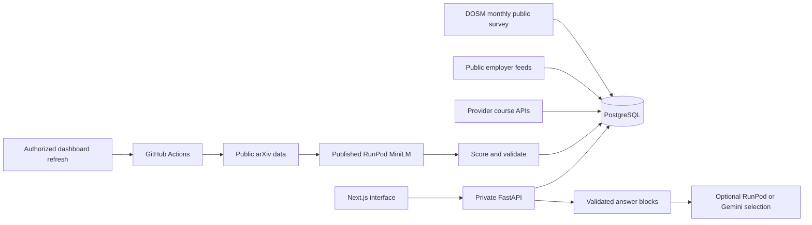

# Adept Final Project and Prototype Report

Working source aligned to the supplied **Phase 2 Final Project & Prototype Report** template,
reviewed 30 October 2026. Deadline in that template: **1 November 2026**. Export filename:
`SDC2026_Pecel-Lele_Final.pdf`. This is an unsigned draft. Unmeasured claims and private team
attestations remain explicitly outstanding; source code and local tests do not establish a
production deployment or real-world impact.

## 1. Team and project overview

| Field | Response |
|---|---|
| Team | Pecel Lele |
| Product | Adept |
| Domain | The Aiversecity Future-Ready Workforce |
| Primary SDG | SDG 4, especially target 4.4; supporting targets 4.3, 8.2 and 8.5 |
| Final live deployment | https://adept-my.replit.app — verify the final revision and snapshot before submission |
| Codebase | https://github.com/pecel-lelele/adept |
| Leader | David Kurniawan, per the README; confirm registered details privately |
| Leader contact | Complete privately in the final PDF; do not commit personal contact information |
| University | Xiamen University Malaysia |

## 2. Project description

<!-- answer:start final-2 limit=250 -->
Adept helps working adults, graduates and career switchers choose skills to develop as AI
changes work. Learners upload a synthetic demonstration CV or complete an intake, confirm
their skills, explore dated research signals, compare future roles and choose a sourced
learning plan. Scores show their components and concrete skills that could improve fit.
Two parameter-driven AI scenarios expose uncertainty rather than promising employment.

The platform combines public research, occupational references, course catalogues and
Malaysian job feeds. Published Malaysian labour-survey statistics provide national context;
they are not presented as occupation-specific vacancy forecasts. Every recommendation
retains sources, dates and estimate labels. Unknown skills and gaps without catalogue courses
remain visible instead of being invented.

Organisation managers can invite members, plan training within budgets and send programmes
for members to accept. Skill sharing is optional, and personal plans remain private.
SDG mappings explain relevant targets and show estimated learning-hour alignment, not measured
UN indicator achievement. Adi uses checked application facts and validated answer-block IDs.
Adept supports human judgment and never makes hiring, firing, promotion or admission decisions.
<!-- answer:end final-2 -->

## 3. Upgraded product and technical execution

### 3.1 Final system architecture

Next.js renders the web application and forwards authenticated API requests to a private
FastAPI process. PostgreSQL stores accounts, memberships, catalogue records, plans, progress,
evidence and dated snapshots. Server-side membership checks enforce workspace boundaries.

The trend batch pipeline retrieves public arXiv data, uses the published RunPod MiniLM
endpoint for embeddings, scores and validates signals, then publishes a snapshot atomically.
An operator-authorized dashboard control dispatches that pipeline and reports its run and
served snapshot. Page views read stored results. Source failure retains dated, disclosed
fallback data. Optional Adi model selection uses GLM on RunPod with separately authenticated
Gemini failover; displayed answers come from server-authored blocks through the F8 validator.

### 3.2 Implementation and hackathon deliverables

<!-- answer:start final-3.2 limit=300 -->
The repository implements the six-stage learner journey, organisation programmes and
multilingual interfaces. The final review integrates previously separated Claude worktrees
and improves cold-start handling, snapshot provenance, scenario scaling, low-evidence labels,
optional sharing, navigation, keyboard controls and error recovery. A dashboard refresh
control uses the existing published model rather than adding request-time inference.

Database changes add workspace references, a membership lookup index and scoped funding
policies. Administrator access uses configured stable account IDs. Removing a member clears
that organisation's private assignments while anonymising audit history. Regional SDG output
suppresses small groups and rare contributions. Migration history remains append-only.

The build includes signed-session browser journeys for desktop and mobile, source-attribution
checks, generated API contracts and a synthetic CV counterfactual harness. Operational tools
support local demo preparation and public build identity. Terms, FAQ and Privacy are linked
from the public interface. Courses and job openings can be refreshed on scheduled workflows.

The team must identify which commits and deployments occurred inside the official physical
sprint; this draft does not infer that every historical commit was made in that window.
Current check results and remaining external evidence are recorded in the final-round status
report. Production publication, public asset access and human impact measurements require
separate evidence before the checklist is signed.
<!-- answer:end final-3.2 -->

## 4. Environmental and SDG impact verification

| Template category | Evidence and current limit |
|---|---|
| Target SDG metric achievement | The Phase 1 target is at least 20% less planning time. Matched manual/Adept human trials remain **not run**. No achieved reduction is claimed. |
| Verification evidence method | `src/scripts/kpi_time_to_plan.py` calculates paired measurements using `docs/kpi-trials-template.json`; invalid or missing trials are not converted to results. Browser/HTTP tests verify functionality, not human planning speed. |
| Socio-economic and civic value | Initial channels are career centres, TVET providers and HR/L&D teams. Reach and willingness to pay require a measured pilot; no user count or commercial conversion is asserted. |
| Deployment and commercial feasibility | One web/API deployment plus scheduled batch jobs. Course budgets are planning inputs; employers buy training directly. Production hosting/model cost per run/user must be taken from actual usage and bills. |
| Learning cost | Free/paid/HRD labels derive from dated provider records. Report free-step share and plan cost from the exact five saved demo plans; do not reuse obsolete global counts. |
| Privacy and fairness | Synthetic CV counterfactuals and workspace/privacy regressions provide bounded evidence. They do not prove universal fairness, legal certification or real employment outcomes. |

### 4.1 Mathematical proof and code logic

For each valid paired human trial, planning-time reduction is
`100 * (manual_minutes - adept_minutes) / manual_minutes`. Report sample size, median paired
reduction and valid-plan share from the calculator output. A zero, absent or negative manual
baseline is not valid evidence. Do not substitute account age for a stopwatch measurement.

The score remains a documented weighted sum of skill fit, dated trend evidence and interest
fit, optionally blended with SDG alignment. Scenario velocities share the same robust scale.
The production implementation and synthetic checks are linked in
[final-round status](final-round-status.md). Synthetic invariance tests are proof only for the
listed fixtures and variants. These are functional/code proofs, not a measured social-impact KPI.

## 5. Market viability and future scalability

<!-- answer:start final-5 limit=250 -->
Adept would first be piloted with a career centre, TVET provider or employer learning team.
The pilot should measure time to a valid plan, relevance of selected courses, completion
follow-through, accessibility and feedback from both learners and advisors. Pricing and
willingness to pay remain hypotheses until interviews and trials supply evidence.

Scaling uses stored public reference data and scheduled batch inference, keeping third-party
API latency outside the learner's normal journey. Database pooling, bounded operations and
workspace access checks support concurrent use. Larger deployments need load measurements,
least-privilege database roles, operational alerts, retention policies and verified provider
terms. National labour statistics provide context without pretending to describe each role.

Partnerships with education providers, TalentCorp, PERKESO or employers would require actual
agreements and permitted data access. Course and occupation expansion must preserve source
records, licensing, human review and honest uncertainty. The platform would remain decision
support; institutions and employers retain personnel and admission decisions.
<!-- answer:end final-5 -->

## 6. Final submission checklist

- [ ] Final deployed revision and snapshot match the recorded demonstration.
- [ ] Judges can access the live application and source repository.
- [ ] README installation steps have been verified on the selected disposable setup.
- [ ] Official live-window incremental commits have been identified by the team.
- [ ] Final pitch deck is exported as a flattened PDF and anonymously accessible.
- [ ] All final fields, word limits and the measured evidence have been reviewed.

## 7. IP and originality declaration

### 7.1 Pre-existing / prior-owned work

**No, based on the team leader's provenance clarification on 25 October 2026.** The team
reports that Adept's implementation was created for this hackathon. KerjaCerdas belongs to
a different team and was consulted for general security concepts, implemented for Adept's
own APIs and use cases; the team does not declare a reused prior-owned implementation.
Earlier repository statements describing KerjaCerdas as work by the same team or as imported
security code were inaccurate; see decision M3-028. Third-party frameworks, public data,
pre-trained models and development tools remain disclosed separately in section 7.2 and the
technical declaration. The leader must confirm the final form reflects the actual work.

### 7.2 Third-party code, datasets or models

**Yes.** The main resources are declared below; the
[technical declaration](submission-technical-declaration.md#22-languages-frameworks-and-libraries)
provides versions, purposes and a fuller inventory.

| Name | Type (code / dataset / model) | License |
|---|---|---|
| Python >=3.11 | code | Python Software Foundation License |
| Node.js 24, pnpm 10.29.3 | code | MIT |
| Next.js, React, React DOM | code | MIT |
| TypeScript | code | Apache-2.0 |
| Tailwind CSS, @tailwindcss/postcss | code | MIT |
| next-intl | code | MIT |
| Three.js (Adi's interactive mascot) | code | MIT |
| @fontsource-variable/inter | code (font asset) | MIT package; OFL-1.1 for Inter |
| lucide-react | code | ISC |
| class-variance-authority | code | Apache-2.0 |
| clsx, tailwind-merge | code | MIT |
| openapi-fetch, openapi-typescript | code | MIT |
| FastAPI, Pydantic, pydantic-settings | code | MIT |
| Uvicorn | code | BSD-3-Clause |
| Python standard library (signed sessions and password hashing) | code | PSF-2.0 |
| psycopg 3, psycopg-pool | code | LGPL-3.0-only; binary bundle has additional notices |
| python-multipart | code | Apache-2.0 |
| PyMuPDF | code | AGPL-3.0 or Artifex commercial licence |
| HTTPX | code | BSD-3-Clause |
| PostgreSQL 16, pgvector | code | PostgreSQL License |
| RunPod Python SDK, sentence-transformers, Hugging Face Transformers | code | MIT for RunPod SDK; Apache-2.0 for Sentence Transformers/Transformers |
| PyTorch | code | BSD-3-Clause |
| pytest, Ruff, ESLint, eslint-config-next | code | MIT |
| uv | code | MIT or Apache-2.0 |
| Docker Engine and Compose | code / local tools | Apache-2.0 for open-source components; Docker Desktop has separate distribution terms |
| Playwright | code | Apache-2.0 |
| Mermaid | code | MIT |
| @types/node, @types/react, @types/react-dom, @types/three | code | MIT |
| GitHub Actions | service | GitHub Terms of Service |
| sentence-transformers/all-MiniLM-L6-v2 (pinned revision) | model | Apache-2.0 |
| GLM-5.3 (via RunPod) | model | Hosted provider/model terms; no separate licence entitlement inferred |
| Google Gemini 3.5 Flash Lite, 3.6 Flash, 3.1 Flash Lite (optional fallback) | model | Google Gemini API Terms |
| Gemini Embedding 001 (optional) | model | Google Gemini API Terms |
| arXiv cs.AI RSS, query API and cached research windows | dataset / API | arXiv API terms; metadata and paper content have different rights |
| U.S. BLS Employment Projections 2023–2033 extract | dataset | US government data; cite BLS |
| O*NET 31.0 occupation crosswalk | dataset | CC BY 4.0 with stated exceptions; credit and modifications required |
| UN SDG Goal and Target APIs and metadata | dataset / API | UN data terms and attribution |
| Public job-posting feeds (Greenhouse, Lever, Ashby, Workday, Jibe, Himalayas, Jobicy, Remote OK, Remotive) | dataset / API | Each board's and employer's terms; public access is not an open-data licence |
| Optional keyed job APIs (Careerjet, Jooble, Web3.career) | dataset / API | Provider API terms and credentials required |
| Job-opening and certification extracts | dataset | Source sites retain rights |
| Certification and exam-pricing pages (Microsoft, AWS, Google Cloud, IIBA, IAPP) | dataset | Issuer site terms |
| Microsoft Learn Catalog API | dataset / API | Microsoft API Terms of Use |
| Coursera course API and pages | dataset / API | Coursera Terms of Use |
| Other provider course pages (AITraining2U, UNIMAS PROCEL, FMM, MAICSA, UKM, UTM, IBFIM) | dataset | Respective provider copyright and terms |
| Bank Negara Malaysia exchange-rate API | dataset / API | BNM terms and attribution |
| Curated skill, course, prerequisite and SDG-alignment mappings; historical trend snapshots | dataset | Team-created; upstream BLS, provider and research rights retained; no UN endorsement |
| Synthetic personas, organisations, regions and CV fixtures | dataset | Team-created; [five selected demo CVs](demo-cvs/) and regression fixtures are declared separately from real identities |
| PyYAML; actionlint; Prettier | code / development tools | MIT |
| GitHub Container Registry | service | GitHub Terms of Service |

### 7.3 Employment-related IP conflicts

**Yes / No: each member must confirm privately.** No employment, internship or consulting
agreement was reviewed. Add any applicable owner/permission details to the final submission;
do not infer the absence of a conflict from the repository.

## 8. Declaration

Unsigned draft. The leader must verify team declarations, fill private contact information,
and sign/date the final supplied form. Do not infer consent or attestations from this draft.

## Evidence references

[Technical tools declaration](submission-technical-declaration.md) ·
[Official criterion mapping](rubric-check.md) · [Deliverables](submission-deliverables.md) ·
[Demo source register](demo-script.md#evidence-register) · [KPI protocol](kpi-time-to-plan.md)

Final-round measurement status, **30 October 2026**: **0 human testers and 0 human
trials**; no measured manual baseline or achieved planning-time reduction. The
20% figure is a proposed target only. See the [calculator output](kpi-human-summary.json)
and [separate automated synthetic API measurements](kpi-automated-journeys.md)
for dated sample sizes, completion/failure counts and methodological limits.
Automated response timings do not establish human planning speed or impact.
